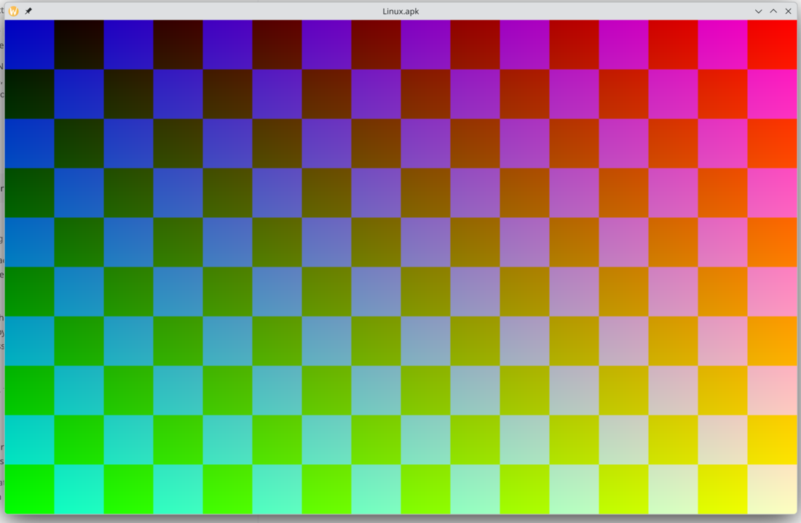

# Linux.apk

Run Android apps on desktop Linux as native-feeling apps. Each app gets its own
Wayland window and follows the desktop's dark mode, notifications, file pickers
and media controls. There's no VM, no visible Android device, and no root at
runtime.

How it works: a real AOSP (Android 17) userspace runs in a rootless, on-demand
session. Our code plugs in at Android's stable vendor interfaces (display, GPU,
audio, input), plus a desktop bridge for portals, notifications and MPRIS. See
[docs/STRATEGY.md](docs/STRATEGY.md).

## Status

**Pre-alpha.** Android 17 boots rootless to its launcher in a Wayland window;
app input and real apps are next.

| Milestone                                                       | Status                                                                                                                             |
| --------------------------------------------------------------- | ---------------------------------------------------------------------------------------------------------------------------------- |
| M0 Session boots (prebuilt image, rootless namespace, binderfs) | ✅ `sys.boot_completed` rootless in ~16 s cold / ~4 s warm; no AOSP patches; netd via userspace eBPF emulation + nftables iptables |
| M1 Pixels in a Wayland window, first noarch apps                | 🚧 launcher in a KDE Wayland window; mouse/keyboard/touch injection passes e2e (15/15); F-Droid compat harness in progress         |
| M2 GPU, audio, per-app windows, launcher                        | ⏳                                                                                                                                 |
| M3 Desktop integration (portals, notifications, MPRIS, IME)     | ⏳                                                                                                                                 |
| M4 No-privilege mode (userspace binder, relocated image)        | ⏳                                                                                                                                 |
| M5 Packaging (per-app Flatpak/AppImage, RPM), aarch64 hosts     | ⏳                                                                                                                                 |
| M6 ARM translation on x86_64                                    | ⏳                                                                                                                                 |

Progress log: [docs/NOTES.md](docs/NOTES.md).

| Android's boot animation rendered rootless (ANGLE → RADV → SurfaceFlinger → our composer) | Composer output in a KDE Wayland window (test pattern) |
| ----------------------------------------------------------------------------------------- | ------------------------------------------------------ |
|                                           |       |

## Dev setup (Fedora)

Install [mise](https://mise.jdx.dev), then run `mise install`. Agent and
contributor context is in [AGENTS.md](AGENTS.md).

Fedora's SELinux policy stops ordinary processes from becoming a binder context
manager. Install the dev policy once:

```sh
cd selinux
checkmodule -M -m -o linuxapk_dev.mod linuxapk_dev.te
semodule_package -o linuxapk_dev.pp -m linuxapk_dev.mod
sudo semodule -i linuxapk_dev.pp
```

## License

AGPL-3.0-only.
