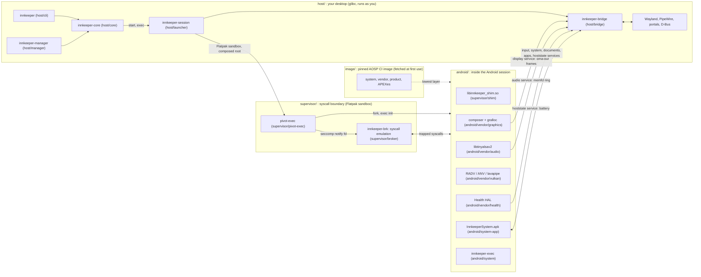

# Innkeeper

Run Android and OpenHarmony apps on Linux. Each app gets its own Wayland window
and follows the desktop's dark mode, notifications, file pickers, clipboard and
media controls. There's no VM, no visible Android device, and no root, ever.

A real AOSP (Android 17) userspace runs in a rootless, on-demand session. The
image is Google's own AOSP build from Android's public CI, downloaded and
checksummed on your machine. Our code plugs in at Android's stable vendor
interfaces (display, GPU, audio, input), plus a desktop bridge for portals,
notifications and MPRIS. See [docs/architecture.md](docs/architecture.md).

## Use it

Open an APK with the **Innkeeper** manager: it shows what the app is and which
permissions it wants, installs it, and adds it to your app menu. Each app then
opens in its own window. The same is scriptable:

```sh
innkeeper install App.apk        # also .apks, .xapk, .apkm bundles
innkeeper run org.wikipedia      # or click its app-menu entry
innkeeper uninstall org.wikipedia
innkeeper list
```

The first use downloads the Android image (about 1.2 GB). Apps share one uid and
are not isolated from each other, as native desktop apps aren't
([docs/security.md](docs/security.md#single-uid-mode)).

## Status

**Pre-alpha.** Android 17 boots rootless in about 3 s warm; see the
[nightly compatibility results](https://github.com/sargunv/innkeeper/wiki/Compatibility)
for app results and notes. Rethink runs without its VPN because the sandbox has
no TUN device. Working apps include Compose, Flutter, React Native, Capacitor
and Godot apps, StreetComplete's MapLibre map and video playback, each in its
own window with sound. Desktop integration (M3) and the no-privilege mode (M4:
userspace binder, single-uid, the CI image) are done. Innkeeper builds as a
Flatpak that runs Android inside its own sandbox
([packaging/flatpak](packaging/flatpak/README.md)). Next: the rest of packaging
(M5) and ARM translation (M6); see the
[milestones](https://github.com/sargunv/innkeeper/milestones).

Real apps running in Innkeeper on KDE Plasma (Wayland):

| Wikipedia                                                                                                                     | F-Droid                                                                                                                  |
| ----------------------------------------------------------------------------------------------------------------------------- | ------------------------------------------------------------------------------------------------------------------------ |
|  |        |
| **Mindustry**                                                                                                                 | **Shattered Pixel Dungeon**                                                                                              |
|                     |  |
| **Tomato** (Jetpack Compose)                                                                                                  | **OpenCalc**                                                                                                             |
|      |                 |

## How it fits together



| Dir                                                          | Artifact                                              | Runs                                                          | Start reading at                |
| ------------------------------------------------------------ | ----------------------------------------------------- | ------------------------------------------------------------- | ------------------------------- |
| [host/core](host/core/README.md)                             | `innkeeper-core` (library)                            | inside the CLI, manager and bridge                            | `src/ops.rs`                    |
| [host/cli](host/cli/README.md)                               | `bin/innkeeper`                                       | desktop, as you                                               | `src/main.rs`                   |
| [host/manager](host/manager/README.md)                       | `bin/innkeeper-manager`                               | desktop, as you                                               | `src/window.rs`                 |
| [host/bridge](host/bridge/README.md)                         | `libexec/innkeeper/innkeeper-bridge`                  | desktop, in the session's sandbox                             | `src/main.rs`, `src/ipc/`       |
| [host/launcher](host/launcher/README.md)                     | `libexec/innkeeper/innkeeper-session`                 | Flatpak sandbox                                               | `src/cli.rs`                    |
| [supervisor](supervisor/README.md)                           | `pivot-exec`, `innkeeper-brk`, `libinnkeeper_shim.so` | sandbox; the shim inside Android                              | `broker/src/notify.rs`          |
| [image](image/README.md)                                     | image scripts, config and static tools                | desktop, when the image is prepared                           | `fetch.sh`, `pin.toml`          |
| [image/ohos](image/ohos/README.md)                           | the OpenHarmony image pin                             | desktop, for the OpenHarmony guest                            | `fetch.sh`, `pin.toml`          |
| [guest/bridge-client](guest/bridge-client/README.md)         | static library                                        | linked into the guests' composers, Android's audio and health | `bridge_client.c`               |
| [ohos](ohos/README.md)                                       | OpenHarmony guest: broker layer, init shim, runner    | test sandbox (not in the stage)                               | `sandbox.sh`, `run.py`          |
| [android/vendor/graphics](android/vendor/graphics/README.md) | allocator, mapper, composer                           | Android `/vendor`                                             | `composer/Display.cpp`          |
| [android/vendor/vulkan](android/vendor/vulkan/README.md)     | `vulkan.radv.so`, `vulkan.anv.so`, `vulkan.lvp.so`    | Android, in every Vulkan user                                 | `build.sh`, `patches/mesa/`     |
| [android/vendor/audio](android/vendor/audio/README.md)       | `libtinyalsav2.so`                                    | Android, in the audio HAL                                     | `tinyalsa/pcm.c`                |
| [android/vendor/health](android/vendor/health/README.md)     | `android.hardware.health-service.innkeeper`           | Android `/vendor`                                             | `src/battery.c`                 |
| [android/system](android/system/README.md)                   | `innkeeper-exec`                                      | Android `/system`                                             | `exec/innkeeper-exec.c`         |
| [android/system-app](android/system-app/README.md)           | `InnkeeperSystem.apk`                                 | Android, as a privileged app                                  | `app/.../InnkeeperSystemApp.kt` |
| [android/overlay](android/overlay/README.md)                 | config files over the image's partitions              | Android                                                       | its README                      |
| [android/microg](android/microg/README.md)                   | optional microG addon                                 | Android                                                       | `install.sh`                    |
| [tests](tests/README.md)                                     | test harnesses and suites                             | desktop, never shipped                                        | its README                      |
| [packaging/flatpak](packaging/flatpak/README.md)             | the Flatpak, `dev.sargunv.Innkeeper`                  | build time                                                    | `build.sh`                      |
| [tools](tools/README.md)                                     | build container, staging, dev scripts                 | build time                                                    | `build/artifacts.toml`          |
| [docs](docs/)                                                | cross-cutting design                                  |                                                               | `architecture.md`               |

## Develop

Build prerequisites: [mise](https://mise.jdx.dev), the Android SDK with NDK r30
and build-tools 37, podman, clang, and the GTK 4 and libadwaita development
files. A session runs in Flatpak on a Wayland desktop, with GPU and audio
access. Details: [docs/development.md](docs/development.md).

```sh
mise install                    # toolchains and the pre-commit hook
mise run build                  # everything, staged into out/stage
mise run install-dev            # install the committed Flatpak, including APK handling
flatpak run dev.sargunv.Innkeeper install app.apk
mise run test                   # unit tests; test:e2e needs a session; compat is manual/nightly
```

Contributor and agent rules: [AGENTS.md](AGENTS.md).

## License

AGPL-3.0-only.
