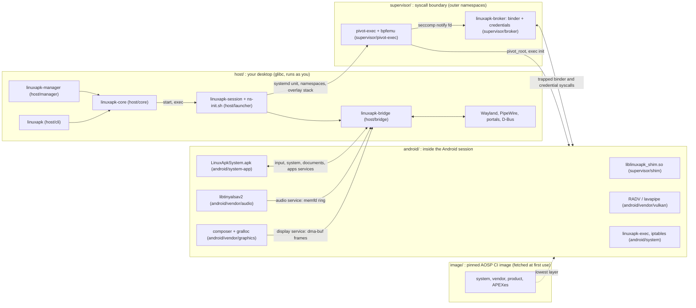

# Linux.apk

Run Android apps on desktop Linux as native-feeling apps. Each app gets its own
Wayland window and follows the desktop's dark mode, notifications, file pickers,
clipboard and media controls. There's no VM, no visible Android device, and no
root, ever.

A real AOSP (Android 17) userspace runs in a rootless, on-demand session. The
image is Google's own AOSP build from Android's public CI, downloaded and
checksummed on your machine. Our code plugs in at Android's stable vendor
interfaces (display, GPU, audio, input), plus a desktop bridge for portals,
notifications and MPRIS. See [docs/architecture.md](docs/architecture.md).

## Use it

Open an APK with the **Linux.apk** manager: it shows what the app is and which
permissions it wants, installs it, and adds it to your app menu. Each app then
opens in its own window. The same is scriptable:

```sh
linuxapk install App.apk        # also .apks, .xapk, .apkm bundles
linuxapk run org.wikipedia      # or click its app-menu entry
linuxapk uninstall org.wikipedia
linuxapk list
```

The first use downloads the Android image (about 1.2 GB). On a host without a
subordinate uid range (such as inside Flatpak) apps share one uid and are not
isolated from each other, as native desktop apps aren't
([docs/security.md](docs/security.md#single-uid-mode)).

## Status

**Pre-alpha.** Android 17 boots rootless in about 3 s warm, and 30 of 31 test
apps work ([docs/compatibility.md](docs/compatibility.md)): Compose, Flutter,
React Native, Capacitor and Godot apps, StreetComplete's MapLibre map and video
playback, each in its own window with sound. Desktop integration (M3) and the
no-privilege mode (M4: userspace binder, automatic single-uid, the CI image) are
done. Next: packaging Linux.apk as a Flatpak (M5) and ARM translation (M6); see
the [milestones](https://github.com/sargunv/linux.apk/milestones).

Real apps running in Linux.apk on KDE Plasma (Wayland):

| Wikipedia                                                                                                                     | F-Droid                                                                                                                  |
| ----------------------------------------------------------------------------------------------------------------------------- | ------------------------------------------------------------------------------------------------------------------------ |
|  |        |
| **Mindustry**                                                                                                                 | **Shattered Pixel Dungeon**                                                                                              |
|                     |  |
| **Tomato** (Jetpack Compose)                                                                                                  | **OpenCalc**                                                                                                             |
|      |                 |

## How it fits together



| Dir                                                                    | Artifact                                               | Runs                                      | Start reading at               |
| ---------------------------------------------------------------------- | ------------------------------------------------------ | ----------------------------------------- | ------------------------------ |
| [host/core](host/core/README.md)                                       | `linuxapk-core` (library)                              | inside the CLI, manager and bridge        | `src/ops.rs`                   |
| [host/cli](host/cli/README.md)                                         | `bin/linuxapk`                                         | desktop, as you                           | `src/main.rs`                  |
| [host/manager](host/manager/README.md)                                 | `bin/linuxapk-manager`                                 | desktop, as you                           | `src/window.rs`                |
| [host/bridge](host/bridge/README.md)                                   | `libexec/linuxapk/linuxapk-bridge`                     | desktop, in the session's unit            | `src/main.rs`, `src/ipc/`      |
| [host/launcher](host/launcher/README.md)                               | `libexec/linuxapk/linuxapk-session`, `ns-init.sh`      | desktop, then outer namespaces            | `linuxapk-session`             |
| [supervisor](supervisor/README.md)                                     | `pivot-exec`, `linuxapk-broker`, `liblinuxapk_shim.so` | outer namespaces; the shim inside Android | `broker/src/notify.rs`         |
| [image](image/README.md)                                               | image scripts, config and static tools                 | desktop, when the image is prepared       | `fetch.sh`, `pin.toml`         |
| [android/vendor/graphics](android/vendor/graphics/README.md)           | allocator, mapper, composer                            | Android `/vendor`                         | `composer/Display.cpp`         |
| [android/vendor/vulkan](android/vendor/vulkan/README.md)               | `vulkan.radv.so`, `vulkan.lvp.so`                      | Android, in every Vulkan user             | `build.sh`, `patches/mesa/`    |
| [android/vendor/audio](android/vendor/audio/README.md)                 | `libtinyalsav2.so`                                     | Android, in the audio HAL                 | `tinyalsa/pcm.c`               |
| [android/vendor/bridge-client](android/vendor/bridge-client/README.md) | static library                                         | linked into the composer and audio        | `bridge_client.c`              |
| [android/system](android/system/README.md)                             | `linuxapk-exec`, nf_tables iptables                    | Android `/system`                         | `exec/linuxapk-exec.c`         |
| [android/system-app](android/system-app/README.md)                     | `LinuxApkSystem.apk`                                   | Android, as a privileged app              | `app/.../LinuxApkSystemApp.kt` |
| [android/overlay](android/overlay/README.md)                           | config files over the image's partitions               | Android                                   | its README                     |
| [android/microg](android/microg/README.md)                             | optional microG addon                                  | Android                                   | `install.sh`                   |
| [tests](tests/README.md)                                               | test harnesses and suites                              | desktop, never shipped                    | its README                     |
| [packaging/flatpak](packaging/flatpak/README.md)                       | prototype Flatpak of the staged prefix                 | build time                                | `build.sh`                     |
| [tools](tools/README.md)                                               | build container, staging, dev scripts                  | build time                                | `build/artifacts.toml`         |
| [docs](docs/)                                                          | cross-cutting design                                   |                                           | `architecture.md`              |

## Develop

Build prerequisites: [mise](https://mise.jdx.dev), the Android SDK with NDK r30
and build-tools 37, podman, clang, and the GTK 4 and libadwaita development
files. A session needs a Wayland desktop, `systemd --user`, pasta, util-linux
`unshare` (plus `newuidmap` for subuid mode), read-write `/dev/udmabuf` and
pipewire-pulse. Details: [docs/development.md](docs/development.md).

```sh
mise install                    # toolchains and the pre-commit hook
mise run build                  # everything, staged into out/stage
mise run install-dev            # the manager in your app menu, as the APK handler
out/stage/bin/linuxapk install app.apk
mise run test                   # unit tests; test:boot, test:e2e, test:compat need a session
```

Contributor and agent rules: [AGENTS.md](AGENTS.md).

## License

AGPL-3.0-only.
