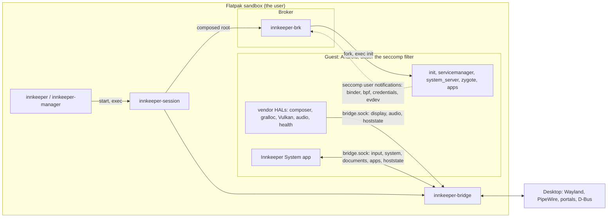

# Architecture

Innkeeper runs a near-stock AOSP userspace, including ART, system_server and
SurfaceFlinger, as ordinary host processes. The session starts on demand and
runs without root. Innkeeper's code plugs into Android's stable boundaries, so
routine work doesn't need an AOSP build.

## Runtime zones

Everything runs as the user inside Innkeeper's Flatpak sandbox. The desktop's
services are the only parts outside it.

- **Host side.** The CLI and the manager install and launch apps through
  `innkeeper-core`. The launcher assembles and starts the session. The bridge is
  the only process that talks to the desktop.
- **Broker.** A seccomp filter on Android's init traps the operations that the
  sandbox can't perform. These are binder, eBPF, Android credentials on a single
  kernel uid, and session-local evdev. The Rust broker defines the filter and
  starts init under it as a child process. It serves every notification and
  reaps orphaned processes. See [supervisor/README.md](../supervisor/README.md).
- **Guest.** The guest is the pinned image plus Innkeeper's overlay layer,
  vendor HALs and privileged system app. Each Android module installs a tree
  that mirrors Android's partition paths. The session stacks these trees over
  the image's partitions ([session.md](session.md#overlay-stack)). A profile can
  run an OpenHarmony guest instead, with the same broker, bridge and launcher
  ([ohos](../ohos/README.md)).

The zones communicate through the seccomp notification fd and one socket,
`bridge.sock` ([bridge-protocol.md](bridge-protocol.md)). The bridge also writes
input records to the broker's private `evdev.sock`. Android has no other path to
the desktop except `/dev/dri`, `/dev/udmabuf` and the host network
([session.md](session.md)).

## Modules

This table lists what each directory builds and where it runs. The stage's
`share/innkeeper/manifest.tsv` lists every staged file and the module that built
it.

| Dir                                                             | Artifact                                                                                | Runs                                                                                        | Start reading at                    |
| --------------------------------------------------------------- | --------------------------------------------------------------------------------------- | ------------------------------------------------------------------------------------------- | ----------------------------------- |
| [host/core](../host/core/README.md)                             | `innkeeper-core` (library)                                                              | inside the CLI, manager and bridge                                                          | `src/ops.rs`                        |
| [host/cli](../host/cli/README.md)                               | `bin/innkeeper`                                                                         | desktop, as you                                                                             | `src/main.rs`                       |
| [host/manager](../host/manager/README.md)                       | `bin/innkeeper-manager`                                                                 | desktop, as you                                                                             | `src/window.rs`                     |
| [host/bridge](../host/bridge/README.md)                         | `libexec/innkeeper/innkeeper-bridge`                                                    | desktop, in the session's sandbox                                                           | `src/main.rs`, `src/ipc/`           |
| [host/launcher](../host/launcher/README.md)                     | `libexec/innkeeper/innkeeper-session`                                                   | Flatpak sandbox                                                                             | `src/cli.rs`                        |
| host/profile                                                    | `innkeeper-profile` (library)                                                           | inside the launcher and core                                                                | `src/lib.rs`                        |
| [supervisor](../supervisor/README.md)                           | `innkeeper-brk`, `libinnkeeper_shim.so`                                                 | sandbox; the shim inside Android                                                            | `broker/src/notify.rs`              |
| [image](../image/README.md)                                     | every guest's image fetcher; Android's image config, scripts and static tools           | desktop, when the image is prepared                                                         | `fetch.sh`                          |
| [guest/bridge-client](../guest/bridge-client/)                  | static library                                                                          | linked into the guests' composers, Android's audio and health, and OpenHarmony's system app | `include/innkeeper/bridge_client.h` |
| [guest/audio-client](../guest/audio-client/)                    | static library                                                                          | linked into Android's audio HAL and OpenHarmony's audio VDI                                 | `include/innkeeper/pcm.h`           |
| [ohos](../ohos/README.md)                                       | experimental OpenHarmony guest: image pin, layer, shim, display and audio HDI, test HAP | an OpenHarmony profile's sandbox                                                            | `host/launcher/src/ohos.rs`         |
| [ohos/system-app](../ohos/README.md#innkeeper-system)           | `InnkeeperSystem.hap` and its native module, `libinnkeeper.so`                          | OpenHarmony, as a preinstalled system app                                                   | `ets/bridge/Apps.ets`               |
| [android/vendor/graphics](../android/vendor/graphics/README.md) | allocator, mapper, composer                                                             | Android `/vendor`                                                                           | `composer/Display.cpp`              |
| [android/vendor/vulkan](../android/vendor/vulkan/README.md)     | `vulkan.radv.so`, `vulkan.anv.so`, `vulkan.lvp.so`                                      | Android, in every Vulkan user                                                               | `build.sh`, `patches/mesa/`         |
| [android/vendor/audio](../android/vendor/audio/README.md)       | `audio_bridge` (`IModule/innkeeper`)                                                    | Android, in the audio HAL's APEX                                                            | `stream/Module.cpp`                 |
| [android/vendor/health](../android/vendor/health/README.md)     | `android.hardware.health-service.innkeeper`                                             | Android `/vendor`                                                                           | `src/battery.c`                     |
| [android/system](../android/system/)                            | `innkeeper-exec`, a no-op `iptables`                                                    | Android `/system`                                                                           | `exec/innkeeper-exec.c`             |
| [android/system-app](../android/system-app/README.md)           | `InnkeeperSystem.apk`                                                                   | Android, as a privileged app                                                                | `app/.../InnkeeperSystemApp.kt`     |
| [android/overlay](../android/overlay/README.md)                 | config files over the image's partitions                                                | Android                                                                                     | its README                          |
| [tests](../tests/README.md)                                     | test harnesses and suites                                                               | desktop, never shipped                                                                      | its README                          |
| [packaging/flatpak](../packaging/flatpak/README.md)             | the Flatpak, `dev.sargunv.Innkeeper`                                                    | build time                                                                                  | `build.sh`                          |
| [tools](../tools/)                                              | build container, staging, dev scripts ([development.md](development.md))                | build time                                                                                  | `build/stage.sh`                    |

## Decisions

- **The real Android userspace.** Compatibility comes from AOSP's own code.
  Projects that reimplement the framework, such as ATL and Mac.apk, have to keep
  writing stubs for missing APIs. A fake system_server or a libgui without
  SurfaceFlinger would depend on unstable internals. Innkeeper doesn't use them
  unless measurements of session cost require it.
- **Stable boundaries.** Innkeeper uses HAL AIDL and stable C interfaces, NDK
  APIs, rc and overlay files, and LD_PRELOAD and seccomp at the syscall ABI. It
  doesn't patch the image in place, and it has no AOSP patch queue. An AOSP
  patch would need a written reason why no stable boundary works.
- **Google's CI image, downloaded at setup.** The image is an unmodified AOSP
  build from ci.android.com. Innkeeper downloads and verifies it on the user's
  machine and doesn't redistribute it ([image/README.md](../image/README.md)).
  No local AOSP build is needed.
- **Vendor code links LL-NDK libraries** and the libraries Innkeeper installs in
  `/vendor/lib64`, and nothing else. It builds out of tree with the NDK.
- **Binder in userspace.** The broker serves binder from the seccomp supervisor.
  A session therefore needs no binderfs and no SELinux module, and it works
  where nested user namespaces are blocked.
- **The bridge owns the desktop connection.** The composer is a plain HWC that
  hands frames to the bridge. The bridge is the Wayland client and handles
  decorations, fractional scale and activation. Bionic code doesn't link desktop
  libraries.
- **The language depends on where code runs.** Code loaded into Android
  processes or on C ABIs is C or C++ and stays small. This covers the HALs, the
  mapper and Vulkan `.so` files, the shim and the Mesa patches. Standalone
  components are Rust, especially at trust boundaries: the broker, bridge,
  launcher and host tools. The system app is Kotlin. Zig isn't used, because it
  has no binder or AIDL ecosystem and the NDK already cross-compiles C.
- **x86_64 first.** Most apps other than games ship x86_64 code. Most top games
  don't, because Unity and Unreal default to arm64. ARM translation through a
  NativeBridge is a later milestone.

## Packaging scope

- Innkeeper ships as a Flatpak. Per-app Flatpaks are an optional extra and don't
  constrain the design.
- **Desktop baseline: current major distro releases.** Innkeeper supports the
  oldest desktop stack in a current release of Debian, Ubuntu, Fedora, openSUSE
  or Arch. That is Debian 13, with GNOME 48, Plasma 6.3 and xdg-desktop-portal
  1.20. Portals and freedesktop specs come first. A desktop-specific path is
  used where a baseline desktop has no standard one. Desktops older than the
  baseline get no fallback.
- Installing Innkeeper doesn't need `sudo`. It needs no RPM, deb or AUR
  packages, SELinux modules, AppArmor profiles or kernel modules.
- `out/stage` is the installable prefix, laid out as the Flatpak expects. It
  becomes `/app` in the Flatpak. Every lookup is relative to the running
  executable, and runtime state lives in the XDG directories. Development, test
  and packaged runs therefore share one code path.
- Flatpak allows no nested user namespaces, mounts or capabilities. The session
  therefore runs in the app's own sandbox as one kernel uid, with the host's
  network ([session.md](session.md)). Its root is built from symlinks, because
  Flatpak's `/` is a writable tmpfs. Innkeeper doesn't use
  `flatpak-spawn --host`, because that escapes the sandbox.

## Non-goals

- **Virtual machines.** Android runs as host processes integrated with the
  desktop. VM-based Android already exists in the emulator, Cuttlefish and
  ChromeOS ARCVM. Innkeeper won't use a VM or a guest kernel.
- **Play Integrity.** Banking and other apps that require it are out of scope.
- **Protection beyond desktop parity** ([security.md](security.md)).
