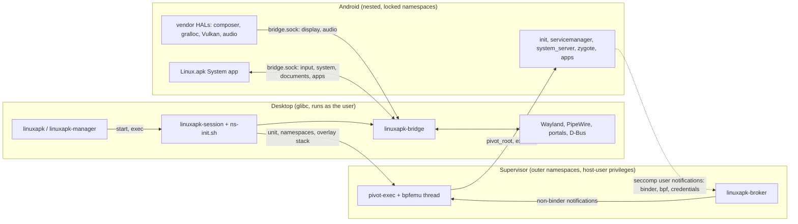

# Architecture

Linux.apk runs a near-stock AOSP userspace (ART, system_server, SurfaceFlinger)
as ordinary host processes in a rootless, on-demand session. Our code sits at
Android's stable boundaries, so routine work never needs an AOSP build.

## Three runtime zones

- **Desktop.** The CLI and manager install and launch apps through
  `linuxapk-core`; the launcher assembles and starts the session; the bridge is
  the only process that talks to the desktop.
- **Supervisor.** One seccomp filter on Android's init traps what an
  unprivileged namespace can't do (binder, eBPF, single-uid credentials). The
  broker receives every notification, serves binder and credentials, and
  forwards the rest to a C thread in pivot-exec. See
  [supervisor/README.md](../supervisor/README.md).
- **Android.** The pinned image plus our overlay layer, vendor HALs and the
  privileged system app. See [android/README.md](../android/README.md).

The channels between zones are the seccomp notification fd and one socket,
`bridge.sock` ([bridge-protocol.md](bridge-protocol.md)). Nothing in Android
reaches the desktop any other way, apart from `/dev/dri`, `/dev/udmabuf` and the
network through pasta ([session.md](session.md)).

## Decisions

- **Real Android userspace, not a reimplementation.** Compatibility comes from
  AOSP's own code. Reimplementing the framework (ATL, Mac.apk) means chasing
  stubs forever. A fake system_server or a SurfaceFlinger-less libgui would
  depend on unstable internals; they stay out unless measured session cost
  demands them.
- **Stable boundaries only.** HAL AIDL and stable-C interfaces, NDK APIs, rc and
  overlay files, LD_PRELOAD and seccomp at the syscall ABI. The image is never
  patched in place, and there is no AOSP patch queue; one would need a written
  reason why no stable boundary works.
- **Google's CI image, downloaded at setup.** An unmodified AOSP build from
  ci.android.com, fetched and verified on the user's machine; we never
  redistribute it ([image/README.md](../image/README.md)). No local AOSP build
  is needed.
- **Vendor code links only LL-NDK libraries** plus what we install in
  `/vendor/lib64`, and builds out of tree with the NDK.
- **Binder in userspace.** The broker serves binder from the seccomp supervisor,
  so a session needs no binderfs and no SELinux module, and it works where
  nested user namespaces are blocked. Kernel binder remains only as the test
  oracle.
- **The bridge owns the desktop.** The composer is a pure HWC: it hands frames
  to the bridge, which is the Wayland client (decorations, fractional scale,
  activation). Bionic code never links desktop libraries.
- **Languages by where code runs.** C or C++ for code loaded into Android
  processes or on C ABIs (HALs, the mapper and Vulkan `.so`, the shim, Mesa
  patches), kept small. Rust for standalone components, especially at trust
  boundaries (broker, bridge, host tools); the launcher is bash until its Rust
  rewrite. Kotlin for the system app. Not Zig: no binder/AIDL ecosystem, and the
  NDK already cross-compiles C.
- **x86_64 first.** In a 47-app sample (2026-10), 77% of non-game apps ship
  x86_64 but only 14% of top games do (Unity and Unreal default to arm64), so
  ARM translation through a NativeBridge is a later milestone.

## Packaging scope

- Linux.apk itself ships as a Flatpak (an AppImage if practical). Per-app
  Flatpaks are an optional extra, never a design constraint.
- Installing anything never needs `sudo`: no RPM/deb/AUR packages, SELinux
  modules, AppArmor profiles or kernel modules.
- `out/stage` is the installable prefix and already has the Flatpak shape: it
  becomes `/app` in a Flatpak and `usr/` in an AppImage. Every lookup is
  relative to the running executable, and runtime state lives in the XDG dirs,
  so dev, test and packaged runs share one code path.
  [tools/build/artifacts.toml](../tools/build/artifacts.toml) lists what each
  module stages and where it runs.
- Inside Flatpak there are no nested user namespaces, mounts or capabilities, so
  the session runs in the app's own sandbox in single-uid mode, with a root
  built from symlinks (Flatpak's `/` is a writable tmpfs) and the host's network
  ([Flatpak mode](session.md#flatpak-mode)). No `flatpak-spawn --host`: that is
  a sandbox escape.

## Non-goals

- **Virtual machines.** Android runs as host processes integrated with the
  desktop. VM-based Android exists (the emulator, Cuttlefish, ChromeOS ARCVM); a
  VM or guest kernel is never an acceptable architecture here.
- **Play Integrity.** Banking and other apps that require it are out of scope.
- **Protection beyond desktop parity** ([security.md](security.md)).

## Prior art

- **Waydroid:** full LineageOS in a root LXC container on binderfs. The most
  compatible option, but heavy, rootful and weakly integrated; not on Flathub.
  Linux.apk differs by being rootless, starting on demand, giving each app its
  own window and integrating through portals.
- **ATL:** reimplements the framework on ART with GTK4.
- **Mac.apk:** reimplements the framework on HotSpot, since macOS has no Linux
  kernel or Bionic.
- **Nucleus:** a Compose Desktop host, and the reference for Linux desktop
  integration patterns (portals, MPRIS, notifications, AT-SPI).
