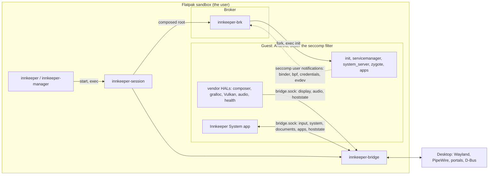

# Architecture

Innkeeper runs a near-stock AOSP userspace (ART, system_server, SurfaceFlinger)
as ordinary host processes in a rootless, on-demand session. Our code sits at
Android's stable boundaries, so routine work never needs an AOSP build.

## Runtime zones

Everything runs as the user inside Innkeeper's Flatpak sandbox; only the
desktop's own services are outside it.

- **Host side.** The CLI and manager install and launch apps through
  `innkeeper-core`; the launcher assembles and starts the session; the bridge is
  the only process that talks to the desktop.
- **Broker.** One seccomp filter on Android's init traps what the sandbox can't
  do (binder, eBPF, Android credentials over one kernel uid, session-local
  evdev). The Rust broker defines the filter, starts init under it as its child,
  serves every notification and reaps orphans. See
  [supervisor/README.md](../supervisor/README.md).
- **Guest.** The pinned image plus our overlay layer, vendor HALs and the
  privileged system app. Each Android module installs a tree that mirrors
  Android's partition paths, which the session stacks over the image's
  ([session.md](session.md#overlay-stack)).

The channels between zones are the seccomp notification fd and one socket,
`bridge.sock` ([bridge-protocol.md](bridge-protocol.md)). The bridge also writes
input records to the broker's private `evdev.sock`. Nothing in Android reaches
the desktop any other way, apart from `/dev/dri`, `/dev/udmabuf` and the host
network ([session.md](session.md)).

## Modules

What each directory builds and where it runs. The stage's
`share/innkeeper/manifest.tsv` lists every staged file and the module that built
it.

| Dir                                                             | Artifact                                                                    | Runs                                                          | Start reading at                    |
| --------------------------------------------------------------- | --------------------------------------------------------------------------- | ------------------------------------------------------------- | ----------------------------------- |
| [host/core](../host/core/README.md)                             | `innkeeper-core` (library)                                                  | inside the CLI, manager and bridge                            | `src/ops.rs`                        |
| [host/cli](../host/cli/README.md)                               | `bin/innkeeper`                                                             | desktop, as you                                               | `src/main.rs`                       |
| [host/manager](../host/manager/README.md)                       | `bin/innkeeper-manager`                                                     | desktop, as you                                               | `src/window.rs`                     |
| [host/bridge](../host/bridge/README.md)                         | `libexec/innkeeper/innkeeper-bridge`                                        | desktop, in the session's sandbox                             | `src/main.rs`, `src/ipc/`           |
| [host/launcher](../host/launcher/README.md)                     | `libexec/innkeeper/innkeeper-session`                                       | Flatpak sandbox                                               | `src/cli.rs`                        |
| [supervisor](../supervisor/README.md)                           | `innkeeper-brk`, `libinnkeeper_shim.so`                                     | sandbox; the shim inside Android                              | `broker/src/notify.rs`              |
| [image](../image/README.md)                                     | image scripts, config and static tools                                      | desktop, when the image is prepared                           | `fetch.sh`, `pin.toml`              |
| [guest/bridge-client](../guest/bridge-client/)                  | static library                                                              | linked into the guests' composers, Android's audio and health | `include/innkeeper/bridge_client.h` |
| [ohos](../ohos/README.md)                                       | experimental OpenHarmony guest: image pin, layer, shim, display HDI, runner | a test sandbox, from the stage                                | `sandbox.sh`, `run.py`              |
| [android/vendor/graphics](../android/vendor/graphics/README.md) | allocator, mapper, composer                                                 | Android `/vendor`                                             | `composer/Display.cpp`              |
| [android/vendor/vulkan](../android/vendor/vulkan/README.md)     | `vulkan.radv.so`, `vulkan.anv.so`, `vulkan.lvp.so`                          | Android, in every Vulkan user                                 | `build.sh`, `patches/mesa/`         |
| [android/vendor/audio](../android/vendor/audio/README.md)       | `audio_bridge` (`IModule/innkeeper`)                                        | Android, in the audio HAL's APEX                              | `stream/Module.cpp`                 |
| [android/vendor/health](../android/vendor/health/README.md)     | `android.hardware.health-service.innkeeper`                                 | Android `/vendor`                                             | `src/battery.c`                     |
| [android/system](../android/system/)                            | `innkeeper-exec`, a no-op `iptables`                                        | Android `/system`                                             | `exec/innkeeper-exec.c`             |
| [android/system-app](../android/system-app/README.md)           | `InnkeeperSystem.apk`                                                       | Android, as a privileged app                                  | `app/.../InnkeeperSystemApp.kt`     |
| [android/overlay](../android/overlay/README.md)                 | config files over the image's partitions                                    | Android                                                       | its README                          |
| [tests](../tests/README.md)                                     | test harnesses and suites                                                   | desktop, never shipped                                        | its README                          |
| [packaging/flatpak](../packaging/flatpak/README.md)             | the Flatpak, `dev.sargunv.Innkeeper`                                        | build time                                                    | `build.sh`                          |
| [tools](../tools/)                                              | build container, staging, dev scripts ([development.md](development.md))    | build time                                                    | `build/stage.sh`                    |

## Decisions

- **Real Android userspace, not a reimplementation.** Compatibility comes from
  AOSP's own code. Reimplementing the framework (ATL, Mac.apk) means chasing
  stubs forever. A fake system_server or a SurfaceFlinger-less libgui would
  depend on unstable internals; they stay out unless measured session cost
  demands them.
- **Stable boundaries only.** HAL AIDL and stable-C interfaces, NDK APIs, rc and
  overlay files, LD_PRELOAD and seccomp at the syscall ABI. The image is never
  patched in place, and there is no AOSP patch queue; one would need a written
  reason why no stable boundary works.
- **Google's CI image, downloaded at setup.** An unmodified AOSP build from
  ci.android.com, fetched and verified on the user's machine; we never
  redistribute it ([image/README.md](../image/README.md)). No local AOSP build
  is needed.
- **Vendor code links only LL-NDK libraries** plus what we install in
  `/vendor/lib64`, and builds out of tree with the NDK.
- **Binder in userspace.** The broker serves binder from the seccomp supervisor,
  so a session needs no binderfs and no SELinux module, and it works where
  nested user namespaces are blocked.
- **The bridge owns the desktop.** The composer is a pure HWC: it hands frames
  to the bridge, which is the Wayland client (decorations, fractional scale,
  activation). Bionic code never links desktop libraries.
- **Languages by where code runs.** C or C++ for code loaded into Android
  processes or on C ABIs (HALs, the mapper and Vulkan `.so`, the shim, Mesa
  patches), kept small. Rust for standalone components, especially at trust
  boundaries (broker, bridge, launcher, host tools). Kotlin for the system app.
  Not Zig: no binder/AIDL ecosystem, and the NDK already cross-compiles C.
- **x86_64 first.** Most non-game apps ship x86_64, but most top games don't
  (Unity and Unreal default to arm64), so ARM translation through a NativeBridge
  is a later milestone.

## Packaging scope

- Innkeeper ships as a Flatpak. Per-app Flatpaks are an optional extra, never a
  design constraint.
- **Desktop baseline: current major distro releases only.** We support the
  oldest desktop stack in a current release of Debian, Ubuntu, Fedora, openSUSE
  or Arch (Debian 13: GNOME 48, Plasma 6.3, xdg-desktop-portal 1.20). Portals
  and freedesktop specs come first, a desktop-specific path only where a
  baseline desktop has no standard one, and nothing older than the baseline gets
  a fallback.
- Installing anything never needs `sudo`: no RPM/deb/AUR packages, SELinux
  modules, AppArmor profiles or kernel modules.
- `out/stage` is the installable prefix and already has the Flatpak shape: it
  becomes `/app` in the Flatpak. Every lookup is relative to the running
  executable, and runtime state lives in the XDG dirs, so dev, test and packaged
  runs share one code path.
- Inside Flatpak there are no nested user namespaces, mounts or capabilities, so
  the session runs in the app's own sandbox as one kernel uid, with a root built
  from symlinks (Flatpak's `/` is a writable tmpfs) and the host's network
  ([session.md](session.md)). No `flatpak-spawn --host`: that is a sandbox
  escape.

## Non-goals

- **Virtual machines.** Android runs as host processes integrated with the
  desktop. VM-based Android exists (the emulator, Cuttlefish, ChromeOS ARCVM); a
  VM or guest kernel is never an acceptable architecture here.
- **Play Integrity.** Banking and other apps that require it are out of scope.
- **Protection beyond desktop parity** ([security.md](security.md)).
