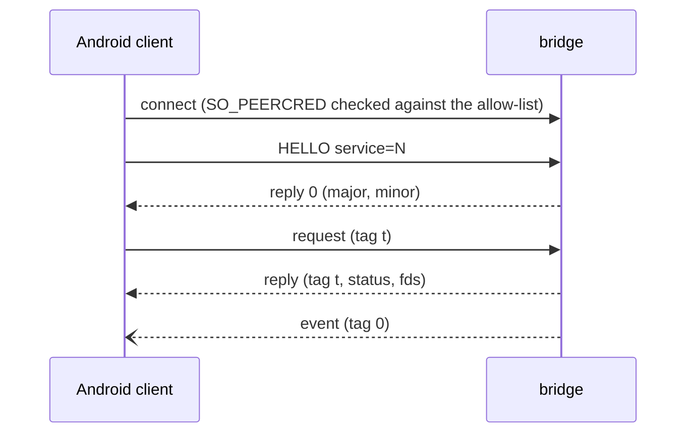

# Bridge protocol

`linuxapk-bridge` serves Android-side clients over one socket,
`$XDG_RUNTIME_DIR/linuxapk[-<instance>]/bridge/bridge.sock`, bound into Android
as `/dev/socket/linuxapk/bridge.sock`. This file is the cross-language spec;
each service's messages are in the module doc of its Rust `proto.rs`.

| Implementation | Where                                                                                                 |
| -------------- | ----------------------------------------------------------------------------------------------------- |
| Rust (server)  | [host/bridge/src/ipc](../host/bridge/src/ipc): `wire.rs`, `transport.rs`, `proto.rs`, `server.rs`     |
| C (client)     | [android/vendor/bridge-client](../android/vendor/bridge-client/README.md), for the composer and audio |
| Kotlin         | `Wire.kt` and `BridgeConnection.kt` in [android/system-app](../android/system-app/README.md)          |

`host/bridge/src/ipc/wire-fixtures.txt` holds encodings that the Rust and Kotlin
tests both check.

## Framing

`AF_UNIX`, `SOCK_SEQPACKET`: one packet is one message, at most 512 bytes and 4
fds (`SCM_RIGHTS`). Integers are little-endian.

| Part   | Layout                                                             |
| ------ | ------------------------------------------------------------------ |
| header | `u16 type`, `u16 flags` (0), `u32 tag`                             |
| body   | type-specific, at most 504 bytes                                   |
| name   | `u16 len` (≤ 96) + UTF-8, no NUL or control characters             |
| reply  | type `0x8000`, the request's tag, `i32 status` (0 or -errno), body |

- Every request gets exactly one reply, in order; a reply may carry fds.
- Events (types `0x4000..=0x7fff`, tag 0) may arrive at any time. They never
  block the bridge: a client that doesn't read its socket loses them. Clients
  match replies by tag and treat events separately.
- Requests carry fds only where their service says so; any other request with
  fds gets them closed and `-EPROTO`.
- A malformed body gets `-EINVAL`, an unknown type `-ENOSYS`; the connection
  stays open. An unreadable header, a packet over 512 bytes or more than 4 fds
  ends it.
- Payloads that don't fit go as a sealed memfd (`F_SEAL_WRITE | SHRINK | GROW`)
  next to a small message carrying their length; the bridge reads them once with
  `pread` and never maps them.

## HELLO

| Type     | Body                                                  | Reply                    |
| -------- | ----------------------------------------------------- | ------------------------ |
| `0x0001` | `u16 major (1)`, `u16 minor (0)`, `u32 service`, name | `u16 major`, `u16 minor` |

HELLO is the first message and binds the connection to one service; a client
that needs two services opens two connections. A wrong major gets `-EPROTO`, an
unknown service `-ENOSYS`, a service the peer isn't admitted to `-EACCES`, and
any other first message `-EPROTO`; each closes the connection.

## Services

| Id  | Service   | Types / events      | Clients (Android side)                  | Spec                                                                 |
| --- | --------- | ------------------- | --------------------------------------- | -------------------------------------------------------------------- |
| 1   | audio     | `0x01xx`            | `libtinyalsav2` in the audio HAL        | [audio/proto.rs](../host/bridge/src/audio/proto.rs), `audio/ring.rs` |
| 2   | display   | `0x02xx` / `0x42xx` | the composer                            | [display/proto.rs](../host/bridge/src/display/proto.rs)              |
| 3   | system    | `0x03xx` / `0x43xx` | the system app (integration)            | [system/proto.rs](../host/bridge/src/system/proto.rs)                |
| 4   | documents | `0x04xx` / `0x44xx` | the system app (picker, provider)       | [documents/proto.rs](../host/bridge/src/documents/proto.rs)          |
| 5   | apps      | `0x05xx`            | the system app (app mirror)             | [apps/mod.rs](../host/bridge/src/apps/mod.rs)                        |
| 6   | input     | `0x06xx` / `0x46xx` | the system app only (WM, injector, IME) | [input/proto.rs](../host/bridge/src/input/proto.rs)                  |

Who may open which service: [security.md](security.md#the-bridge-socket).

## Versioning

Minor versions only add message types or trailing reply fields, and clients
ignore reply bytes they don't know. A new major version means a new HELLO.

## Adding a service

1. Take an id below 64 in `ipc::proto::service`. Requests use `0xNN01..=0xNNff`
   and events `0x40NN`-style ranges (NN = the id); the core answers types at or
   above `0x4000` with `-EPROTO`.
2. Write `<service>/proto.rs`: `decode` built only on `wire::Reader` and ending
   with `Reader::end()`, `encode` for tests, and the message table as its module
   doc. Bound every count and length, read names with `Reader::name`,
   range-check floats, require reserved fields to be 0, and add proptests
   (arbitrary bodies never panic; accepted bodies re-encode to the same bytes).
3. Implement `server::Service::handle(ty, body, fds)`. It runs on the
   connection's thread, so hand long work to your own threads. Close fds you
   don't expect, and check the ones you do (`fstat`, seals, size) before mapping
   them. Put per-client caps in the service.
4. Send events with `server::Events::try_send`, which never blocks.
5. Register the factory in `main.rs`, and extend the launcher's `--allow-uid`
   list if the service has new clients.
6. Shared memory you hand out is created and sealed by the bridge; never read
   back state you own from it, and clamp what the client writes there.
