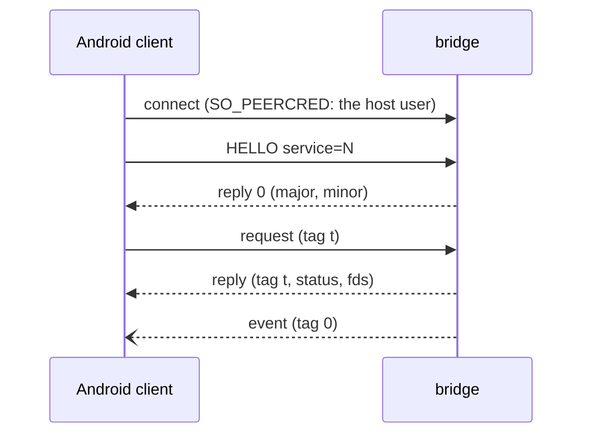

# Bridge protocol

`innkeeper-bridge` serves Android-side clients over one socket,
`$XDG_RUNTIME_DIR/app/<app id>/innkeeper-<profile>/bridge/bridge.sock`. The
socket is bound into Android as `/dev/socket/innkeeper/bridge.sock`. This file
is the cross-language spec. Each service's messages are listed in the module doc
of its Rust `proto.rs`.

| Implementation | Where                                                                                                                |
| -------------- | -------------------------------------------------------------------------------------------------------------------- |
| Rust (server)  | [host/bridge/src/ipc](../host/bridge/src/ipc): `wire.rs`, `transport.rs`, `proto.rs`, `server.rs`                    |
| C (client)     | [guest/bridge-client](../guest/bridge-client/include/innkeeper/bridge_client.h), for the composers, audio and health |
| Kotlin         | `Wire.kt` and `BridgeConnection.kt` in [android/system-app](../android/system-app/README.md)                         |

`host/bridge/src/ipc/wire-fixtures.txt` and
`host/bridge/src/a11y/snapshot-fixture.txt` hold encodings that both the Rust
and the Kotlin tests check.

## Framing

The socket is `AF_UNIX` with `SOCK_SEQPACKET`. Each packet is one message of at
most 512 bytes and 4 fds (`SCM_RIGHTS`). Integers are little-endian.

| Part   | Layout                                                             |
| ------ | ------------------------------------------------------------------ |
| header | `u16 type`, `u16 flags` (0), `u32 tag`                             |
| body   | type-specific, at most 504 bytes                                   |
| name   | `u16 len` (≤ 96) + UTF-8, no NUL or control characters             |
| reply  | type `0x8000`, the request's tag, `i32 status` (0 or -errno), body |

- Every request gets one reply, and replies come in request order. A reply may
  carry fds.
- Events have types `0x4000..=0x7fff` and tag 0, and they may arrive at any
  time. Sending an event does not block the bridge, so a client that doesn't
  read its socket loses events. Clients match replies by tag and handle events
  separately.
- A request may carry fds when its service defines it that way. Any other
  request with fds gets its fds closed and the status `-EPROTO`.
- A malformed body gets `-EINVAL`, and an unknown type gets `-ENOSYS`. The
  connection stays open in both cases. An unreadable header, a packet over 512
  bytes or more than 4 fds ends the connection.
- A payload that doesn't fit in a message goes in a sealed memfd
  (`F_SEAL_WRITE | SHRINK | GROW`), sent with a small message that carries its
  length. The bridge reads the memfd once with `pread` and does not map it.

## HELLO

| Type     | Body                                                  | Reply                    |
| -------- | ----------------------------------------------------- | ------------------------ |
| `0x0001` | `u16 major (1)`, `u16 minor (0)`, `u32 service`, name | `u16 major`, `u16 minor` |

HELLO is the first message on a connection, and it binds the connection to one
service. A client that needs two services opens two connections. A wrong major
version gets `-EPROTO`, an unknown service gets `-ENOSYS`, and any other first
message gets `-EPROTO`. Each of these errors closes the connection.

## Services

Each service has an id `NN` below 64. Its requests use types `0xNN01..=0xNNff`,
and its events use `0x4000` plus the same range. For example, the display
service (id 2) uses `0x0201..=0x02ff` and `0x4201..=0x42ff`. The
[bridge README](../host/bridge/README.md#services) lists the ids, the Android
clients and the desktop side of each service. Each service's messages are listed
in the module doc of its `proto.rs`.
[security.md](security.md#the-bridge-socket) says which clients may open which
service.

## Versioning

A minor version can add message types and trailing reply fields. Clients ignore
reply bytes they don't recognize. Any other change needs a new major version,
which the client states in HELLO.

## Adding a service

1. Take the next id in `ipc::proto::service`. The core answers requests with
   types at or above `0x4000` with `-EPROTO`.
2. Write `<service>/proto.rs` with the message table as its module doc. Decode
   with `wire::Reader`. Bound every count and length, require reserved fields to
   be 0, and end with `Reader::end()` so that trailing bytes are refused.
3. Implement `server::Service::handle(ty, body, fds)`. It runs on the
   connection's thread, so move long work to the service's own threads. Send
   events with `server::Events::try_send`, because nothing may block on a
   client. Close fds the request should not carry. Check the expected fds
   (`fstat`, seals, size) before using them.
4. Register the factory in `main.rs` and add a row to the bridge README.
5. The bridge creates and seals any shared memory it hands out. Do not read
   state that the bridge owns back from that memory.

The Session1 D-Bus API that desktop clients use is specified in
[host/bridge/src/session.rs](../host/bridge/src/session.rs).
