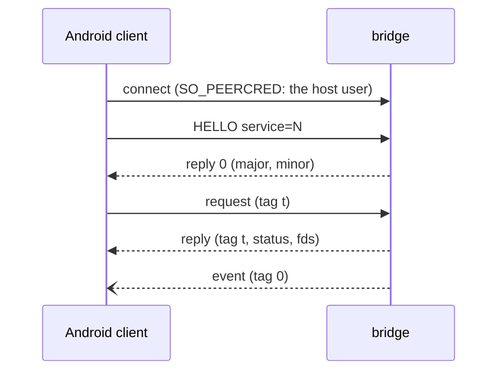

# Bridge protocol

`innkeeper-bridge` serves Android-side clients over one socket,
`$XDG_RUNTIME_DIR/app/<app id>/innkeeper-<profile>/bridge/bridge.sock`, bound
into Android as `/dev/socket/innkeeper/bridge.sock`. This file is the
cross-language spec; each service's messages are in the module doc of its Rust
`proto.rs`.

| Implementation | Where                                                                                                                |
| -------------- | -------------------------------------------------------------------------------------------------------------------- |
| Rust (server)  | [host/bridge/src/ipc](../host/bridge/src/ipc): `wire.rs`, `transport.rs`, `proto.rs`, `server.rs`                    |
| C (client)     | [guest/bridge-client](../guest/bridge-client/include/innkeeper/bridge_client.h), for the composers, audio and health |
| Kotlin         | `Wire.kt` and `BridgeConnection.kt` in [android/system-app](../android/system-app/README.md)                         |

`host/bridge/src/ipc/wire-fixtures.txt` and
`host/bridge/src/a11y/snapshot-fixture.txt` hold encodings that the Rust and
Kotlin tests both check.

## Framing

`AF_UNIX`, `SOCK_SEQPACKET`: one packet is one message, at most 512 bytes and 4
fds (`SCM_RIGHTS`). Integers are little-endian.

| Part   | Layout                                                             |
| ------ | ------------------------------------------------------------------ |
| header | `u16 type`, `u16 flags` (0), `u32 tag`                             |
| body   | type-specific, at most 504 bytes                                   |
| name   | `u16 len` (≤ 96) + UTF-8, no NUL or control characters             |
| reply  | type `0x8000`, the request's tag, `i32 status` (0 or -errno), body |

- Every request gets exactly one reply, in order; a reply may carry fds.
- Events (types `0x4000..=0x7fff`, tag 0) may arrive at any time. They never
  block the bridge: a client that doesn't read its socket loses them. Clients
  match replies by tag and treat events separately.
- Requests carry fds only where their service says so; any other request with
  fds gets them closed and `-EPROTO`.
- A malformed body gets `-EINVAL`, an unknown type `-ENOSYS`; the connection
  stays open. An unreadable header, a packet over 512 bytes or more than 4 fds
  ends it.
- Payloads that don't fit go as a sealed memfd (`F_SEAL_WRITE | SHRINK | GROW`)
  next to a small message carrying their length; the bridge reads them once with
  `pread` and never maps them.

## HELLO

| Type     | Body                                                  | Reply                    |
| -------- | ----------------------------------------------------- | ------------------------ |
| `0x0001` | `u16 major (1)`, `u16 minor (0)`, `u32 service`, name | `u16 major`, `u16 minor` |

HELLO is the first message and binds the connection to one service; a client
that needs two services opens two connections. A wrong major gets `-EPROTO`, an
unknown service `-ENOSYS`, and any other first message `-EPROTO`; each closes
the connection.

## Services

Each service has an id below 64; its requests use types `0xNN01..=0xNNff` and
its events `0x40NN`-style ranges (`NN` the id). The ids, the Android clients and
the desktop side of each are in the
[bridge README](../host/bridge/README.md#services); each service's messages are
the module doc of its `proto.rs`. Who may open which service:
[security.md](security.md#the-bridge-socket).

## Versioning

Minor versions only add message types or trailing reply fields, and clients
ignore reply bytes they don't know. A new major version means a new HELLO.

## Adding a service

1. Take the next id in `ipc::proto::service`; the core answers types at or above
   `0x4000` with `-EPROTO`.
2. Write `<service>/proto.rs` with the message table as its module doc. Decode
   only with `wire::Reader`: bound every count and length, require reserved
   fields to be 0, and end with `Reader::end()` so trailing bytes are refused.
3. Implement `server::Service::handle(ty, body, fds)`. It runs on the
   connection's thread, so hand long work to your own threads, and send events
   with `server::Events::try_send`: nothing may block on a client. Close fds you
   don't expect, and check the ones you do (`fstat`, seals, size) before using
   them.
4. Register the factory in `main.rs` and add a row to the bridge README.
5. Shared memory the bridge hands out is created and sealed by the bridge; never
   read back state you own from it.

The Session1 D-Bus API that desktop clients use is specified in
[host/bridge/src/session.rs](../host/bridge/src/session.rs).
