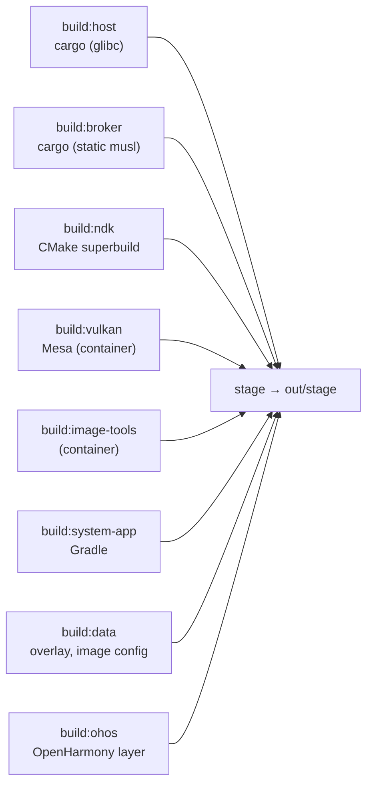

# Development

## Prerequisites

`mise install` provides Rust with the `x86_64-unknown-linux-musl` target, Java,
CMake, Ninja, sccache, dprint, shellcheck, shfmt, hk and jactionlint. The rest
comes from the host, and none of it needs root.

| For               | What                                                                                                                                                                                                                     |
| ----------------- | ------------------------------------------------------------------------------------------------------------------------------------------------------------------------------------------------------------------------ |
| building          | Android SDK at `$ANDROID_HOME` (default `~/Android/Sdk`) with the NDK, build-tools and platform [toolchain.env](../tools/build/toolchain.env) pins; podman; clang; GTK 4 (4.18+) and libadwaita (1.7+) development files |
| running a session | Flatpak, a Wayland desktop, GPU access (`/dev/udmabuf`) and audio; development sessions also use `systemd --user` and Python 3.11+                                                                                       |

## Build

`mise run build` runs every `build:<module>` task. Each task installs into its
own `out/build/<module>/install` tree, with paths relative to the prefix. Then
[tools/build/stage.sh](../tools/build/stage.sh) copies the trees into
`out/stage` and writes `share/innkeeper/manifest.tsv`, which has the path,
module and sha256 of each file. Staging fails if two modules write the same
path. Nothing builds at runtime.



- **Toolchain pin.** [tools/build/toolchain.env](../tools/build/toolchain.env)
  pins the toolchains. mise loads it, container builds get it with `--env-file`,
  and Gradle reads it from the environment.
- **NDK superbuild.** The root `CMakeLists.txt` builds every Android-side C and
  C++ artifact. Its presets are `android` and `host-tests`. Ninja rebuilds what
  changed.
- **Build container.** Mesa and the static image tools build in the container in
  `tools/container/`. Its `run.sh` tags the image with the hash of the
  `Containerfile` and runs every build at nice 10. These builds are skipped
  while their inputs hash to the same stamp.
- **Compiler cache.** Every C and C++ compile goes through sccache, inside the
  container or outside it. The cache is `~/.cache/innkeeper/sccache`, and every
  checkout and worktree shares it.
  [tools/build/sccache.sh](../tools/build/sccache.sh) keys the cache on paths
  relative to the checkout and keeps each depfile local. A new worktree's first
  build therefore reuses the objects of other worktrees, and Ninja still tracks
  the worktree's own headers.
- **AOSP interfaces.** `android/vendor/third_party/aosp` holds the frozen AIDL
  snapshots that the HALs implement and the AOSP headers they build against.
  `android/vendor/tools/sync-aosp.sh` copies them from one AOSP tag. At
  configure time, `android/vendor/tools/gen-aidl.sh` generates each HAL's NDK
  backend with the build-tools' `aidl`.
- **Gradle** builds the system app. The Gradle wrapper is checked in.
- `tools/build/host.sh` runs `build:host`.
- `mise run clean` removes build output and keeps test results.

## Run

- `mise run session -- start|stop|status|log|exec|shell|selftest|prepare` runs
  the staged launcher ([host/launcher](../host/launcher/README.md)) in a private
  Flatpak. The host caps its memory. Its scratch HOME and XDG directories are
  under `out/dev/flatpak/<profile>`, and the default profile is `dev`. A start
  fails at once if less than 10 GiB of memory is available
  ([packaging/flatpak](../packaging/flatpak/README.md#development)).
- `tools/dev/innkeeper.sh` runs the CLI's `install app.apk`, `run`, `uninstall`
  and `list` commands ([host/cli](../host/cli/README.md)) in the same Flatpak.
  It adds `--profile $INNKEEPER_PROFILE`. It needs its own desktop, for example
  `INNKEEPER_PROFILE=cli tests/nested.sh tools/dev/innkeeper.sh list`
  ([a nested desktop](#a-nested-isolated-desktop)).
- `tools/dev/footprint.sh` prints the PSS and RSS of every process in a running
  session. Use it to see how much memory an idle session holds.
- `mise run package` builds the Flatpak bundle from the committed tree into
  `out/release/` ([packaging/flatpak](../packaging/flatpak/README.md)).
  `mise run package -- --install` also installs the bundle into
  `FLATPAK_USER_DIR`. The default is the user installation, where the manager
  appears in the app menu as an APK handler. Install into the user installation
  only from a checkout that you want to use as your Innkeeper. To test, use a
  private `FLATPAK_USER_DIR` under `out/`.
- Use `INNKEEPER_PROFILE=<name>` for anything experimental. Each profile is a
  separate session with its own `/data`, logs and sandbox. Off a nested desktop,
  the dev runner starts a test session by default. `INNKEEPER_TEST=0` turns this
  off ([security.md](security.md#test-sessions)).

## Test

[tests/README.md](../tests/README.md) describes the test tiers and their mise
tasks. `mise run check` runs every hk linter: dprint, shellcheck, clippy and
jactionlint. The pre-commit hook runs the same linters on staged files.
`mise run fix` fixes what it can.

## Android logs

This command takes a bounded snapshot of the log in a named session:

```sh
INNKEEPER_PROFILE=debug mise run session -- exec timeout 10 logcat -d -t 100
```

Without `-d` or `-t`, `logcat` streams until it is interrupted. `-T 100` also
streams. The timeout stops a reader that stalls.

- The `kernel` buffer is empty, because logd can't read the host's `/proc/kmsg`.
  Init's writes to `/dev/kmsg` go to the launcher. Read them with
  `innkeeper profile log` or `mise run session -- log`.
- The session has no tracefs. libcutils turns atrace off when `trace_marker`
  fails to open. Each process then logs a `cutils-trace` error, which
  `image/vendor.prop` silences with `log.tag.cutils-trace=S`.

## A nested, isolated desktop

`tests/nested.sh CMD...` runs a command on a disposable KWin. With
`INNKEEPER_TEST_COMPOSITOR=mutter`, it uses headless Mutter instead. The command
gets a private D-Bus, runtime directory, HOME and XDG directories under
`out/test/nested/<profile>/`. It also gets private PipeWire and Pulse, with a
null sink and no hardware monitors. `nested.sh` removes all of these when the
command exits. Use it for anything that opens windows, portals or notifications.

The nested desktop serves `dev.sargunv.Innkeeper.TestDesktop`, which provides
input, window visibility and position, and screenshots. `tests/e2e/kwin.py`
serves it on KWin, and `tests/e2e/mutter.js` serves it on GNOME Shell.

- KWin offers `org_kde_kwin_fake_input` and `org.kde.KWin.ScreenShot2` to a
  client whose resolved executable matches the `Exec` of a desktop file. That
  desktop file must name the interfaces in `X-KDE-Wayland-Interfaces` and
  `X-KDE-DBUS-Restricted-Interfaces`. `nested.sh` writes such a file for
  `/usr/bin/python3`.
- Inside Android, `screencap` without a display shows the launcher. Each app
  window is a separate virtual display, named `innkeeper:<package>`. To capture
  one, get its id from `dumpsys SurfaceFlinger --display-id` and run
  `screencap -d <id> -p <file>`. tests/compat does the same.
