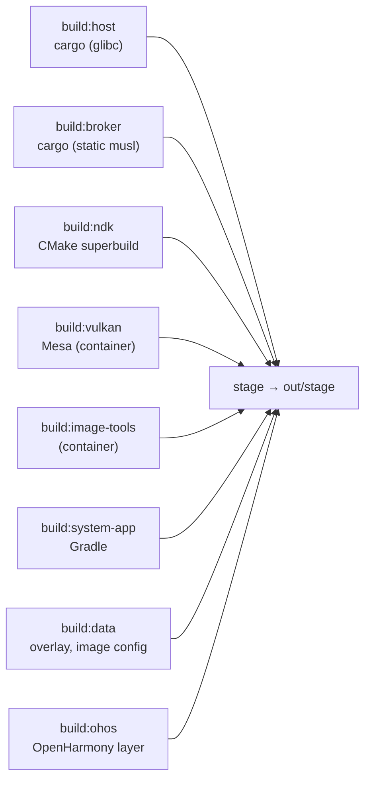

# Development

## Prerequisites

mise provides Rust (with the `x86_64-unknown-linux-musl` target), Java, CMake,
Ninja, dprint, shellcheck, shfmt, hk and jactionlint (`mise install`). The rest
comes from the host; none of it needs root.

| For               | What                                                                                                                                                                                                                     |
| ----------------- | ------------------------------------------------------------------------------------------------------------------------------------------------------------------------------------------------------------------------ |
| building          | Android SDK at `$ANDROID_HOME` (default `~/Android/Sdk`) with the NDK, build-tools and platform [toolchain.env](../tools/build/toolchain.env) pins; podman; clang; GTK 4 (4.18+) and libadwaita (1.7+) development files |
| running a session | Flatpak, a Wayland desktop, GPU access (`/dev/udmabuf`) and audio; development sessions also use `systemd --user` and Python 3.11+                                                                                       |

## Build

`mise run build` runs every `build:<module>` task, each into its own
`out/build/<module>/install` tree (paths relative to the prefix), then
[tools/build/stage.sh](../tools/build/stage.sh) copies them into `out/stage` and
writes `share/innkeeper/manifest.tsv` (path, module, sha256 per file). It fails
if two modules write the same path. Nothing at runtime builds anything.



- **One toolchain pin**,
  [tools/build/toolchain.env](../tools/build/toolchain.env): mise loads it,
  container builds get it with `--env-file`, and Gradle reads it from the
  environment.
- **One NDK superbuild**, the root `CMakeLists.txt` (presets `android` and
  `host-tests`), builds every Android-side C/C++ artifact; ninja rebuilds only
  what changed.
- **One build container**, `tools/container/` (`Containerfile`, and `run.sh`,
  which tags the image by the Containerfile's hash and always caps the run at
  nice 10), for Mesa and the static image tools. Those builds are skipped while
  their inputs hash to the same stamp.
- **One compiler cache**: every C/C++ compile, in the container or not, goes
  through sccache into `~/.cache/innkeeper/sccache`, which every checkout and
  worktree shares. [tools/build/sccache.sh](../tools/build/sccache.sh) keys it
  on paths relative to the checkout and keeps each depfile local, so a new
  worktree's first build reuses its siblings' objects and Ninja still tracks its
  own headers.
- **AOSP interfaces.** `android/vendor/third_party/aosp` holds every frozen AIDL
  snapshot the HALs implement and the AOSP headers they build against, copied
  from one AOSP tag by `android/vendor/tools/sync-aosp.sh`. At configure time
  `android/vendor/tools/gen-aidl.sh` generates each HAL's NDK backend with the
  build-tools' `aidl`.
- **Gradle** builds the system app; the wrapper is checked in.
- `mise run clean` removes build output and keeps test results.
- `tools/build/` also holds `host.sh` (`build:host`).

## Run

- `mise run session -- start|stop|status|log|exec|shell|selftest|prepare` runs
  the staged launcher ([host/launcher](../host/launcher/README.md)) in a private
  Flatpak, capped from the host, with scratch HOME and XDG dirs under
  `out/dev/flatpak/<profile>` (default profile `dev`); a start fails at once
  with less than 10 GiB available
  ([packaging/flatpak](../packaging/flatpak/README.md#development)).
- `tools/dev/innkeeper.sh install app.apk`, `run`, `uninstall`, `list`
  ([host/cli](../host/cli/README.md)) in the same Flatpak, with
  `--profile $INNKEEPER_PROFILE` added. It needs a desktop of its own:
  `INNKEEPER_PROFILE=cli tests/nested.sh tools/dev/innkeeper.sh list`
  ([a nested desktop](#a-nested-isolated-desktop)).
- `tools/dev/footprint.sh`: PSS and RSS of every process in a running session,
  to see what an idle session holds.
- `mise run package` builds the Flatpak bundle from the committed tree into
  `out/release/` ([packaging/flatpak](../packaging/flatpak/README.md)).
  `mise run package -- --install` also installs it into `FLATPAK_USER_DIR`
  (default: the user installation, adding the manager to the app menu as an APK
  handler). Install into the user installation only for a checkout you mean to
  use as your Innkeeper; use a private `FLATPAK_USER_DIR` under `out/` to test.
- Use `INNKEEPER_PROFILE=<name>` for anything experimental: it is a separate
  session with its own `/data`, logs and sandbox. Off a nested desktop the dev
  runner defaults to a test session (`INNKEEPER_TEST=0` opts out)
  ([security.md](security.md#test-sessions)).

## Test

Test tiers and their mise tasks are in [tests/README.md](../tests/README.md).
`mise run check` runs every hk linter (dprint, shellcheck, clippy, jactionlint),
as the pre-commit hook does on staged files; `mise run fix` fixes what it can.

## Android logs

Take a bounded snapshot inside a named session:

```sh
INNKEEPER_PROFILE=debug mise run session -- exec timeout 10 logcat -d -t 100
```

Without `-d` or `-t`, `logcat` streams until interrupted (`-T 100` streams too);
the timeout bounds a stalled reader.

- The `kernel` buffer is empty: logd can't read the host's `/proc/kmsg`. Init's
  `/dev/kmsg` writes go to the launcher instead (`innkeeper profile log`, or
  `mise run session -- log`).
- There is no tracefs. libcutils turns atrace off when `trace_marker` fails to
  open, and `image/vendor.prop` silences the resulting per-process
  `cutils-trace` error (`log.tag.cutils-trace=S`).

## A nested, isolated desktop

`tests/nested.sh CMD...` runs a command on a disposable KWin (or headless Mutter
with `INNKEEPER_TEST_COMPOSITOR=mutter`) with a private D-Bus, runtime dir, HOME
and XDG dirs under `out/test/nested/<profile>/`, private PipeWire/Pulse with a
null sink and no hardware monitors, and removes them after. Use it for anything
that opens windows, portals or notifications. It serves
`dev.sargunv.Innkeeper.TestDesktop` (input, window visibility and position,
screenshots): `tests/e2e/kwin.py` on KWin, `tests/e2e/mutter.js` on GNOME Shell.

- KWin offers `org_kde_kwin_fake_input` and `org.kde.KWin.ScreenShot2` only to a
  client whose resolved executable is the `Exec` of a desktop file naming them
  in `X-KDE-Wayland-Interfaces` and `X-KDE-DBUS-Restricted-Interfaces`;
  `nested.sh` writes one for `/usr/bin/python3`.
- Inside Android, plain `screencap` shows only the launcher: each app window is
  its own virtual display, named `innkeeper:<package>`. Capture one with
  `screencap -d <id> -p <file>`, taking the id from
  `dumpsys SurfaceFlinger --display-id`, as tests/compat does.
