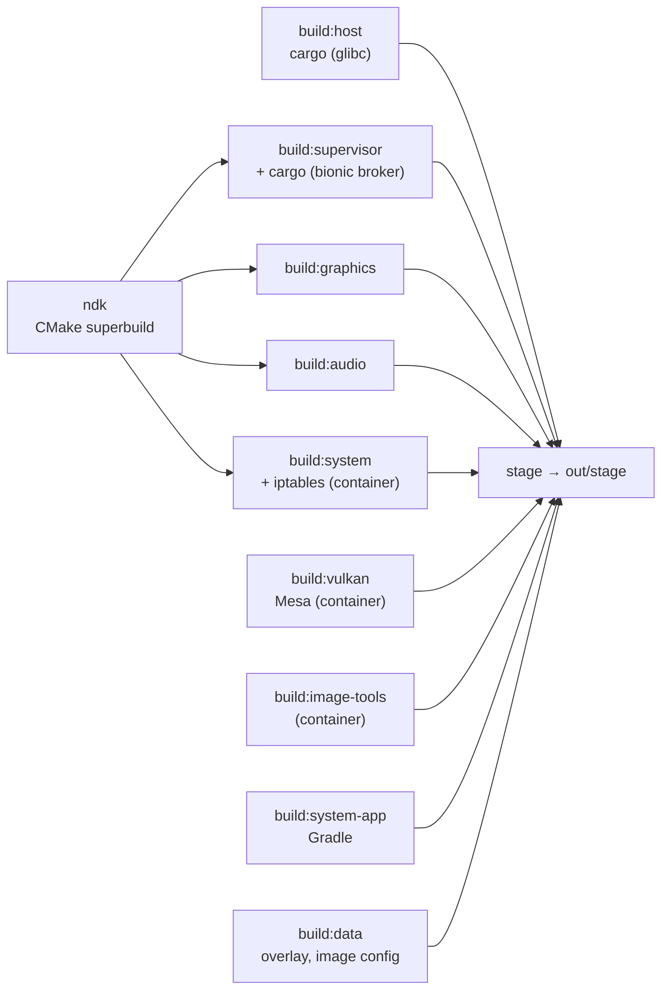

# Development

## Prerequisites

mise provides Rust (with the `x86_64-linux-android` target), Java, CMake, Ninja,
dprint, shellcheck, shfmt, hk and jactionlint (`mise install`). The rest comes
from the host; none of it needs root.

| For               | What                                                                                                                                                                                                       |
| ----------------- | ---------------------------------------------------------------------------------------------------------------------------------------------------------------------------------------------------------- |
| building          | Android SDK at `$ANDROID_HOME` (default `~/Android/Sdk`) with NDK `30.0.16248370`, build-tools `37.0.0` and `platforms;android-37.0`; podman; clang; GTK 4 (4.18+) and libadwaita (1.7+) development files |
| running a session | a Wayland desktop, `systemd --user`, pasta (passt), curl, Python 3.11+, read-write `/dev/udmabuf` (a logind ACL) and pipewire-pulse; `start` names what's missing                                          |
| subuid mode       | `newuidmap`/`newgidmap` and a range of at least 49999 ids in `/etc/subuid` and `/etc/subgid`; without them the session runs in single-uid mode                                                             |

## Build

`mise run build` runs every `build:<module>` task, each into its own
`out/build/<module>/install` tree (paths relative to the prefix), then `stage`
merges them into `out/stage` and writes `share/linuxapk/manifest.tsv` (path,
module, sha256 per file). Stage fails if a module misses an artifact declared in
[tools/build/artifacts.toml](../tools/build/artifacts.toml) or two modules write
the same path. Nothing at runtime builds anything.



- **One toolchain pin**,
  [tools/build/toolchain.env](../tools/build/toolchain.env): mise loads it,
  container builds get it with `--env-file`, and Gradle reads it from the
  environment.
- **One NDK superbuild**, the root `CMakeLists.txt` (presets `android` and
  `host-tests`), builds every Android-side C/C++ artifact; each module installs
  its CMake component.
- **One build container**, [tools/container](../tools/README.md), for Mesa,
  iptables and the static image tools. Every run is capped (`--memory`,
  `--pids-limit`); those builds are skipped while their inputs hash to the same
  stamp.
- `mise run clean` removes build output and keeps test results.

## Run

- `mise run session -- start|stop|status|log|exec|shell|selftest|prepare` runs
  the current stage inside a real Flatpak through `tools/dev/session.sh`. The
  first command registers a stage snapshot in `out/flatpak/user`; later builds
  use `flatpak run --app-path=out/stage`, with no export or bundle. The default
  named instance is `dev`. Scratch HOME and XDG dirs are under
  `out/dev/flatpak/<instance>`; `tools/dev/session.sh paths` prints them. Only
  the prepared image cache is shared with the host setup. The host driver caps
  the app's scope at 6/8 GiB and waits when less than 25 GiB of host memory is
  available. Use `LINUXAPK_MODE=host` for comparison.
- `tools/dev/linuxapk.sh install app.apk`, `run`, `uninstall`, `list`
  ([host/cli](../host/cli/README.md)). CLI integration runs on an isolated
  desktop: `LINUXAPK_INSTANCE=cli tests/nested.sh tools/dev/linuxapk.sh list`.
  `tests/nested.sh` starts and cleans up an isolated KWin, D-Bus, AT-SPI bus,
  runtime directory and HOME/XDG directories.
- `packaging/flatpak/build.sh` builds the Flatpak from the committed tree and
  installs it into `FLATPAK_USER_DIR`; use a private one under `out/`
  ([packaging/flatpak](../packaging/flatpak/README.md)).
- `mise run install-dev` adds the staged manager to the app menu and makes it an
  APK handler. Do this only for a checkout you mean to use as your Linux.apk.
- Use `LINUXAPK_INSTANCE=<name>` for anything experimental: it is a separate
  session with its own `/data`, logs and unit, and stays off the real desktop
  ([security.md](security.md#test-sessions)).

## Test

Test tiers and their mise tasks are in [tests/README.md](../tests/README.md).
`mise run check` (hk and dprint) is the pre-commit gate; `mise run fix` formats.

## A nested, isolated desktop

Features that open windows, portals or notifications are tested in a nested
compositor that is fully isolated from the user's desktop: a private D-Bus
session, a private `XDG_RUNTIME_DIR` and XDG dirs under `out/`, `DISPLAY` unset,
and `WAYLAND_DISPLAY` set to the nested socket before the bus starts, so
whatever the bus activates (portals, kded) inherits it.

```sh
N=$PWD/out/nested
mkdir -p $N/{home,config,data,cache,state}
# A short runtime dir: a socket path must fit in 108 bytes, which a deep
# checkout's out/ can exceed (KWin then dumps core). Remove it when done.
RT=$(mktemp -d -p "$XDG_RUNTIME_DIR" lapk-XXXXXX)
printf '#!/bin/sh\necho "$DBUS_SESSION_BUS_ADDRESS" >%s/bus\nexec sleep infinity\n' $N >$N/hold.sh
chmod +x $N/hold.sh   # the session's command: publishes the nested bus, then waits
E=(-u DISPLAY -u WAYLAND_DISPLAY -u DBUS_SESSION_BUS_ADDRESS HOME=$N/home XDG_RUNTIME_DIR=$RT
   XDG_CONFIG_HOME=$N/config XDG_DATA_HOME=$N/data XDG_CACHE_HOME=$N/cache XDG_STATE_HOME=$N/state
   XDG_CURRENT_DESKTOP=KDE)
systemd-run --user --unit linuxapk-nested-kwin -p MemoryMax=3G -- env "${E[@]}" WAYLAND_DISPLAY=lapk-nested \
  dbus-run-session -- kwin_wayland --virtual --no-lockscreen --socket lapk-nested \
  --width 1920 --height 1080 --exit-with-session $N/hold.sh
WAYLAND_DISPLAY=$RT/lapk-nested DBUS_SESSION_BUS_ADDRESS=$(cat $N/bus) \
  LINUXAPK_INSTANCE=nested mise run session -- start
# linuxapk writes desktop entries under XDG_DATA_HOME for every instance, so
# point it at $N while keeping the session's image and /data:
D=(XDG_DATA_HOME=$N/data XDG_CONFIG_HOME=$N/config LINUXAPK_INSTANCE=nested
   LINUXAPK_IMAGES=$HOME/.local/share/linuxapk/images
   LINUXAPK_DATA=$HOME/.local/share/linuxapk/data-nested)
env "${D[@]}" out/stage/bin/linuxapk install some.apk
```

- Check `/proc/<pid>/environ` of every process on the nested bus (private
  `HOME`, nested `WAYLAND_DISPLAY`) before testing. Never start plasmashell,
  kded, akonadi or kdeconnect against the real dirs, and stop every unit you
  started when done.
- KWin's `org_kde_kwin_fake_input` gives real seat input. KWin offers it only to
  a client whose resolved executable (e.g. `/usr/bin/python3.14`, not the
  symlink) is the `Exec` of a `.desktop` file in `$N/data/applications` with
  `X-KDE-Wayland-Interfaces=org_kde_kwin_fake_input`. `spectacle -b -n` with the
  nested bus captures screenshots.
- Inside Android, plain `screencap` shows only the launcher: each app window is
  its own virtual display, named `linuxapk:<package>`. Capture one with
  `screencap -d <id> -p <file>`, taking the id from
  `dumpsys SurfaceFlinger --display-id`, as tests/compat does.
- A fake `x-scheme-handler/https` handler in `$N/data/applications` logs what
  OpenURI opens, and a null sink (`LINUXAPK_AUDIO_SINK`) keeps media silent.
