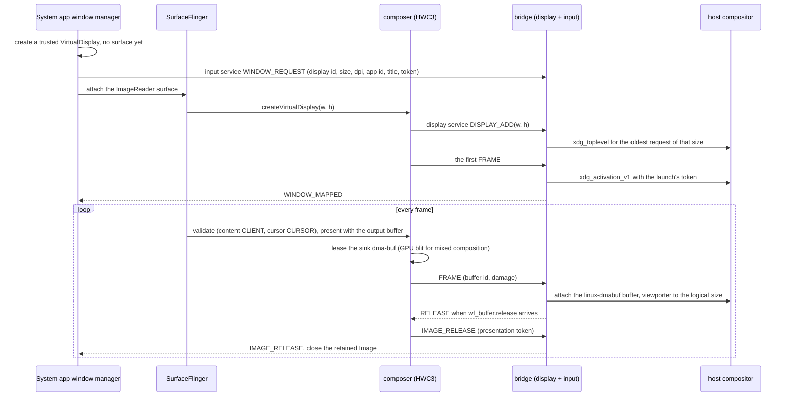
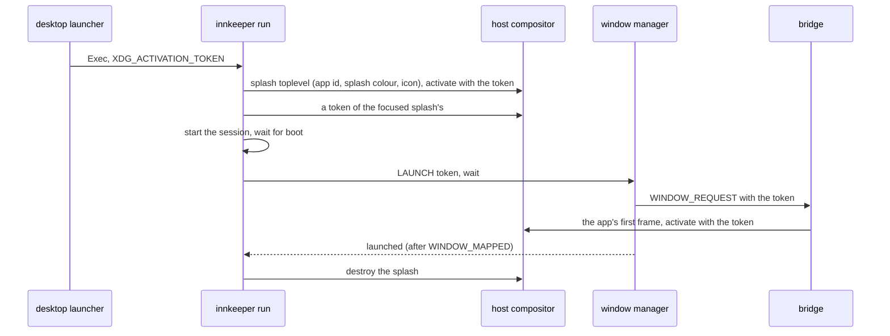

# Display and windows

Each Android app task gets its own Wayland window: titled with the app's label,
`app_id` `dev.sargunv.innkeeper.<package>` (inside the Flatpak
`dev.sargunv.Innkeeper.<package>`; the `StartupWMClass` of its desktop entry),
resized with the app, closed with its task. Android's default display 0 has no
window; it keeps running headless with the system app’s empty HomeActivity as
HOME. A profile in [phone mode](#phone-mode) shows display 0 instead.

## Frame path

- **The window manager** (`wm/WindowManagerFeature.kt`) creates each display
  with `TRUSTED`, `OWN_DISPLAY_GROUP`, `ALWAYS_UNLOCKED`, `OWN_FOCUS`,
  `OWN_CONTENT_ONLY`, `SUPPORTS_TOUCH`, `DESTROY_CONTENT_ON_REMOVAL` and
  `SECURE`, with no system decorations (apps see zero system-bar insets), and
  starts the app on it with `setLaunchDisplayId`. Its sink is an RGBA
  ImageReader owned by `FrameSink`. Each acquired image stays alive until the
  host compositor releases its pixels.
- **HWC-backed virtual displays.** The composer's rc sets
  `debug.sf.enable_hwc_vds=1` and reports 32 virtual displays, so SurfaceFlinger
  hands the composer every frame. Content layers stay CLIENT: RenderEngine
  renders into the sink buffer, which is both client target and output buffer.
  CURSOR layers stay separate and are exported to the host cursor surface.
- **Matching a display to its window.** HWC3's `createVirtualDisplay` carries
  only a size, so the window manager orders things: request the window first,
  then attach the surface, so SurfaceFlinger's next commit creates the HWC
  display, and the bridge gives it the oldest request of that size (requests
  expire after 10 s). Displays nobody asked for (`screenrecord`,
  MediaProjection) stay headless. A foreign display of exactly the same size
  created in the same commit could take the window; that is unlikely and
  accepted.
- **Buffer ownership.** The composer imports the sink's own dma-buf into
  linux-dmabuf, using its linear format, stride and offset. It writes a unique
  presentation token to the buffer's shared metadata page before submitting it.
  `FrameSink` reads that token without mapping pixels and retains the image
  until HWC observes Wayland RELEASE and forwards the token. Unsubmitted images
  close immediately. At most two host leases leave room in the three-image
  reader for dropped frames, even if the host stops releasing. Display teardown
  closes the retained images. For mixed composition, where SF provides a
  separate scratch client target, HWC blits it into the sink on the GPU; the
  common path imports the client target directly.
- **The bridge is the Wayland client**, because the composer is a Bionic process
  with no libdecor, GTK or host fonts. Decorations are always an Adwaita-style
  client frame, matching the GTK/libadwaita manager on every desktop, including
  KWin. The bridge does not negotiate server decorations. Its vendored
  `sctk-adwaita` 0.12 adds a ‹ Back button at the start of the header; it sends
  BACK to that window's display, plus a fullscreen button beside the window
  controls. Both support pointer and touch. The frame hides in fullscreen until
  its top edge is touched or hovered, and retains resize edges and
  maximize/tiling, and right-click asks the compositor for its window menu
  (`show_window_menu`). If the compositor goes away the bridge ends the
  composer's connection; the composer reconnects every second and adds its
  displays again.

## Cursor

The composer accepts `Composition::CURSOR` and copies its RGBA/BGRA buffer to a
sealed memfd for the bridge's CURSOR message. SurfaceFlinger excludes that layer
from the client target, so the window never contains a second cursor. A missing
or transparent cursor layer hides the Wayland pointer while it is over content
(`PointerIcon.TYPE_NULL`); client-side frame edges keep their resize cursors.

HWC3 carries no pointer style or hotspot metadata. The bridge displays the
Android bitmap on a `wl_shm` cursor surface. Hotspots are cached by the hash of
bitmap pixels and dimensions. A hotspot is measured as pointer position minus
layer origin only after both stay unchanged across consecutive frames; motion
uses the cached value. A new bitmap uses the previous hotspot (initially the
top-left) until a stationary sample is available. Both image and hotspot follow
the window's scale. This covers standard and custom icons without matching style
names or using a private Android pointer-icon listener.

Pointer capture uses the mouse's Android source change independently of cursor
visibility; see [input.md](input.md#pointer-capture). A hidden cursor alone does
not constrain the host pointer.

## Window semantics

- **Resize and scale.** `configure` and the fractional (or integer) scale come
  to the window manager as `window <w> <h> <scale> <display>`. After a 120 ms
  debounce it calls `VirtualDisplay.resize(w×scale, h×scale, 160×scale)`, so the
  app renders at the window's physical pixels and stays sharp at fractional
  scales; `wp_viewporter` stretches the old frame until a new one arrives. The
  last scale seen is kept, so later windows open at it.
- **Close.** `xdg_toplevel.close` removes every task on the display and releases
  it once they are gone, after a short settle: releasing while a task's removal
  is still in flight lets Android 17's display-compat recovery
  (AppCompatDisplayCompatPolicy) relaunch a finished activity onto the display
  id being destroyed; that launch fails inside system_server, which restarts and
  closes every window. When the display's last task finishes, a
  `TaskStackListener` closes the window; Back on a launcher root instead moves
  the task to the back and minimizes its host window, keeping the task and
  display alive for the next launch; a window whose app never starts a task
  closes after 20 s.
- **Focus.** `keyboard_enter` makes the window's top task Android's focused one.
  Launching an app that has a window activates it through `xdg_activation_v1`,
  with the launch's token ([Launch feedback](#launch-feedback)); without one,
  compositors may only flag it without a fresh input serial.
- **Task appearance.** The top task's `TaskDescription` supplies the window icon
  and primary colour, refreshed on mapping and description changes. An absent
  task icon falls back to the app launcher icon, drawn with the same mask as its
  desktop entry. The initial icon is set when the toplevel is created, before
  its first map; only an app without either icon has no icon. Changes are
  coalesced for 120 ms before copying an icon, scaled to fit 256×256 pixels;
  identical updates are skipped. The bridge uses `xdg_toplevel_icon_v1` when
  offered (KWin), with no icon fallback on other compositors. Client-side
  captions on every desktop use the primary RGB with a contrasting title and
  button foreground; a zero primary colour restores the desktop theme. Clearing
  a task icon restores the launcher icon.
- **Task ownership.** A window is owned by an Android task id, independent of
  the package of its top activity. A start without `NEW_TASK` stays in that task
  and window. A new task on an occupied app display gets a VirtualDisplay of its
  own, including a second task of the same package; all its windows share the
  package's `app_id`. Before moving a new task off its caller's display, the
  bridge requests an `xdg_activation_v1` token from the caller's surface and
  uses it when the new window first maps. A desktop launch restores the
  package's most recent task. `innkeeper run --new-window <package>` and the
  desktop entry's **New Window** action request `NEW_TASK | MULTIPLE_TASK` on a
  fresh display. Entries advertise it only for launcher activities whose launch
  and document modes permit multiple tasks; singleton or document-never
  launchers keep the ordinary launch action. DynamicLauncher 1.20 accepts only
  one desktop-entry group, so its upstream restriction prevents installing a New
  Window action group. Flatpak portal entries retain the ordinary launcher; the
  CLI option remains available inside Flatpak. Native desktop entries include
  the action.
- **Display 0.** Any ordinary app task that appears there (`am start` without a
  display, notification `PendingIntent`s) moves into a window of its own; home,
  recents, dream and assistant tasks stay.

### Window size

From the launch activity's metadata (`wm/WindowSizing.kt`), in dp times the
window's scale:

1. `<layout android:defaultWidth/defaultHeight>`;
2. else portrait-only activities get 412x915 and landscape-only ones 1280x720;
3. else 1280x800.

`<layout android:minWidth/minHeight>` become the toplevel's minimum size.
Runtime `onActivityRequestedOrientationChanged` requests, and changes of the top
activity, swap a floating window's width and height when its shape disagrees
with a fixed portrait/landscape request. Ctrl+R swaps the focused floating
window's shape. Like WMShell's `DesktopActivityOrientationChangeHandler`, this
is a request to reshape the window; a later compositor configure wins. The
virtual display ignores physical rotation requests, so Android keeps the
activity's aspect ratio by letterboxing inside the display buffer when
necessary.

### Fullscreen and immersive

The title bar's fullscreen button and F11 toggle the focused window's desktop
fullscreen mode. In fullscreen, move the pointer to the top edge or touch its
first four logical pixels to reveal the header over the app. Its inward-corner
fullscreen button leaves fullscreen; F11 also exits. The header hides when the
pointer leaves it. After a touch reveals it, it stays available for a second tap
on the button and hides when a touch moves or starts outside it. The app's
Android display keeps its fullscreen size while the header is revealed. The
compositor's window menu also offers fullscreen where supported (for example,
Alt+F3 on KWin). Escape releases pointer capture; it does not exit fullscreen.

Fullscreen is a user control. App immersive mode (hidden Android system bars)
never changes the host window, including for games. Each app already fills its
own Android virtual display, with no system decorations. Shape requests
([Window size](#window-size)) wait while a window is fullscreen, maximized or
tiled.

The system app registers `IDisplayWindowInsetsController` on its own displays.
Android 17 reports the focused component and **requested** visible inset types
through `topFocusedWindowChanged`, even without system-bar surfaces. A small
platform-signed RRO enables `config_remoteInsetsControllerControlsSystemBars`,
which gates that callback. This hidden interface is needed because no public or
system SDK API observes another app's requested bar visibility; using
`TaskOrganizer` instead would take task and surface ownership from WMShell.
`TaskStackListener` and `TaskInfo.topActivityInfo` supply orientation changes
and activity metadata for the same reason: SDK display listeners don't report
another activity's request. Signatures and behavior were checked against
`android-17.0.0_r1` and the pinned Android 17 image; the image is not patched.

`Activity.requestFullscreenMode` is unsupported: Android rejects it before
dispatch because each app task already fills its virtual display. Desktop
fullscreen stays the user's choice.

### Hidden windows

Each host window observes xdg-shell's `suspended` configure state (v6), and
probes visibility with a frame callback every 250 ms. Both baseline desktops
advertise xdg-shell v6:
[GNOME 48](https://github.com/GNOME/mutter/blob/48.0/src/wayland/meta-wayland-versions.h)
and
[Plasma 6.3](https://github.com/KDE/kwin/blob/v6.3.0/src/wayland/xdgshell.cpp).
An outstanding callback without a response for one second also means hidden. The
latter works on compositors without the suspended state, including when a window
is fully occluded. A static window still probes; a hidden window leaves its
callback pending so showing it can resume Android without waiting for an app
frame.

The window manager sleeps the existing VirtualDisplay's own power group through
Android 17's platform `IPowerManager.goToSleepWithDisplayId` API. Android stops
the activity; restore wakes the same group with `wakeUpWithDisplayId`. Each
window already owns a display group, so these requests cannot sleep another
window or the session's primary display. The display and tasks stay registered.
The bridge replaces the last Android buffer with a host-owned snapshot on hide
and returns subsequent frames. Wayland releases the old dma-bufs, allowing
FrameSink to close the retained ImageReader images through their normal lease
release path without reusing pixels that the compositor is still reading.

### Keeping the desktop awake

The window manager observes Android 17's per-display screen-timeout policy
through IPowerManager.addScreenTimeoutPolicyListener. WMS translates
FLAG_KEEP_SCREEN_ON into a display-specific screen wake lock; the policy also
includes SCREEN_BRIGHT, SCREEN_DIM and FULL wake locks. The hidden platform
listener is needed because the SDK cannot observe other applications' aggregate
screen wake locks. It is compiled against the pinned Android 17 signature.

A visible window with that policy owns a zwp_idle_inhibitor_v1. Clearing the
request, hiding the window or closing it destroys the inhibitor. Restoring a
window reapplies its current request. Android's SCREEN_OFF_TIMEOUT is set to
Int.MAX_VALUE so ordinary Android idle timeout cannot stop an activity behind
its visible desktop window; host visibility controls its power group instead.
The system app holds no screen wake lock of its own, which would feed back into
desktop idle inhibition.

Both baseline desktops advertise idle-inhibit v1:
[GNOME 48](https://github.com/GNOME/mutter/blob/48.0/src/wayland/meta-wayland-versions.h)
and
[Plasma 6.3](https://github.com/KDE/kwin/blob/v6.3.0/src/wayland/idleinhibit_v1.cpp).
The global is optional: if absent, windows and Android lifecycle keep working
and desktop idle inhibition is unavailable.

### Moving between outputs

Each surface tracks the outputs it has entered. Fractional-scale v1 supplies its
preferred pixel scale; without that optional global, SCTK uses
wl_surface.preferred_buffer_scale or the entered outputs' integer scales.
Changing scale resizes the existing VirtualDisplay's pixel dimensions and
density together, keeping the logical content size. It does not recreate the
display. Android delivers its normal density/size configuration change to the
activity; activities declaring those configuration changes can redraw in place.

The bridge reports every visible output's ID and current mode refresh rate.
Membership comes directly from SCTK's per-surface enter/leave set, so a window
spanning two outputs keeps both until it leaves one. Mode changes and hot unplug
update affected observations. Zero means the output rate is unknown; an empty
set means hidden or unmapped. Window LIST reports these as `hostOutputs=id@Hz`.

Android 17's VirtualDisplayConfig.setRequestedRefreshRate is a creation-time
setting: VirtualDisplayAdapter keeps mRequestedRefreshRate final and
IDisplayManager has no live setter. Innkeeper leaves the requested rate at zero
so SurfaceFlinger follows the primary display; it never recreates an app's
VirtualDisplay to change the rate. Pacing follows the host through primary
display 0.

Output reporting and presentation pacing share `State::visible_outputs`, driven
by lifecycle, surface enter/leave and output-mode events, with no polling.
Fractional-scale v1 is available on the baseline GNOME 48 and Plasma 6.3.

### Launch feedback

- **The splash.** `innkeeper run` on a stopped session maps a toplevel of its
  own at once (`host/cli/src/splash.rs`), with the app's app id and title,
  filled with its splash colour, its icon in the middle, at the size its window
  will open at. `innkeeper install` records the colour and size in the desktop
  entry (`X-Innkeeper-Splash`, `X-Innkeeper-Window`): the launcher activity
  theme's `windowSplashScreenBackground`, else its window background colour,
  else `colorBackground`, and [its window size](#window-size). It asks for
  server-side decorations only, so on GNOME it has no frame.
- **Activation.** The splash uses the desktop's `XDG_ACTIVATION_TOKEN`, which
  ends the launch's startup feedback, and once focused asks for a token of its
  own for the app's window. The bridge activates the window with it on its first
  frame, and `LAUNCH`'s `wait` makes the window manager answer only then, so the
  splash goes as the app's window takes focus. On a running session there is no
  splash, and the desktop's token goes straight through (`WINDOW_REQUEST` for a
  new window, `WINDOW_ACTIVATE` for a shown one); the manager passes a token
  from its own window.
- **Android's SplashScreen** (Android 12's starting window) doesn't show on the
  window manager's displays: no starting window is added there, so the first
  frame is the app's own.

### System dialogs

- Runtime permission prompts, the share sheet, PackageInstaller, crash and ANR
  dialogs start in the app's task or on its display, so they show in its window.
- The "built for an older Android" warning always targets display 0, so the
  window manager disables it and shows the same text in the app's window
  (`AppWarningActivity`).
- Other `AppWarnings` and SystemUI dialogs not tied to an activity (volume, USB)
  still go to display 0, unseen.

## Phone mode

A profile's `mode = "phone"` (`innkeeper profile set --mode phone`, the
manager's Display row) shows the whole device in one window, for developing
apps: display 0, with SystemUI's status and navigation bars and the image's
Launcher3, where apps start instead of in windows of their own. It applies at
the next start.

**Why display 0.** It is where Android already runs SystemUI, the launcher,
recents, the keyguard, rotation and system dialogs, as on a phone. A new
VirtualDisplay would need system decorations, a secondary home and rotation
emulated for it, and still wouldn't behave like a phone's screen. The cost is in
the composer: display 0's mode is fixed at boot, so a preset applies at the next
start, and its frames are SurfaceFlinger's own client targets rather than an
ImageReader's.

- **Size.** innkeeper-session sets display 0's mode from the preset
  (`vendor.innkeeper.hwc.primary`, `ro.sf.lcd_density`): small phone 720 × 1280
  at 320 dpi, medium phone 1080 × 2400 at 420 dpi, medium tablet 2560 × 1600 at
  320 dpi, as Android Studio's devices of those names. Apps keep their data
  across presets and modes.
- **Frames.** The composer's display 0 presenter copies each client target on
  the GPU into a pool of its own LINEAR buffers and hands those to the bridge,
  so SurfaceFlinger gets its buffers back at once. Display 0 exists before the
  window manager asks for its window, so the composer offers it again every half
  second until the request (`WINDOW_REQUEST` for display 0) claims it.
- **Window manager.** In phone mode it asks for display 0's window, starts
  launches there (`innkeeper run`, notifications, `am start` alike), never moves
  display 0's tasks to windows of their own, and disables its empty HOME so the
  launcher is home. Closing the window powers the profile off, as closing an
  emulator does.
- **Navigation.** Phone-sized presets use three-button navigation, which a mouse
  can click; the tablet keeps gestures, whose taskbar crash-loops with buttons.
  The window's ‹ Back works too.
- **Rotation.** Android rotates display 0 (an app's requested orientation, or
  `adb shell wm user-rotation lock 1`) inside its buffer, which keeps its
  natural orientation. The window manager sends the rotation
  (`WINDOW_ROTATION`); the bridge shows the frames turned back with a
  `wl_surface` buffer transform, gives the window the turned shape and maps
  input to the rotated display. Launcher3 stays portrait on phones, as it does
  on devices.
- Every boot, the framework warns on display 0 that the build is inconsistent
  (VINTF finds no kernel SELinux policy, as the session has none); init closes
  that dialog in phone mode.

## Buffers

The allocator ([android/vendor/graphics](../android/vendor/graphics/README.md))
allocates GPU-only, single-layer RGB render/composer targets through the
selected Vulkan driver. It exports a dma-buf with the driver's single-plane
tiled modifier, row pitch and allocation size, using a dedicated allocation
where the driver requires one (RADV does for shareable tiled images). The native
handle's second fd is a small sealed memfd holding the shared metadata page,
including the modifier for IMapper, and any client reserved region, so the pixel
fd can be exactly the driver's allocation. Auxiliary compression planes are
excluded. Tiled targets render about 1.6x faster than LINEAR on RADV and several
times faster on Intel.

CPU-accessed buffers, cursor buffers, YUV and unsupported GPU allocations use
the sealed memfd and `/dev/udmabuf` path: LINEAR, CPU-mappable and importable by
RADV, ANV, lavapipe and linux-dmabuf. Like minigbm's i915 policy, CPU access
keeps LINEAR while rendering prefers tiled memory.

- **LINEAR row pitch is a multiple of 256 bytes on every plane**, which RADV
  requires for linear images. YV12 keeps Android's rule
  (`c_stride = align(y_stride / 2, 16)`) by padding luma to 512.
- All planes of a YUV buffer share one dma-buf; offsets and strides are in
  `PLANE_LAYOUTS`, and `DATASPACE` carries the colour model (unset means BT.601
  narrow range).
- GPU and composer usages fail rather than fall back to a plain memfd, which
  their consumers can't import.

The window sink requests CPU-read access because the bridge reads its pixels for
hidden-window snapshots and fallback. These exported buffers remain LINEAR;
tiled app buffers and SurfaceFlinger targets are imported by the Android GPU
compositor. Headless PNG dumps copy tiled targets through the GPU into a
CPU-readable buffer before encoding.

The bridge imports the sink's actual DRM fourcc and LINEAR modifier, including
RGBA FP16 and 10-bit targets, only when that pair is advertised in linux-dmabuf
feedback (or v3 modifier events). Unsupported pairs and failed imports use an
ARGB8888 wl_shm snapshot; half-floats and 10-bit channels are clamped and
rounded to their 8-bit SDR equivalents. Ordinary supported frames still use
their original dma-buf without a copy. KWin 6.3 predates the standard
colour-management protocol, so no wide-gamut/HDR output capability is
advertised; SurfaceFlinger performs colour conversion for the SDR virtual
display.

## Fences

The composer waits on acquire fences before submitting buffers. It exports real
sync_files with `DMA_BUF_IOCTL_EXPORT_SYNC_FILE` for completed virtual sink work
when supported. Mixed composition completes its GPU blit before releasing the
scratch client target. `PRESENT_FENCE_IS_NOT_RELIABLE` remains: these fences
describe GPU completion, while ImageReader leases protect the pixels until host
release. They do not describe host presentation.

## Control interface

The host launches and lists windows with the window manager's
`dev.sargunv.innkeeper.LAUNCH`, `LIST` and `CLOSE` broadcasts, and sets the
background setting ([session](session.md#lifecycle)) with `BACKGROUND`, run as
root inside the session; `wm/ControlReceiver.kt` documents the arguments and
replies, and `innkeeper-core`'s `android` module is the one caller.
