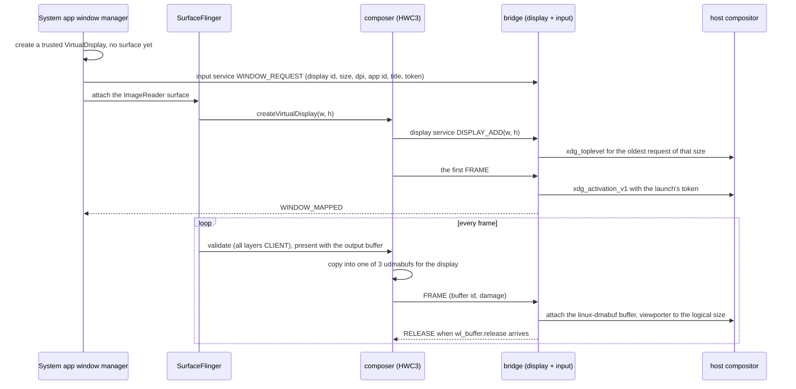

# Display and windows

Each Android app task gets its own Wayland window: titled with the app's label,
`app_id` `dev.linuxapk.<package>` (inside the Flatpak
`dev.linuxapk.Manager.<package>`; the `StartupWMClass` of its desktop entry),
resized with the app, closed with its task. Android's default display 0 has no
window; it keeps running headless with the system app’s empty HomeActivity as
HOME.

## Frame path

- **The window manager** (`wm/WindowManagerFeature.kt`) creates each display
  with `TRUSTED`, `OWN_DISPLAY_GROUP`, `ALWAYS_UNLOCKED`, `OWN_FOCUS`,
  `OWN_CONTENT_ONLY`, `SUPPORTS_TOUCH`, `DESTROY_CONTENT_ON_REMOVAL` and
  `SECURE`, with no system decorations (apps see zero system-bar insets), and
  starts the app on it with `setLaunchDisplayId`. Its sink is a `PRIVATE`
  ImageReader that drops every frame; it exists because a virtual display needs
  a consumer.
- **HWC-backed virtual displays.** The composer's rc sets
  `debug.sf.enable_hwc_vds=1` and reports 32 virtual displays, so SurfaceFlinger
  hands the composer every frame. Every layer stays CLIENT: RenderEngine renders
  into the sink buffer, which is both client target and output buffer.
- **Matching a display to its window.** HWC3's `createVirtualDisplay` carries
  only a size, so the window manager orders things: request the window first,
  then attach the surface, so SurfaceFlinger's next commit creates the HWC
  display, and the bridge gives it the oldest request of that size (requests
  expire after 10 s). Displays nobody asked for (`screenrecord`,
  MediaProjection) stay headless. A foreign display of exactly the same size
  created in the same commit could take the window; that is unlikely and
  accepted.
- **Why a copy, not zero-copy.** The sink buffer returns to SurfaceFlinger as
  soon as the ImageReader drops it, so showing it directly would tear. The copy
  of a 2176x1360 frame costs 1 to 2 ms; RGBA goes as XBGR8888 so it is a plain
  `memcpy`.
- **The bridge is the Wayland client**, because the composer is a Bionic process
  with no libdecor, GTK or host fonts. Decorations are always an Adwaita-style
  client frame, matching the GTK/libadwaita manager on every desktop, including
  KWin. The bridge does not negotiate server decorations. Its vendored
  `sctk-adwaita` 0.12 adds a ‹ Back button at the start of the header; it sends
  BACK to that window's display. The frame disappears in fullscreen, retains
  resize edges and maximize/tiling, and right-click asks the compositor for its
  window menu (`show_window_menu`). If the compositor goes away the bridge ends
  the composer's connection; the composer reconnects every second and adds its
  displays again.

## Window semantics

- **Resize and scale.** `configure` and the fractional (or integer) scale come
  to the window manager as `window <w> <h> <scale> <display>`. After a 120 ms
  debounce it calls `VirtualDisplay.resize(w×scale, h×scale, 160×scale)`, so the
  app renders at the window's physical pixels and stays sharp at fractional
  scales; `wp_viewporter` stretches the old frame until a new one arrives. The
  last scale seen is kept, so later windows open at it.
- **Close.** `xdg_toplevel.close` removes every task on the display and releases
  it. When the display's last task finishes, a `TaskStackListener` closes the
  window; Back on a launcher root instead moves the task to the back and
  minimizes its host window, keeping the task and display alive for the next
  launch; a window whose app never starts a task closes after 20 s.
- **Focus.** `keyboard_enter` makes the window's top task Android's focused one.
  Launching an app that has a window activates it through `xdg_activation_v1`,
  with the launch's token ([Launch feedback](#launch-feedback)); without one,
  compositors may only flag it without a fresh input serial.
- **Task appearance.** The top task's `TaskDescription` supplies the window icon
  and primary colour, refreshed on mapping and description changes. Changes are
  coalesced for 120 ms before copying an icon, scaled to fit 256×256 pixels;
  identical updates are skipped. The bridge uses `xdg_toplevel_icon_v1` when
  offered (KWin), with no icon fallback on other compositors. Client-side
  captions on every desktop use the primary RGB with a contrasting title and
  button foreground; a zero primary colour restores the desktop theme. Clearing
  a task icon restores the compositor's default icon.
- **Display 0.** Any ordinary app task that appears there (`am start` without a
  display, notification `PendingIntent`s) moves into a window of its own; home,
  recents, dream and assistant tasks stay.

### Window size

From the launch activity's metadata (`wm/WindowSizing.kt`), in dp times the
window's scale:

1. `<layout android:defaultWidth/defaultHeight>`;
2. else portrait-only activities get 412x915 and landscape-only ones 1280x720;
3. else 1280x800.

`<layout android:minWidth/minHeight>` become the toplevel's minimum size.
Runtime `onActivityRequestedOrientationChanged` requests, and changes of the top
activity, swap a floating window's width and height when its shape disagrees
with a fixed portrait/landscape request. Ctrl+R swaps the focused floating
window's shape. Like WMShell's `DesktopActivityOrientationChangeHandler`, this
is a request to reshape the window; a later compositor configure wins. The
virtual display ignores physical rotation requests, so Android keeps the
activity's aspect ratio by letterboxing inside the display buffer when
necessary.

### Fullscreen and immersive

F11 toggles the focused window's desktop fullscreen mode. The compositor's
window menu also offers fullscreen where supported. Normal immersive apps keep
their window: hiding Android's bars offers fullscreen without forcing it, as in
WMShell's `DesktopImmersiveController`. Games (`ApplicationInfo`'s game category
or legacy game flag) automatically enter desktop fullscreen when they request
both status and navigation bars hidden together with landscape or sensor
orientation. Showing the bars again restores the previous window. A manual F11
or native-menu exit takes precedence until the next visible-to-hidden immersive
entry. User-entered fullscreen remains in effect until the user exits it. A pure
per-window policy function computes fullscreen and shape requests for every app,
shortcut and compositor event; only its result is applied to Wayland.

The system app registers `IDisplayWindowInsetsController` on its own displays.
Android 17 reports the focused component and **requested** visible inset types
through `topFocusedWindowChanged`, even without system-bar surfaces. A small
platform-signed RRO enables `config_remoteInsetsControllerControlsSystemBars`,
which gates that callback. This hidden interface is needed because no public or
system SDK API observes another app's requested bar visibility; using
`TaskOrganizer` instead would take task and surface ownership from WMShell.
`TaskStackListener` and `TaskInfo.topActivityInfo` supply orientation changes
and activity metadata for the same reason: SDK display listeners don't report
another activity's request. Signatures and behavior were checked against
`android-17.0.0_r1` and the pinned Android 17 image; the image is not patched.

`Activity.requestFullscreenMode` is a separate, currently unsupported request:
Android rejects it before dispatch because each app task already fills its
Android virtual display. Supporting it requires a task-mode/transition policy
([#77](https://github.com/sargunv/linux.apk/issues/77)).

### Launch feedback

- **The splash.** `linuxapk run` on a stopped session maps a toplevel of its own
  at once (`host/cli/src/splash.rs`), with the app's app id and title, filled
  with its splash colour, its icon in the middle, at the size its window will
  open at. `linuxapk install` records the colour and size in the desktop entry
  (`X-LinuxApk-Splash`, `X-LinuxApk-Window`): the launcher activity theme's
  `windowSplashScreenBackground`, else its window background colour, else
  `colorBackground`, and [its window size](#window-size). It asks for
  server-side decorations only, so on GNOME it has no frame.
- **Activation.** The splash uses the desktop's `XDG_ACTIVATION_TOKEN`, which
  ends the launch's startup feedback, and once focused asks for a token of its
  own for the app's window. The bridge activates the window with it on its first
  frame, and `LAUNCH`'s `wait` makes the window manager answer only then, so the
  splash goes as the app's window takes focus. On a running session there is no
  splash, and the desktop's token goes straight through (`WINDOW_REQUEST` for a
  new window, `WINDOW_ACTIVATE` for a shown one); the manager passes a token
  from its own window.
- **Android's SplashScreen** (Android 12's starting window) doesn't show on the
  window manager's displays: no starting window is added there, so the first
  frame is the app's own.

### System dialogs

- Runtime permission prompts, the share sheet, PackageInstaller, crash and ANR
  dialogs start in the app's task or on its display, so they show in its window.
- The "built for an older Android" warning always targets display 0, so the
  window manager disables it and shows the same text in the app's window
  (`AppWarningActivity`).
- Other `AppWarnings` and SystemUI dialogs not tied to an activity (volume, USB)
  still go to display 0, unseen.

## Buffers

The allocator ([android/vendor/graphics](../android/vendor/graphics/README.md))
makes every buffer a sealed memfd turned into a dma-buf through `/dev/udmabuf`:
linear, CPU-mappable, importable by RADV (as GTT), lavapipe and linux-dmabuf.

- **Row pitch is a multiple of 256 bytes on every plane**, which RADV requires
  for linear images. YV12 keeps Android's rule
  (`c_stride = align(y_stride / 2, 16)`) by padding luma to 512.
- All planes of a YUV buffer share one dma-buf; offsets and strides are in
  `PLANE_LAYOUTS`, and `DATASPACE` carries the colour model (unset means BT.601
  narrow range).
- GPU and composer usages fail rather than fall back to a plain memfd, which
  their consumers can't import.

## Fences

The composer reports `PRESENT_FENCE_IS_NOT_RELIABLE` and returns no present or
release fences ("already signalled"): it copies the client target before
`present` returns, waiting on the acquire fence first. The Vulkan drivers hand
SurfaceFlinger real sync_files (amdgpu syncobjs), so no sw_sync is needed. Real
present fences would come from `DMA_BUF_IOCTL_EXPORT_SYNC_FILE` or a GPU
semaphore.

## Control interface

The host launches and lists windows with the window manager's
`dev.linuxapk.LAUNCH`, `LIST` and `CLOSE` broadcasts, and sets the background
setting ([session](session.md#lifecycle)) with `BACKGROUND`, run as root inside
the session; `wm/ControlReceiver.kt` documents the arguments and replies, and
`linuxapk-core`'s `android` module is the one caller.
