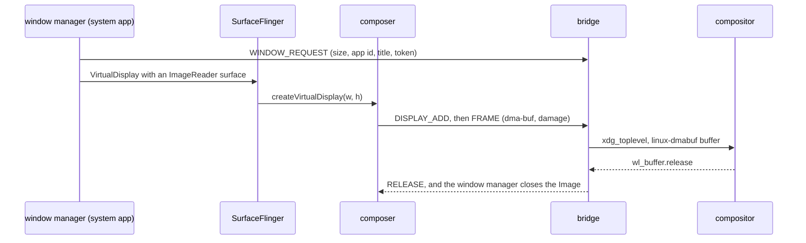

# Display and windows

Each Android app task gets its own Wayland window. The window takes the app's
label as its title and `dev.sargunv.Innkeeper.<package>` as its `app_id`, which
matches the `StartupWMClass` of the app's desktop entry. The window resizes with
the app and closes with its task. Android's default display 0 has no window. It
keeps running headless, with the system app's empty HomeActivity as HOME. A
profile in [phone mode](#phone-mode) shows display 0 instead.

## Frame path

- **One trusted VirtualDisplay per window.** The window manager
  (`wm/WindowManagerFeature.kt`) gives each display its own display group and
  focus, and no system decorations, so apps see zero system-bar insets. Each
  display's sink is an RGBA ImageReader. Each image stays alive until the host
  compositor releases its pixels.
- **HWC-backed virtual displays.** With `debug.sf.enable_hwc_vds=1`,
  SurfaceFlinger hands every frame to the composer, which supports 32 virtual
  displays. Content stays CLIENT and is rendered into the sink buffer. The
  composer imports that buffer directly into linux-dmabuf. A GPU blit happens
  only for mixed composition. CURSOR layers become the host cursor.
- **Matching a display to its window.** HWC3's `createVirtualDisplay` carries
  only a size. The window manager therefore requests the window first and
  attaches the surface afterwards. The bridge gives the new display the oldest
  request of that size. Requests expire after 10 s. Displays that nobody
  requested, such as those from `screenrecord` or MediaProjection, stay
  headless.
- **The bridge is the Wayland client.** The composer is a Bionic process with no
  libdecor, GTK or host fonts, so it can't draw a window itself. The bridge
  draws an Adwaita-style client frame on every desktop with the vendored
  `sctk-adwaita`. The frame has a ‹ Back button, which sends BACK to the
  window's display, and a fullscreen button. If the compositor goes away, the
  composer tries to reconnect every second and then adds its displays again.

## Cursor

The composer copies the CURSOR layer to the bridge. The bridge shows it on a
`wl_shm` cursor surface, so the window never draws a second cursor. When there
is no cursor layer, the pointer is hidden over the app's content. HWC3 has no
cursor hotspot, so the bridge measures one for each bitmap. The hotspot is the
pointer position minus the layer origin, taken once both hold still. The bridge
caches it by the bitmap's hash. Pointer capture is described in
[input.md](input.md#pointer-capture).

## Windows

- **Resize and scale.** The bridge passes each configure and the window's scale
  to the window manager. After 120 ms, the window manager resizes the display to
  the window's physical pixels at 160 dpi times the scale, so apps stay sharp at
  fractional scales. Until then, `wp_viewporter` stretches the old frame.
- **Close.** Closing a window removes its display's tasks and releases the
  display after a short wait. If the display is released while a task removal is
  still in progress, Android 17's display-compat recovery relaunches the task
  onto the dying display, and system_server restarts. The window closes when its
  last task finishes. Back on a launcher root activity minimizes the window
  instead, and the task is kept for the next launch.
- **Focus.** When a window has keyboard focus, its top task becomes Android's
  focused task. Launching an app that already has a window activates that window
  with the launch's `xdg_activation_v1` token.
- **Appearance.** The top task's `TaskDescription` sets the window icon and the
  caption colour. The icon uses `xdg_toplevel_icon_v1` where the compositor
  offers it. If the task has no icon, the window uses the launcher icon with the
  mask from the app's desktop entry.
- **Tasks.** Each window belongs to one Android task. A new task that starts on
  an occupied display gets its own display, activated with a token from the
  caller's window. A launch from the desktop restores the package's most recent
  task. `innkeeper run --new-window` asks for another task when the launcher
  activity allows several.
- **Display 0.** Ordinary app tasks that start on display 0, such as `am start`
  without a display or a notification intent, move into their own windows.

### Window size

The window manager (`wm/WindowSizing.kt`) picks the initial size from the launch
activity's metadata, in dp multiplied by the window's scale:

1. `<layout android:defaultWidth/defaultHeight>`, if set.
2. Otherwise 412x915 for portrait-only activities and 1280x720 for
   landscape-only activities.
3. Otherwise 1280x800.

`<layout android:minWidth/minHeight>` sets the window's minimum size. If an
activity requests an orientation that doesn't match a floating window's shape,
the window swaps its width and height, as WMShell's desktop mode does. Ctrl+R
swaps them by hand. The display ignores physical rotation, so Android
letterboxes the app when it must.

### Fullscreen

The title bar's fullscreen button and F11 toggle desktop fullscreen. In
fullscreen, the header appears when the pointer or a touch reaches the top edge.
Only the user controls fullscreen. An app's immersive mode doesn't change the
host window, because each app already fills its own display. For the same
reason, `Activity.requestFullscreenMode` is refused. The window manager still
tracks each app's requested system-bar visibility (`wm/RequestedInsets.kt`).
Orientation-driven shape changes wait while a window is fullscreen, maximized or
tiled.

### Hidden windows

A window counts as hidden when xdg-shell reports the `suspended` state. It also
counts as hidden when a frame callback goes unanswered for a second, which
covers compositors without `suspended` and fully occluded windows. When a window
is hidden, its display's power group sleeps, which stops the activity. The
bridge replaces the last frame with a host-owned snapshot so that Android gets
its buffers back. Showing the window wakes the group again.

### Keeping the desktop awake

An app can keep the screen on with `FLAG_KEEP_SCREEN_ON` or a screen wake lock.
Android 17's per-display screen-timeout policy reports this. While such an app's
window is visible, the bridge holds a `zwp_idle_inhibitor_v1`. Hiding or closing
the window lets the desktop go idle. If the compositor has no idle-inhibit
global, nothing inhibits idle. Android's own screen timeout is off, because host
visibility decides when an activity stops.

### Moving between outputs

The bridge takes the scale from fractional-scale v1, or from the outputs'
integer scales if that is missing. A scale change resizes the display's pixels
and density together, so apps get an ordinary configuration change and keep
their display. In Android 17, a virtual display's refresh rate is fixed when the
display is created. Apps' displays therefore follow display 0, which paces to
the host.

### Launch feedback

When the session is stopped, `innkeeper run` maps a splash window immediately
(`host/cli/src/splash.rs`). The splash shows the app's id, title, splash colour
and icon at the app's window size. `innkeeper install` records these in the
desktop entry as `X-Innkeeper-Splash` and `X-Innkeeper-Window`. The splash takes
the desktop's activation token, which ends the desktop's startup feedback. It
then gets a new token for the app's window, so focus passes from the splash to
the app. When the session is already running, the desktop's token goes directly
to the app's window. Android's own SplashScreen doesn't show on these displays.

### System dialogs

Permission prompts, the share sheet, PackageInstaller, and crash or ANR dialogs
start in the app's task or display, so they show in the app's window. Android
always shows the warning that an app was built for an older Android on
display 0. The window manager shows that warning's text in the app's window
instead (`AppWarningActivity`). Other dialogs that aren't tied to an activity,
such as volume or USB dialogs, go to display 0 and aren't seen.

## Phone mode

A profile can use a phone or tablet display, chosen in the Display row of its
settings. This mode is for developing apps. The profile shows the whole device
in one window: display 0, with SystemUI's bars and the image's Launcher3. Apps
start on display 0 instead of in their own windows. Android already runs
SystemUI, the launcher, recents, rotation and system dialogs on display 0, as it
does on a phone. A new virtual display would need all of that emulated. The
drawback is that display 0's mode is fixed at boot, so a change of preset
applies at the next start.

- **Sizes.** The presets follow Android Studio's devices. The small phone is 720
  × 1280 at 320 dpi, the medium phone is 1080 × 2400 at 420 dpi, and the medium
  tablet is 2560 × 1600 at 320 dpi. Apps keep their data across presets and
  modes.
- **Frames.** The composer copies each of display 0's client targets into its
  own LINEAR buffers on the GPU, so SurfaceFlinger gets its buffers back
  immediately.
- **Navigation.** Phones use three-button navigation, which works with a mouse.
  The tablet keeps gesture navigation. Closing the window stops the profile, as
  closing an emulator does.
- **Rotation.** Android rotates the content inside display 0's buffer. The
  bridge rotates the frames back with a buffer transform, reshapes the window,
  and maps input to match.
- **Boot dialog.** The session has no kernel SELinux policy, so the framework
  shows an "inconsistent build" dialog at boot. Init closes it.

## Buffers

The allocator ([android/vendor/graphics](../android/vendor/graphics/README.md))
allocates GPU render targets and composer targets through the Vulkan driver.
These buffers use the driver's tiled modifier, which renders much faster than
LINEAR.

CPU-accessed, cursor and YUV buffers are sealed memfds that `/dev/udmabuf` turns
into dma-bufs. These buffers are LINEAR and mappable, and RADV, ANV, lavapipe
and linux-dmabuf can import them. Every plane's row pitch is a multiple of 256
bytes, which RADV requires. An allocation with GPU usage fails if it can't get a
dma-buf, because its consumers can't import a plain memfd. Window sinks are
LINEAR and CPU-readable so that the bridge can snapshot hidden windows.

The bridge imports a sink's format only if linux-dmabuf advertises it. Otherwise
it sends an 8-bit `wl_shm` copy. SurfaceFlinger converts colour for the SDR
displays. The composer waits on acquire fences and exports sync_files for
finished GPU work. It leaves `PRESENT_FENCE_IS_NOT_RELIABLE` set, because
ImageReader leases protect the pixels until the host releases them.

Desktop clients launch, list and close windows through the session's `Session1`
API ([session.rs](../host/bridge/src/session.rs)). The bridge relays these calls
to the window manager (`wm/WindowCommands.kt`).
