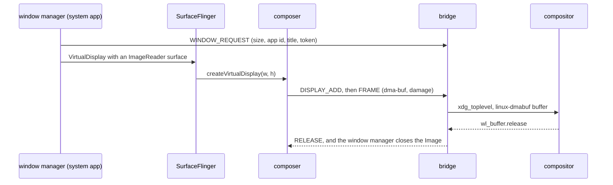

# Display and windows

Each Android app task gets its own Wayland window: titled with the app's label,
`app_id` `dev.sargunv.Innkeeper.<package>` (its desktop entry's
`StartupWMClass`), resized with the app, closed with its task. Android's default
display 0 has no window; it keeps running headless with the system app's empty
HomeActivity as HOME. A profile in [phone mode](#phone-mode) shows display 0
instead.

## Frame path

- **One trusted VirtualDisplay per window** (`wm/WindowManagerFeature.kt`), with
  its own display group and focus, no system decorations (apps see zero
  system-bar insets), and an RGBA ImageReader as its sink. Each image stays
  alive until the host compositor releases its pixels.
- **HWC-backed virtual displays** (`debug.sf.enable_hwc_vds=1`, 32 of them), so
  SurfaceFlinger hands the composer every frame. Content stays CLIENT, rendered
  into the sink buffer, which the composer imports straight into linux-dmabuf;
  only mixed composition costs a GPU blit. CURSOR layers become the host cursor.
- **Matching a display to its window.** HWC3's `createVirtualDisplay` carries
  only a size, so the window manager requests the window first, then attaches
  the surface, and the bridge gives the new display the oldest request of that
  size (requests expire after 10 s). Displays nobody asked for (`screenrecord`,
  MediaProjection) stay headless.
- **The bridge is the Wayland client**, because the composer is a Bionic process
  with no libdecor, GTK or host fonts. It draws an Adwaita-style client frame on
  every desktop (vendored `sctk-adwaita`), with a ‹ Back button that sends BACK
  to the window's display and a fullscreen button. If the compositor goes away
  the composer reconnects every second and adds its displays again.

## Cursor

The composer copies the CURSOR layer to the bridge, which shows it on a `wl_shm`
cursor surface, so the window never holds a second cursor; no cursor layer hides
the pointer over content. HWC3 has no hotspot, so the bridge measures one per
bitmap (pointer position minus layer origin, once both hold still) and caches it
by the bitmap's hash. Pointer capture is separate:
[input.md](input.md#pointer-capture).

## Windows

- **Resize and scale.** A configure and the window's scale reach the window
  manager, which after 120 ms resizes the display to the window's physical
  pixels at 160 dpi × scale, so apps stay sharp at fractional scales;
  `wp_viewporter` stretches the old frame meanwhile.
- **Close** removes the display's tasks and releases it after a short settle:
  releasing while a removal is in flight lets Android 17's display-compat
  recovery relaunch onto the dying display, which restarts system_server. When
  the last task finishes the window closes; Back on a launcher root minimizes it
  instead, keeping the task for the next launch.
- **Focus.** Keyboard focus on a window makes its top task Android's focused
  one. Launching an app that has a window activates it with the launch's
  `xdg_activation_v1` token.
- **Appearance.** The top task's `TaskDescription` gives the window icon
  (`xdg_toplevel_icon_v1`, where offered) and the caption colour; without a task
  icon the launcher icon is used, with its desktop entry's mask.
- **Tasks.** A window belongs to an Android task. A new task on an occupied
  display gets a display of its own, activated with a token from its caller's
  window; a desktop launch restores the package's most recent task, and
  `innkeeper run --new-window` asks for another where the launcher activity
  allows several tasks.
- **Display 0.** Ordinary app tasks that land there (`am start` without a
  display, notification intents) move into windows of their own.

### Window size

From the launch activity's metadata (`wm/WindowSizing.kt`), in dp times the
window's scale: `<layout android:defaultWidth/defaultHeight>`; else 412x915 for
portrait-only activities and 1280x720 for landscape-only ones; else 1280x800.
`<layout android:minWidth/minHeight>` become the window's minimum size. An
orientation request that disagrees with a floating window's shape swaps its
width and height, as WMShell's desktop mode does, and Ctrl+R swaps it by hand;
the display ignores physical rotation, so Android letterboxes when it must.

### Fullscreen

The title bar's fullscreen button and F11 toggle desktop fullscreen; the header
then shows when the pointer or a touch reaches the top edge. Fullscreen is the
user's control: an app's immersive mode never changes the host window, since
each app already fills its own display, and `Activity.requestFullscreenMode` is
refused for the same reason. The window manager still observes each app's
requested bar visibility (`wm/RequestedInsets.kt`). Shape requests wait while a
window is fullscreen, maximized or tiled.

### Hidden windows

A window counts as hidden on xdg-shell's `suspended` state, or when a frame
callback goes unanswered for a second (compositors without `suspended`, fully
occluded windows). Its display's power group sleeps, which stops the activity,
and the bridge swaps the last frame for a host-owned snapshot so Android's
buffers go back. Showing the window wakes the group.

### Keeping the desktop awake

A visible window whose app keeps the screen on (`FLAG_KEEP_SCREEN_ON` or a
screen wake lock, through Android 17's per-display screen-timeout policy) holds
a `zwp_idle_inhibitor_v1`; hiding or closing it lets the desktop idle. Android's
own screen timeout is off, since host visibility decides when an activity stops.
Without the idle-inhibit global, nothing inhibits idle.

### Moving between outputs

A scale change (fractional-scale v1, else the outputs' integer scales) resizes
the display's pixels and density together, so apps get an ordinary configuration
change rather than a new display. A virtual display's refresh rate is fixed at
creation in Android 17, so apps' displays follow display 0, which paces to the
host.

### Launch feedback

`innkeeper run` on a stopped session maps a splash window at once
(`host/cli/src/splash.rs`): the app's id, title, splash colour and icon, at its
window size, which `innkeeper install` records in the desktop entry
(`X-Innkeeper-Splash`, `X-Innkeeper-Window`). The splash takes the desktop's
activation token, ending its startup feedback, then gets one of its own for the
app's window, so focus passes from splash to app. On a running session the
desktop's token goes straight to the window. Android's own SplashScreen never
shows on these displays.

### System dialogs

Permission prompts, the share sheet, PackageInstaller and crash or ANR dialogs
start in the app's task or display, so they show in its window. The "built for
an older Android" warning always targets display 0, so the window manager shows
its text in the app's window instead (`AppWarningActivity`). Other dialogs not
tied to an activity (volume, USB) go to display 0, unseen.

## Phone mode

A profile with a phone or tablet display (the Display row in its settings) shows
the whole device in one window, for developing apps: display 0, with SystemUI's
bars and the image's Launcher3, where apps start instead of in windows of their
own. Display 0 is where Android already runs SystemUI, the launcher, recents,
rotation and system dialogs, as on a phone; a new virtual display would need all
of that emulated. The cost is that display 0's mode is fixed at boot, so a
preset applies at the next start.

- **Sizes** follow Android Studio's devices: small phone 720 × 1280 at 320 dpi,
  medium phone 1080 × 2400 at 420 dpi, medium tablet 2560 × 1600 at 320 dpi.
  Apps keep their data across presets and modes.
- **Frames.** The composer copies each of display 0's client targets into its
  own LINEAR buffers on the GPU, so SurfaceFlinger gets its buffers back at
  once.
- **Navigation.** Phones use three-button navigation, which a mouse can click;
  the tablet keeps gestures. Closing the window stops the profile, as closing an
  emulator does.
- **Rotation.** Android rotates inside display 0's buffer; the bridge turns the
  frames back with a buffer transform, reshapes the window and maps input to
  match.
- Init closes the framework's boot-time "inconsistent build" dialog (the session
  has no kernel SELinux policy).

## Buffers

The allocator ([android/vendor/graphics](../android/vendor/graphics/README.md))
allocates GPU render and composer targets through the Vulkan driver, with its
tiled modifier, which renders much faster than LINEAR. CPU-accessed, cursor and
YUV buffers are sealed memfds made into dma-bufs by `/dev/udmabuf`: LINEAR,
mappable and importable by RADV, ANV, lavapipe and linux-dmabuf, with every
plane's row pitch a multiple of 256 bytes, which RADV requires. GPU usages fail
rather than fall back to a plain memfd their consumers can't import. Window
sinks are LINEAR and CPU-readable for hidden-window snapshots. The bridge
imports a sink's format only if linux-dmabuf advertises it, else it sends an
8-bit `wl_shm` copy; SurfaceFlinger converts colour for the SDR displays. The
composer waits on acquire fences and exports sync_files for finished GPU work,
but leaves `PRESENT_FENCE_IS_NOT_RELIABLE` set: ImageReader leases, not fences,
protect pixels until the host releases them. Desktop clients launch, list and
close windows through the session's `Session1` API
([session.rs](../host/bridge/src/session.rs)), which the bridge relays to the
window manager (`wm/WindowCommands.kt`).
