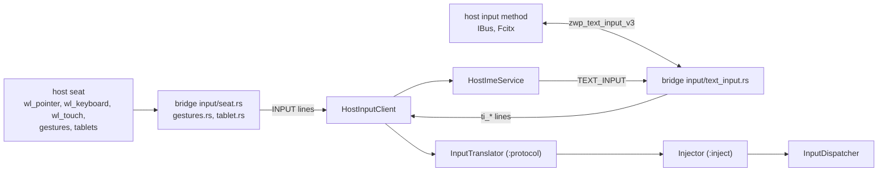
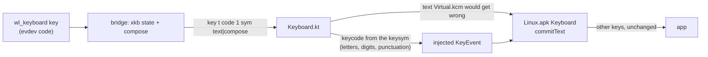

# Input

The host seat reaches Android through the bridge's input service, which only the
Linux.apk System app may open. The bridge turns `wl_pointer`, `wl_keyboard`,
`wl_touch`, touchpad gestures (`zwp_pointer_gestures_v1`) and tablets
(`zwp_tablet_v2`) into protocol v2 lines
([input/proto.rs](../host/bridge/src/input/proto.rs) lists every line); the
system app translates them into `MotionEvent`s and `KeyEvent`s and injects them
into InputDispatcher. The composer never sees input.

## Injection

The mapping follows what InputReader produces for real devices
(`CursorInputMapper`, the multi-touch mapper, `TouchInputMapper`'s stylus,
`GestureConverter` for touchpads, `KeyboardInputMapper`); the code is
`android/system-app/protocol/.../input/InputTranslator.kt`.

- **Per window.** The display id on `pointer_enter`, `keyboard_enter` and
  `touch_down` decides where the following events go (`setDisplayId`). Moving to
  another window first ends the hover or drag on the old one; a touch sequence
  stays on its first finger's window.
- **One injection stream.** InputDispatcher gives every injected event device id
  −1 and checks the stream with InputVerifier, so the mouse, touchscreen and pen
  must never overlap: touch or a pen during a mouse drag or touchpad gesture is
  dropped, and so is mouse input during a touch sequence or while the pen is in
  proximity. Leaving a window with a button held releases it (Wayland sends no
  release after `leave`).
- **Wheel.** A detent (`value120` 120) is one unit of `AXIS_VSCROLL` or
  `AXIS_HSCROLL`; hi-res wheels give fractions, as CursorInputMapper's hi-res
  scroll does. Continuous sources (trackpoints) convert surface pixels to
  display pixels and divide by `config_verticalScrollFactor`.
- **Touchpad scrolling** (`axis_source` finger) is what Android 14+ does for its
  own touchpads (GestureConverter): the hover exits, and a fake finger
  (`SOURCE_MOUSE`, `TOOL_TYPE_FINGER`, `CLASSIFICATION_TWO_FINGER_SWIPE`, the
  `AXIS_GESTURE_SCROLL_*_DISTANCE` axes) goes down at the cursor, moves with the
  content and lifts at `axis_stop`. The app flings from the finger's own
  velocity; Wayland sends no kinetic scrolling. A hold gesture after a scroll
  sends a fake finger down and cancels it, which stops the fling.
- **Touchpad pinch and swipes** are GestureConverter's too: a pinch is two fake
  fingers 200 px apart around the cursor (`CLASSIFICATION_PINCH`,
  `AXIS_GESTURE_PINCH_SCALE_FACTOR`) that spread with the scale, turn with the
  rotation and follow the center; a swipe of three or more fingers is fake
  fingers 100 px apart (`MULTI_FINGER_SWIPE`), which InputDispatcher gives only
  to system gesture monitors, never to apps, as with Android's own touchpads. A
  cancelled gesture is `ACTION_CANCEL`.
- **Pen.** A tablet tool in proximity is `SOURCE_STYLUS | SOURCE_TOUCHSCREEN`
  with `TOOL_TYPE_STYLUS` or `TOOL_TYPE_ERASER`: `HOVER_*` with `AXIS_DISTANCE`,
  `DOWN`/`MOVE`/`UP` with pressure (the lift repeats the last contact),
  `AXIS_TILT` and `AXIS_ORIENTATION` from the two tilt angles, and the stylus
  buttons as `BUTTON_STYLUS_PRIMARY` and `SECONDARY`, in TouchInputMapper's
  order.
- **Cursor.** The bridge sets the default arrow on every pointer enter and
  tablet proximity, and the frame's resize shapes over a client-side frame
  (`wp_cursor_shape_v1`).
- **Keys** follow the host layout (see [Keyboard layout](#keyboard-layout)). The
  scan code is always the evdev code. Meta state comes from the modifier keys
  and the xkb masks.
- **Repeat.** InputDispatcher synthesizes repeats for injected key downs. The
  bridge forwards `wl_keyboard.repeat_info`, and the system app writes it to
  Android's `key_repeat_timeout` (the delay, clamped to 150–2000 ms),
  `key_repeat_delay` (1000 / rate, 20–2000 ms) and `key_repeat_enabled` secure
  settings. A compositor that repeats keys itself (`wl_keyboard` v10, after a
  rate of 0, as KWin 6 does) sends repeated keys, which become downs with a
  repeat count. KWin also repeats a key that a host input method (such as
  plasma-keyboard) passed on as a press and release; each repeat is then a tap.
- **Window shortcuts.** Ctrl+W and Ctrl+Q close the window, as its close button
  does, and Alt+Left sends BACK to it; none of them reaches the app. Web
  browsers (apps that open any https link) keep Ctrl+W, which closes a tab. F11
  toggles fullscreen in the bridge. `persist.linuxapk.input.window_shortcuts=0`
  turns Ctrl+W, Ctrl+Q and Alt+Left off.
- **Escape stays Escape.** Android 17 already closes dialogs and popups on it;
  mapping it to BACK would break apps that use Escape. The mouse back button and
  the Back key send BACK; `persist.linuxapk.input.escape_back=1` opts in.
- **Timestamps** map the compositor's millisecond clock onto `uptimeMillis`,
  keeping the spacing VelocityTracker needs, clamped to the last 100 ms.
- **Why injection.** uinput isn't available rootless and would create a
  host-global device the compositor picks up; VirtualDeviceManager's input
  devices sit on uinput too.

## Keyboard layout

The bridge loads the compositor's xkb keymap with libxkbcommon (opened at run
time, `input/xkb.rs`, after winit's `common/xkb`) and keeps its state from the
`modifiers` events. Each press goes out with the key's level-1 keysym in the
active layout and what it types, composed from dead keys and the Compose key
with the locale's compose table. The system app's `Keyboard.kt` then follows
Mac.apk's host keymap:

- **Keycodes.** A character key whose level-1 keysym is a Latin letter, a digit
  or one of Android's punctuation keys gets that keycode, so shortcuts follow
  the layout: the AZERTY Z key is `KEYCODE_Z`, and Ctrl+Z undoes. Every other
  key keeps its physical keycode from AOSP's `Generic.kl`
  (`android/system-app/tools/gen-keymap.py` generates `EvdevKeymap.kt`):
  AZERTY's é key is `KEYCODE_2`, and Cyrillic layouts keep the QWERTY positions
  for shortcuts.
- **Text.** Injected keys type through `Virtual.kcm`, which is US. When the
  host's text for a press differs from what `Virtual.kcm` gives its keycode and
  meta state (é, Shift+& on AZERTY, ö, AltGr characters, composed characters),
  the key down carries that text, and the Linux.apk Keyboard, which sees every
  key before the app, commits it instead of passing the key on. Dead keys and
  the Compose key's steps type nothing. Ctrl and Meta chords are never text, and
  neither is an Alt chord whose text is the key's own.
- **Without the IME** (another input method chosen, or no text field) the app
  gets the key event alone, with the keycode above.
- **With a host input method** (IBus, Fcitx) it handles compose itself, so the
  keys it consumes never reach the bridge.

## Text input

"Linux.apk Keyboard" (`ime/HostImeService.kt`) connects Android text fields to
the host's input methods through the bridge's `zwp_text_input_v3`; its pure
logic is `TextInputSession.kt` in `:protocol`.

- **Default, never shown.** `ImeFeature` makes it the default input method at
  every start unless the user chose another than the stock LatinIME. It draws no
  input view, so no soft keyboard covers the window. The window manager's
  per-display IME policy is `LOCAL`: `HIDE` would bind no IME at all, and text
  input would stop.
- **Keys** still arrive as injected key events, which the IME passes through,
  except those whose text it commits ([Keyboard layout](#keyboard-layout)).
- **With a host input method** (CJK, dead keys, compose): for each editor the
  IME sends `ti_enable`, the content type (password, email, number, …), the
  surrounding text (up to 120 UTF-16 units each side) and the cursor rectangle,
  so the candidate window opens at the text cursor. The input method's results
  come back as `ti_*` lines and are applied in `zwp_text_input_v3`'s order in
  one batch edit: remove the preedit, delete surrounding text, commit, set the
  new preedit.
- **Limits:** `setComposingText` can only put the cursor at either end of the
  preedit; `TYPE_NULL` editors (terminals) get raw keys only.

## Known limits

- Notification progress and badge counts use Unity LauncherEntry: Plasma and
  Ubuntu Dock / Dash to Dock display them; stock GNOME Shell does not. No
  alternative is provided. Progress comes from `EXTRA_PROGRESS` or Android 16
  `ProgressStyle`. Unity has no indeterminate state, so busy work shows at 50%;
  multiple active tasks use their equally weighted mean. Badge counts count
  notifications eligible for Launcher3 dots (channel/ranking permits badges, no
  ongoing notifications or group summaries), not unread messages. Cancelling a
  notification or disconnecting clears its contribution.
- On Plasma, host Do Not Disturb suppresses desktop notification calls at the
  bridge, reading `org.freedesktop.Notifications.Inhibited` before each post.
  Progress and counts still update; suppressed popups are not replayed when DND
  ends. On GNOME, Shell applies its own DND policy to our host notifications:
  ordinary banners are suppressed, but critical call/alarm notifications can
  bypass DND. GNOME 48's portal does not export `show-banners`, so the bridge
  cannot suppress that exception without additional settings access (#79). The
  Android interruption filter is unchanged.
- Android sees no physical keyboard (`Configuration.keyboard`), and key events
  still carry `Virtual.kcm`'s characters: apps that read
  `KeyEvent.getUnicodeChar()` outside a text field (games, terminals' key
  handlers) see US characters for non-US keys. A KCM matching the host layout
  needs a real input device (#5).
- Window shortcuts are on or off for every app except browsers' Ctrl+W, until
  per-app settings exist (#24).
- Android draws no pointer for injected events, and pointer-icon changes aren't
  forwarded; the host cursor is the only cursor, and it stays the arrow (text
  fields show no I-beam, games can't hide it). Without `wp_cursor_shape_v1` the
  cursor over a window is whatever it was.
- Views that accept only `SOURCE_TOUCHSCREEN` ignore the touchpad's fake
  fingers, as on stock Android with a touchpad.
- Compositors keep most three- and four-finger swipes for themselves, and tablet
  pads (buttons, rings, strips) aren't forwarded.

## Tests

- `:protocol` unit tests (in `mise run test`): the line parser, keymap and
  translator, with a model of AOSP's InputVerifier run over every test plus
  random streams; `KeyboardTest` covers layouts, text, compose and the
  shortcuts. `cargo test -p linuxapk-bridge` resolves keys under keymaps
  compiled from RMLVO names (`fr`, `de`, `us` with `compose:ralt`).
- `mise run test:e2e -- input` opens the probes APK's `InputProbeActivity` in
  its own mapped desktop window, injects a short pointer/keyboard stream through
  our translator and injector, and checks click, scroll and Shift+A at the
  activity. Detailed translation cases stay in unit tests.
- The IME's text commits and the repeat settings need the bridge's seat: they
  are checked in a nested KWin with `org_kde_kwin_fake_input`
  ([development.md](development.md#a-nested-isolated-desktop)) and the probes'
  `TextProbeActivity`.
