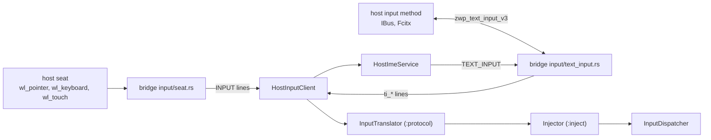

# Input

The host seat reaches Android through the bridge's input service, which only the
Linux.apk System app may open. The bridge turns `wl_pointer`, `wl_keyboard` and
`wl_touch` into protocol v2 lines
([input/proto.rs](../host/bridge/src/input/proto.rs) lists every line); the
system app translates them into `MotionEvent`s and `KeyEvent`s and injects them
into InputDispatcher. The composer never sees input.

## Injection

The mapping follows what InputReader produces for real devices
(`CursorInputMapper`, the multi-touch mapper, `KeyboardInputMapper`); the code
is `android/system-app/protocol/.../input/InputTranslator.kt`.

- **Per window.** The display id on `pointer_enter`, `keyboard_enter` and
  `touch_down` decides where the following events go (`setDisplayId`). Moving to
  another window first ends the hover or drag on the old one; a touch sequence
  stays on its first finger's window.
- **One injection stream.** InputDispatcher gives every injected event device id
  −1 and checks the stream with InputVerifier, so the mouse and touchscreen must
  never overlap: touch during a mouse drag is dropped, and so is mouse input
  during a touch sequence. Leaving a window with a button held releases it
  (Wayland sends no release after `leave`).
- **Scroll.** A wheel detent (`value120`) is one unit of `AXIS_VSCROLL` or
  `AXIS_HSCROLL`. Touchpad scrolling converts surface pixels to display pixels
  and divides by `config_verticalScrollFactor`, so content follows the fingers.
- **Keys.** Keycodes come from AOSP's `Generic.kl`
  (`android/system-app/tools/gen-keymap.py` generates `EvdevKeymap.kt`), with
  the evdev code as scan code. Meta state comes from the modifier keys and the
  xkb masks. Wayland sends no repeats; InputDispatcher synthesizes them for
  injected key downs.
- **Escape stays Escape.** Android 17 already closes dialogs and popups on it;
  mapping it to BACK would break apps that use Escape. The mouse back button and
  the Back key send BACK; `persist.linuxapk.input.escape_back=1` opts in.
- **Timestamps** map the compositor's millisecond clock onto `uptimeMillis`,
  keeping the spacing VelocityTracker needs, clamped to the last 100 ms.
- **Why injection.** uinput isn't available rootless and would create a
  host-global device the compositor picks up; VirtualDeviceManager's input
  devices sit on uinput too.

## Text input

"Linux.apk Keyboard" (`ime/HostImeService.kt`) connects Android text fields to
the host's input methods through the bridge's `zwp_text_input_v3`; its pure
logic is `TextInputSession.kt` in `:protocol`.

- **Default, never shown.** `ImeFeature` makes it the default input method at
  every start unless the user chose another than the stock LatinIME. It draws no
  input view, so no soft keyboard covers the window. The window manager's
  per-display IME policy is `LOCAL`: `HIDE` would bind no IME at all, and text
  input would stop.
- **Keys** still arrive as injected key events, which the IME passes through, so
  without a host input method nothing changes.
- **With a host input method** (CJK, dead keys, compose): for each editor the
  IME sends `ti_enable`, the content type (password, email, number, …), the
  surrounding text (up to 120 UTF-16 units each side) and the cursor rectangle,
  so the candidate window opens at the text cursor. The input method's results
  come back as `ti_*` lines and are applied in `zwp_text_input_v3`'s order in
  one batch edit: remove the preedit, delete surrounding text, commit, set the
  new preedit.
- **Limits:** `setComposingText` can only put the cursor at either end of the
  preedit; `TYPE_NULL` editors (terminals) get raw keys only.

## Known limits

- Android sees no physical keyboard (`Configuration.keyboard`), and characters
  come from `Virtual.kcm`, so the host's xkb layout is ignored (US only).
- Android draws no pointer for injected events, and pointer-icon changes aren't
  forwarded; the host cursor is the only cursor.
- Touchpad gestures arrive as plain scrolls: no fling, pinch or rotate.

## Tests

- `:protocol` unit tests (in `mise run test`): the line parser, keymap and
  translator, with a model of AOSP's InputVerifier run over every test plus
  random streams.
- `tests/e2e/system-app/run.sh` (in `mise run test:e2e`): opens the probes APK's
  `InputProbeActivity` in its own window, injects `probe-stream.txt` through the
  app's translator and injector, and checks the events (hover, click, scroll,
  Shift+A, Escape, two fingers) and that the dispatcher reported no inconsistent
  event.
