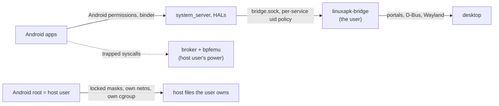

# Security

## Threat model: desktop parity

An Android app may do what a native desktop app running as the user can do.
Linux.apk adds no protection that costs complexity, hacks or performance beyond
that.

- **Kept:** isolation that comes free from the namespaces the session needs
  anyway, and simple bounds and correctness checks (sizes, overflow, never
  writing into the wrong process).
- **Out of scope:** making host helpers robust against deliberately malicious
  Android processes, such as session-wide denial of service or kernel-exact
  fault semantics for malformed requests that only hurt the caller.
- **The outer boundary** is the packaging (Flatpak), as for any desktop app.

## Trust boundaries

- **Android root is the host user.** Inside the user namespace it has the user's
  file access, limited by what the session mounts:
  [session.md](session.md#host-safety) lists the masks, namespaces and binds,
  and `selftest` proves them.
- **The supervisor** (pivot-exec's bpf thread and the broker) runs in the outer
  namespaces with the host user's privileges and reads and writes Android
  processes' memory. It serves only callers inside the session's seccomp filter.
  It keeps bounds checks and pins each process's memory at binder open so writes
  never land in the wrong process, but a process that misbehaves on purpose can
  stop binder for the whole session; that is accepted.
- **The bridge** runs as the user and talks to the desktop. Its socket is the
  only channel out of Android ([bridge-protocol.md](bridge-protocol.md)).

## The bridge socket

- The socket directory is bound into Android as `/dev/socket/linuxapk`,
  `root:audio 0750`; the system app gets the `audio` group through its
  `HOST_BRIDGE` permission.
- `SO_PEERCRED` is checked against an allow-list: Android root (the user),
  `system` and `audioserver` (their subordinate uids in subuid mode).
- The system app's uid (the owner of its data directory) is admitted to the
  system, documents and apps services. The **input service is the system app's
  alone**, since its lines are the user's keystrokes.
- One service per connection (HELLO); anything else gets `-EACCES` or `-EPROTO`
  and is closed.

## Single-uid mode

Every Android process is the same kernel uid, so **apps are not isolated from
each other**: any app can read or write another app's files and signal its
processes. Binder, PackageManager and AppOps still see the right virtual uids,
but that is policy enforced by Android's own processes, not by the kernel.

- This matches one desktop user running several native apps, which is the threat
  model. The CLI and manager show a one-time notice.
- The host user's supplementary groups can't be dropped without a subgid range;
  `selftest` checks that they are unmapped inside and that no bound host path
  belongs to one of them.
- **Accepted:** the bridge sees every Android process as the user, so its uid
  checks admit any app to every service, including input. That matches desktop
  parity: a native app running as the user can reach the same desktop services.

## Flatpak mode

The Flatpak sandbox is the boundary, as for any Flatpak app
([session.md](session.md#flatpak-mode)). Android has no network namespace of its
own there: it uses the host's network, as a native app with `--share=network`
does, and netd's routing and firewall rules are accepted and ignored, so per-app
network restrictions don't apply. Only single-uid mode exists, and there are no
cgroups: a session has no memory cap of its own.

## Desktop exposure

- **Links:** only absolute `http(s)` URLs, rate-limited, through the OpenURI
  portal.
- **Files:** Android reaches only what the user picked in the FileChooser
  portal, through opaque grants and `openat2(RESOLVE_BENEATH)`; the bridge is
  the only side that sees host paths.
- **Clipboard:** synced both ways through `ext_data_control_v1`, so Android sees
  host selections while a session runs; sensitive clips carry the
  password-manager hint.
- **Notifications and MPRIS:** labels and images from apps; images are raw RGBA,
  so nothing Android sends reaches a host image decoder.
- **Desktop entries:** names, schemes and URIs from APKs are validated and
  escaped; `http(s)`, `file`, `content` and `intent` schemes are never
  registered.

## Test sessions

A named `LINUXAPK_INSTANCE` makes a test session that leaves the user's desktop
alone: links are logged, not opened (unless `LINUXAPK_OPEN_URLS=1`),
notifications and MPRIS players are only logged unless the session talks to a
private bus (a nested test desktop), and apps installed inside Android get no
desktop entries. Clipboard sync and the FileChooser portal still reach the real
desktop; that is tracked on GitHub.
