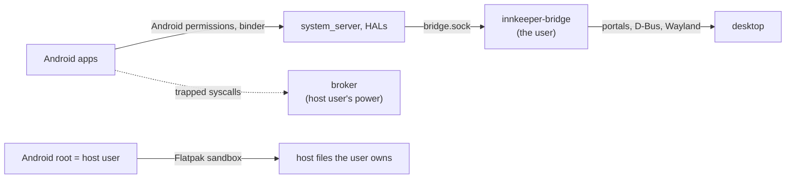

# Security

## Threat model: desktop parity

An Android app may do anything a native desktop app running as the user can do.
Innkeeper adds no protection beyond that if the protection costs complexity,
workarounds or performance.

- **Kept:** the isolation that the Flatpak sandbox provides, and simple bounds
  and correctness checks, such as sizes, overflow and writes into the wrong
  process.
- **Out of scope:** making host helpers robust against malicious Android
  processes. This includes session-wide denial of service, and matching the
  kernel's fault semantics for malformed requests that hurt only the caller.
- **The outer boundary** is the Flatpak packaging, as for any desktop app.

## Trust boundaries

- **Android root is the host user.** It has the user's file access, limited by
  the Flatpak sandbox. [session.md](session.md#host-safety) lists the sandbox's
  grants and probes, and `selftest` checks them.
- **The supervisor** is the Rust broker. It runs in the sandbox with the host
  user's privileges and reads and writes the memory of Android processes. It
  serves only callers inside the session's seccomp filter. It checks bounds, and
  it pins each process's memory when the process opens binder, so that its
  writes go to the right process. A process that misbehaves on purpose can stop
  binder for the whole session. This is accepted.
- **The bridge** runs as the user and talks to the desktop. Its socket is the
  only channel from Android to the desktop
  ([bridge-protocol.md](bridge-protocol.md)).

## The bridge socket

- The socket directory is linked into Android as `/dev/socket/innkeeper`, with
  owner `root:audio` and mode `0750`. The system app gets the `audio` group
  through its `HOST_BRIDGE` permission.
- The bridge checks `SO_PEERCRED` against the host user, which every Android
  process runs as.
- Each connection names one service in its HELLO. Any other first message gets
  `-EPROTO`, and the bridge closes the connection.

## App isolation

Every Android process runs as the same kernel uid, so **apps are not isolated
from each other**. Any app can read or write another app's files and signal its
processes. Binder, PackageManager and AppOps still see the correct virtual uids,
but Android's own processes enforce that policy, and the kernel does not.

- This matches one desktop user running several native apps, which is the threat
  model. The README and the manager's Preferences page say so.
- Host supplementary groups are not mapped in the sandbox. `selftest` checks
  that no host group is mapped.
- **Accepted:** the bridge sees every Android process as the user, so its uid
  checks let any app use every service, including input. This matches desktop
  parity, because a native app running as the user can reach the same desktop
  services.

## The sandbox

The Flatpak sandbox is the boundary, as for any Flatpak app
([session.md](session.md)). `selftest` checks the sandbox's grants and what the
sandbox shows Android.

- **Network.** Android has no network namespace of its own. It uses the host's
  network, as a native app with `--share=network` does. netd's routing and
  firewall rules are accepted and ignored. As a result, per-app network
  restrictions and traffic statistics don't exist, and data-usage and firewall
  apps can't work. The sandbox has no TUN device, so `VpnService` apps can't
  start a VPN. Both limits are accepted.
- **No cgroups.** A session has no memory cap of its own. Development and test
  sessions are capped from the host. The app gets no systemd permission.
- **Input devices.** `--device=input` lets the bridge open the controllers that
  the user can already access through uaccess ACLs, and write rumble effects to
  them. The grant also lets every Android app read the host's input devices,
  including keyboards and mice, as any Flatpak app with that grant could. This
  is accepted for controller support. EventHub and OpenHarmony's MMI scan the
  broker's private discovery directory so that keyboard, mouse and controller
  input isn't duplicated. That routing is not an access boundary. The grant
  needs Flatpak 1.15.6 or newer, and Debian 13 ships 1.16.

The Flatpak has these grants: `--device=dri`, `--device=input`,
`--share=network`, `--share=ipc`, `--socket=wayland`, `--socket=pulseaudio`, and
read-only access to `~/.android/adbkey.pub` for [adb](#desktop-exposure). It
also talks to these bus names, which cover what the baseline portals and proxies
lack:

- `org.a11y.Bus`: the baseline AT-SPI proxy hides the `org.a11y.Status`
  properties that the bridge follows.
- `org.freedesktop.UPower` on the system bus: there is no battery portal.
- `org.freedesktop.Notifications`: the Notification portal can't update a
  notification in place or show progress.

MPRIS players own names under `org.mpris.MediaPlayer2.dev.sargunv.Innkeeper`.
Flatpak grants every app the names under its own id. Links and files go through
the same portals that native Flatpak apps use. App-menu entries go through the
DynamicLauncher portal, so the user confirms each one. Clipboard sync uses the
data control protocol where the compositor offers it (KWin). Otherwise it uses
the display connection while an Innkeeper window has focus (GNOME).

## Desktop exposure

- **Links:** the bridge opens only absolute `http` and `https` URLs, through the
  OpenURI portal, with a rate limit.
- **Files:** Android reaches only the files the user picked in the FileChooser
  portal. It gets them through opaque grants and `openat2(RESOLVE_BENEATH)`.
  Only the bridge sees host paths.
- **Clipboard:** text, images and bounded file selections sync through
  `ext_data_control_v1`, or through `wl_data_device` while an Innkeeper window
  has focus. Files copied in a file manager come through FileTransfer portal
  grants. Plain file URIs can read only paths that the Flatpak already has. On
  the Android side, a file clip is a private cache copy that pasting apps read
  through a read-only content URI. Sensitive clips carry the password-manager
  hint. Test sessions disable both backends.
- **Notifications and MPRIS:** apps supply the labels and images. Images are raw
  RGBA, so nothing Android sends reaches a host image decoder.
- **Accessibility:** while the desktop's assistive technologies are on
  (`org.a11y.Status`), the system app's accessibility service sends the
  AccessibilityNodeInfo tree of every app window to the bridge. The bridge
  publishes it on the AT-SPI bus. Any AT-SPI client can then read the screen
  text of Android apps and act on them, as it can with native apps. Password
  fields are masked. While assistive technologies are off, the Android service
  stays off.
- **Desktop entries:** names, schemes and URIs from APKs are validated and
  escaped. The `http`, `https`, `file`, `content` and `intent` schemes are never
  registered.
- **Host state:** every Android app can see the battery (UPower), the power
  saver (the PowerProfileMonitor portal) and whether the network is metered (the
  NetworkMonitor portal). Any desktop app can read this state, and Android gets
  it read-only.
- **adb** is off for each profile until the user turns it on. When it is on, the
  image's adbd listens on a loopback port that belongs to the profile, with adb
  authentication on (`ro.adb.secure=1`). Only keys in the profile's
  `/data/misc/adb/adb_keys` can connect, and Innkeeper adds the user's
  `~/.android/adbkey.pub` there. Other users of the host can't connect. The
  Flatpak can read only that public key. Unchanged, the image would start adbd
  at every boot on port 5555 without authentication. The overlay's `usbd.rc` and
  `init.usb.rc` keep it from starting.
- **Location** needs two consents. Android's runtime permission comes first.
  When an app that Android allowed asks for a location, the bridge asks the
  Location portal, through one portal session for all of Android. If the user
  refuses there, or location is off on the desktop, Android's location providers
  stay off until the bridge restarts. Apps keep their Android permission. If the
  portal is unavailable, Android gets no location.

## Test sessions

Every test harness sets `INNKEEPER_TEST=1`. The dev runner also sets it unless
it runs in a nested desktop, and `INNKEEPER_TEST=0` turns it off. The variable
reaches the bridge through the session's environment, which a wakeup keeps. It
keeps tests away from the user's desktop, including when tests use a private
bus:

- Links, notifications and MPRIS players are only logged.
- AT-SPI and location are off.
- Apps installed inside Android get no desktop entries.
- Clipboard sync is off in both directions, and the bridge doesn't connect to
  the compositor's clipboard.
- A documents PICK completes at once with `-ECANCELED` and no items, and the
  FileChooser portal doesn't open.
- The system service doesn't connect to the desktop's Settings,
  PowerProfileMonitor or NetworkMonitor portals.

Battery readings come from the caller's system bus (`DBUS_SYSTEM_BUS_ADDRESS`),
which tests point at mocks.
