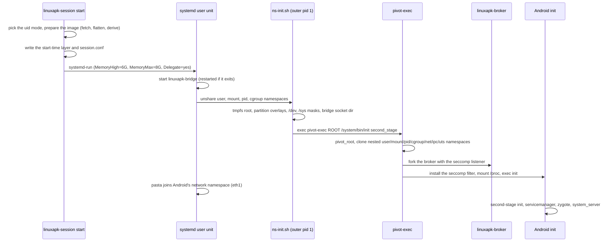
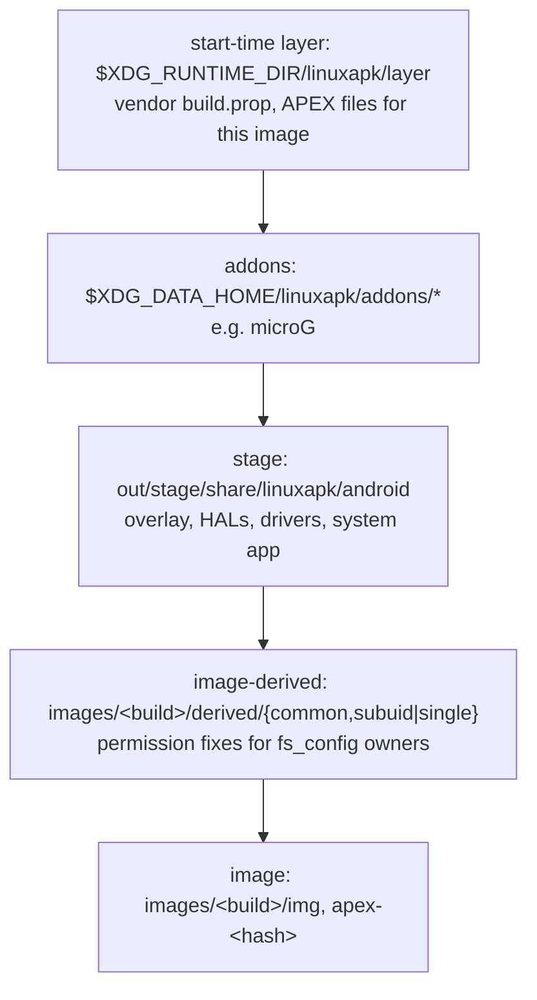

# The session

A session is one rootless Android instance: a transient systemd user unit that
holds the bridge, pasta and two levels of namespaces with Android's real `init`
inside. `linuxapk-session` ([host/launcher](../host/launcher/README.md)) starts
it; `linuxapk run` and the manager start it on demand.

## Boot

- **Second-stage init directly.** The launcher does first stage's job: it mounts
  `/dev`, `/proc` and `/sys`, and passes `androidboot.*` values through a fake
  `/proc/bootconfig` (`androidboot.hardware=linuxapk`, plus the vendor APEX
  selection in [image/bootconfig](../image/bootconfig)).
- **Nested, locked namespaces.** The outer user namespace maps root to the host
  user (plus Android's uid ranges in subuid mode). pivot-exec clones init into
  nested namespaces with an identity map, so every inherited mount is
  `MNT_LOCKED` (the bubblewrap technique) and Android's root can't unmount the
  masks over host sysfs.
- **SELinux hidden.** `/sys/fs/selinux` is an empty tmpfs, so libselinux reports
  SELinux disabled. The LD_PRELOAD shim turns the call sites that still assume a
  policy into no-ops ([supervisor/shim](../supervisor/README.md)); init unsets
  `LD_PRELOAD` for its children, so the rc files of services that need it set it
  again.
- **APEXes pre-flattened.** apexd can't mount APEXes without loop or dm devices.
  The launcher binds a flattened tree over `/apex`, and the `linuxapk-apexd`
  wrapper shows apexd matching `/proc/mounts` entries so it reports every APEX
  active.
- **eBPF emulated.** netd, netbpfload and system_server's JNI code use `bpf()`,
  which an unprivileged namespace can't. The seccomp supervisor emulates maps
  and pins; program loads and attaches succeed and do nothing, so per-app
  traffic accounting and the per-uid firewall are no-ops.
- **iptables on nf_tables.** The image's legacy iptables needs kernel modules;
  ours uses nf_tables in the session's own network namespace, and its wrapper
  drops `-m bpf` and netd's `quota2` rules
  ([android/system](../android/system/README.md)).
- **Networking through pasta.** pasta's tap is `eth1`, which EthernetService
  brings up as the default network (DHCP from pasta). DNS goes to `169.254.1.1`,
  which pasta forwards to the host's first IPv4 resolver. There is no inbound
  forwarding, and `--no-map-gw` keeps host loopback services unreachable.

## Overlay stack

Every partition is a read-only overlayfs; nothing in the image cache is ever
modified.

The topmost layer wins. `/apex` stacks the start-time layer, the uid mode's
derived layer and the flattened APEX tree. The derived layers exist because the
extracted image lost its `fs_config` owners: `common` adds read and exec bits,
`subuid` chowns files whose owner code verifies, and `single` records those
owners in the `user.linuxapk.owner` xattr instead.

## Uid modes

The mode is automatic and fixed per `/data`:

- **subuid:** when `/etc/subuid` and `/etc/subgid` give the user at least 49999
  ids each and `newuidmap` is installed. Android's uids are real host
  subordinate uids, so the kernel isolates apps from each other.
- **single:** otherwise (for example inside Flatpak). Only root is mapped, and
  every Android process is the host user; the supervisor gives each process
  virtual credentials ([supervisor/README.md](../supervisor/README.md)). Apps
  are **not** isolated from each other in this mode
  ([security.md](security.md#single-uid-mode)); the CLI and manager say so once.

An existing `/data` keeps the mode it was made in: the launcher reads it from
the owner of `/data/system`.

## Where things live

| Dir                                      | Contents                                                                                                                                      |
| ---------------------------------------- | --------------------------------------------------------------------------------------------------------------------------------------------- |
| `$XDG_DATA_HOME/linuxapk/`               | `images/<build>/{img,apex-<hash>,derived}` (shared by every instance), `data[-<instance>]/` (Android's `/data`), `addons/`, `test-bin/` (dev) |
| `$XDG_STATE_HOME/linuxapk[-<instance>]`  | `session.log`, `kmsg.log`, `bridge.log`, `documents.grants`                                                                                   |
| `$XDG_STATE_HOME/linuxapk/notices/`      | one-time notices already shown (shared by every instance)                                                                                     |
| `$XDG_RUNTIME_DIR/linuxapk[-<instance>]` | `session.conf`, pid files, the kmsg FIFO, `bridge/bridge.sock`, `layer/`, `root/`                                                             |

`LINUXAPK_INSTANCE` names an independent session for tests; its suffix goes on
every per-instance path and the unit name.

## Host safety

Inside the user namespace Android's root is the host user, so it can touch
anything the user owns (an early vold shutdown aborted every host FUSE mount).
The session therefore:

- masks and locks host sysfs submounts, keeps `/sys` read-only and shows no FUSE
  connections;
- has its own network (pasta), IPC and UTS namespaces;
- runs in its own delegated cgroup with a memory cap;
- binds only `/data`, the kmsg FIFO, the bridge directory and the device nodes
  null, zero, full, random, urandom, fuse, udmabuf and `/dev/dri`, never
  `/run/user`, `$HOME` or `/dev` wholesale;
- drops host supplementary groups (subuid mode), or proves them unusable inside
  (single mode).

`linuxapk-session selftest` probes all of this against a live session, and
`mise run test:boot` runs it in both uid modes. Every change that touches the
session must keep it passing.

## Numbers

Measured on the dev host (Strix Halo, RADV), headless, CI image 16644040:

- Boot to `sys.boot_completed`: about 4.9 s on a fresh `/data`, 2.6 s warm, in
  both uid modes.
- Idle session: `memory.current` 0.8 to 1.3 GB (about 520 MiB anonymous).
- Binder through the broker: 15 µs per round trip against 3.8 µs for kernel
  binder; the difference doesn't show in boot time or the compat corpus.
