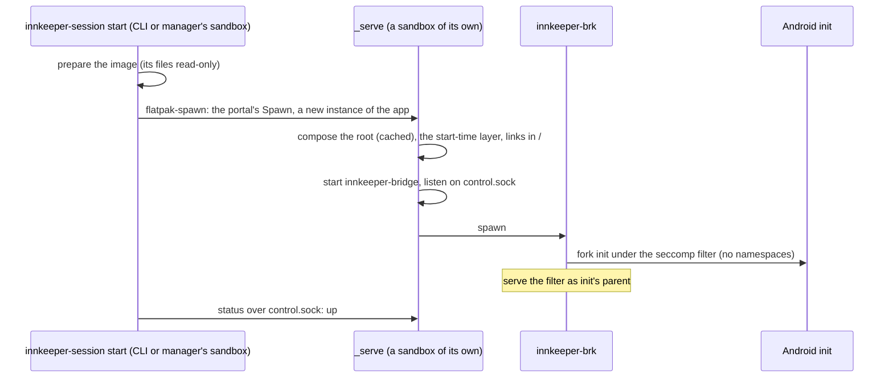
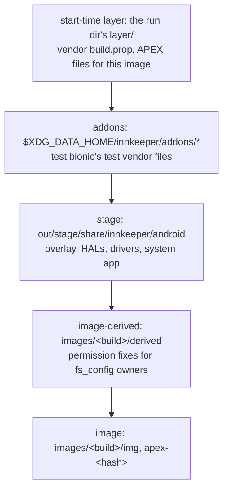
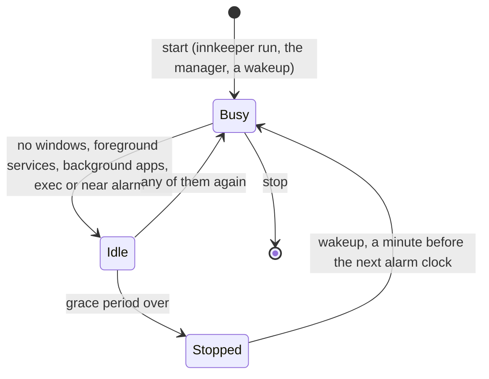

# The session

A session is one rootless Android userspace that runs inside Innkeeper's Flatpak
sandbox. It contains the bridge and Android's real `init`. This page describes
Android sessions. An OpenHarmony profile's session follows the same path with
OpenHarmony's root and init ([ohos/README.md](../ohos/README.md#how-it-boots)).

`innkeeper-session` ([host/launcher](../host/launcher/README.md)) starts a
session on demand, and the session stops itself when nothing needs it
([Lifecycle](#lifecycle)). The `start` command prepares the pinned image and
writes `session.conf`, which holds the paths, the image and the bridge setup.
The launcher supplies the root, the flattened APEXes and the bootconfig for
second-stage init. The supervisor emulates binder, eBPF and credentials.

The session runs in the app's Flatpak sandbox. That sandbox allows no mounts,
namespaces, capabilities or systemd units. Its seccomp filter fails those calls
with `EPERM` before Innkeeper's filter sees them. The sandbox's `/`, `/dev` and
`/sys` are writable tmpfs directories that belong to the sandbox, so the
launcher builds Android's root from symlinks.
[packaging/flatpak](../packaging/flatpak/README.md) builds the Flatpak.

The session lives as long as the process that started it, because that process
owns the sandbox. The process is `_serve`, or `start -f` running in the sandbox
of whatever ran it. Other instances of the app, such as the CLI and the manager,
have their own pid namespace and `/`. They run `status`, `exec` and `stop`
through `control.sock` in the app's runtime directory, which every instance
shares. A session ends on `stop`, on a signal or when init exits. The launcher
then stops and kills everything it started. As the sandbox's main process, it
also kills everything else in the sandbox, because Android processes orphaned by
a dying init would otherwise keep the sandbox alive.

The launcher composes `$XDG_DATA_HOME/innkeeper/root-<profile>` from hardlinks
to the read-only image cache and from copies of the layers. All of it is
read-only. Across filesystems it uses reflink copies instead of hardlinks.
`.compose-key` invalidates the composed root when the image, the stage or the
addons change. Each start copies the start-time layer over the composed root.
Symlinks in `/` expose `/system`, `/apex` and `/data`. `/etc` keeps the
sandbox's files and gains Android's other files.

The broker injects memfds for `/innkeeper/proc/<path>` on `openat`. It rewrites
`readlink` and `getcwd` results to Android paths, and it shows the user's files
as owned by root. The broker also shows init as pid 1 to `SO_PEERCRED`. The shim
treats refused mounts and namespace calls as successful. Capabilities are
virtual. `/sys/fs/cgroup` is a plain directory, so there is no cgroup freezer.
`/data/user/0` links to `/data/data`, and `/storage/emulated` links to
`/data/media`. There is no FUSE, so MediaStore does not index shared storage.

Android uses the host's network (`--share=network`). The system app offers it as
Android's default network, follows the sandbox's `/etc/resolv.conf` and applies
the host's metering. Netd's routes, firewall rules and socket marks are accepted
and ignored. lmkd's PSI windows are widened to 2 s, the minimum for unprivileged
triggers. `start` warns on kernels older than Linux 6.5, which lack unprivileged
PSI triggers. The supervisor requires Linux 5.14.

**There is no memory cap.** Flatpak puts each instance in its own scope, and a
sandbox cannot create units or cgroups, so the session cannot cap itself.
Android reacts to memory pressure through lmkd (PSI). Beyond that, the host's
OOM handling applies, as it does for any Flatpak app. Asking systemd for a cap
would let the app start any unit, which is a sandbox escape.

Development and test sessions get the usual 6 GiB high and 8 GiB maximum limits
from outside. The dev driver sets them on the session's Flatpak scope from the
host ([packaging/flatpak](../packaging/flatpak/README.md#development)).

## Overlay stack

The composed root combines these layers. Nothing in the image cache is modified.

The topmost layer wins. The props for `/vendor/build.prop` come from the stage's
`share/innkeeper/props.d/`, and the launcher merges them into the start-time
layer. `/apex` combines the start-time layer, the derived layer's `apex/` and
the flattened APEX tree. The extracted image has lost its `fs_config` owners.
The derived layer adds read and exec bits to partition files. It also records
the owners that Android verifies, such as clatd's, in the `user.innkeeper.owner`
xattr.

Every Android process runs as the host user. The supervisor supplies virtual
Android credentials ([supervisor](../supervisor/README.md)). Apps are not
isolated from each other ([security.md](security.md#app-isolation)).

## Lifecycle

A session stops itself when nothing needs it, as a desktop app quits when its
last window closes. It starts again for the next alarm.

- **Activity.** The system app sends a `LIFECYCLE` report to the bridge's system
  service whenever one of its parts changes (`integration/lifecycle/`). The
  report lists the windows, the user apps' running foreground services, the next
  alarm clock and the apps allowed in the background. The bridge writes it to
  `<run>/lifecycle`, and the launcher checks it every 5 s. The session counts as
  busy when there is no report yet, for example while booting or while the
  system app restarts. It also counts as busy while an `exec` runs, which holds
  `exec.lock` shared, and when an alarm is less than 3 minutes away or ago.
- **OpenHarmony.** OpenHarmony's system app reports user apps' running
  continuous tasks as services (`ohos/system-app/ets/lifecycle/`). The bridge
  adds OpenHarmony's screen window to the windows, so the session stays up while
  that window is open, even on the home screen. Closing the window starts the
  grace period. No OpenHarmony API lists other apps' reminders, so the report
  has no wakeup, and a stopped session misses reminders.
- **Idle timeout.** The profile's `idle-minutes` setting is the grace period
  before the launcher stops an idle session, as `stop` does. The default is 2
  minutes, and Keep Running disables it. A change applies to a running session.
  Headless sessions, which tests use, do not stop by themselves. Apps that are
  not allowed in the background stop with the session, as if force-stopped.
  Their jobs and syncs wait for the next start.
- **Foreground services** keep the session up. A media app keeps playing after
  its window closes, and its session stays an MPRIS player. Its notification
  shows on the desktop as resident while the app has no window. Clicking that
  notification or calling MPRIS `Raise` opens the window again.
- **Background apps.** `innkeeper app set PKG --background on` lets an app run
  with no window open. It is off by default, and the system app stores the
  setting. While such an app is installed, the session does not stop. The
  desktop shows a resident "Running in the background" notification that names
  those apps.
- **Wakeups.** Android forgets alarms when it stops, and apps set them again on
  `BOOT_COMPLETED`. The launcher therefore starts the session a minute before
  the next alarm clock (`AlarmManager.getNextAlarmClock`, which clock apps use).
  No API exposes other exact alarms, so they do not wake a stopped session.
  `start` and `stop` cancel a pending wakeup. A sandbox cannot create timers,
  and the Background portal has none, so the session's process stays in its
  sandbox as a waiter. The waiter serves `status` (`stopped`, `wakeup=<ms>`) and
  `stop` on `control.sock`. At the wakeup time it runs `start`, which starts the
  session in a new sandbox, because the waiter's `/` holds the last boot's
  runtime files. When no window is open, the process asks the Background portal
  to keep running. This covers a waiter, a foreground service and a background
  app.

## Where things live

| Dir                                                  | Contents                                                                                                                                                                                                                             |
| ---------------------------------------------------- | ------------------------------------------------------------------------------------------------------------------------------------------------------------------------------------------------------------------------------------ |
| `$XDG_DATA_HOME/innkeeper/`                          | `images/<build>/{img,apex-<hash>,derived}` (every guest's, shared by every profile), `data-<profile>/` (the guest's `/data` and `.innkeeper-profile.toml`, the profile's settings), `root-<profile>/` (the composed root), `addons/` |
| `$XDG_STATE_HOME/innkeeper-<profile>/`               | `session.log`, `kmsg.log`, `bridge.log`, `documents.grants`                                                                                                                                                                          |
| `$XDG_CONFIG_HOME/innkeeper/`                        | `preferences.toml`: Keep Running, shared by every profile                                                                                                                                                                            |
| `$XDG_STATE_HOME/innkeeper/`                         | `manager-profile`, the profile the manager showed last                                                                                                                                                                               |
| `$XDG_RUNTIME_DIR/app/<app id>/innkeeper-<profile>/` | `session.conf`, `control.sock`, the kmsg FIFO, `bridge/bridge.sock`, `layer/`, `lifecycle`, `exec.lock`; every instance of the app shares it                                                                                         |

Every per-profile path includes the profile's name.

## Profiles

A profile is a separate Android or OpenHarmony setup with its own apps, data and
settings. A session is a running profile, and profiles can run side by side. A
profile's system is chosen when the profile is created, with
`innkeeper profile create --system ohos NAME` or the manager's New Profile. The
system cannot change later, because the data belongs to that system.

Innkeeper lists profiles from their `data-<name>` directories.
`innkeeper profile` and the manager's Profiles page create, rename, delete,
start and stop them (`host/core/src/profiles.rs`). No profile is special. A
command names a profile with `--profile NAME`. Without it, the CLI uses
`default` and creates it the first time. An app entry runs
`innkeeper --profile NAME run PKG` and records `X-Innkeeper-Profile`. The
manager opens on the profile it showed last. Core takes the profile from its
caller. Only the launcher and the programs it starts read `INNKEEPER_PROFILE`.
Tests use named profiles with fresh data directories.

A profile's settings live in one file, `.innkeeper-profile.toml`, in its data
directory next to the data version record (`host/profile/src/profile.rs`). The
settings therefore move and back up with the data. They cover the system, the
display, adb and its port, the idle timeout and following the desktop. A missing
file or setting takes its default, and an unknown setting is an error.
OpenHarmony uses the display setting, which is a phone preset because
OpenHarmony has no windowed mode, the idle timeout, and the settings for
following the desktop. OpenHarmony has no accent color. The CLI and the manager
refuse adb and following the accent for OpenHarmony, along with app settings and
opening files in apps. `innkeeper profile set` and the manager's Profile
Settings page change settings. A running profile applies the live settings at
once.

Keep Running is an Innkeeper preference shared by every profile
(`$XDG_CONFIG_HOME/innkeeper/preferences.toml`). With it on, no profile stops
when idle, and every profile starts at login.

Deleting a profile removes its data, settings, composed root, logs, runtime
files and app-menu entries. Renaming a profile moves them and recomposes the
root. Both operations need the profile stopped.

## Image upgrades and data recovery

`prepare` prepares the read-only image cache and nothing else. On `start`, the
launcher checks `/data/.innkeeper-data-version` before it changes anything in
`/data`. The record identifies a framework by its Android SDK level and then by
its numeric AOSP CI build ID, both read from the system image's `build.prop`.
Renaming a pin does not change its version. Equal versions and upgrades reuse
the existing data. Non-numeric framework versions are unsupported and fail
before the data is opened.

The launcher durably records `started` before Android can open the data. Init
records `booted` after `sys.boot_completed=1`. An interrupted first boot keeps
the previous successful version. To retry, start the same image or a newer one,
and Android runs its usual startup recovery. Even a failed boot may have
migrated the data, so the launcher refuses a framework older than either
recorded version. The error names the data directory, both versions and the
recovery choices. Data with no record is adopted on its next start. Back it up
first if its history is uncertain.

An image rollback does not roll back `/data`. The README therefore tells users
to back up a profile's whole data directory before upgrading. The way back is to
restore that backup with the matching older framework. Editing or deleting the
version record cannot undo Android's migrations. `INNKEEPER_DATA` overrides the
data location. Development sessions use
`out/dev/flatpak/<profile>/android-data`.

## Host safety

The Flatpak sandbox is the security boundary. `selftest` checks the sandbox's
filesystem and device grants and both seccomp filters. It also checks that the
session sees no host home, block devices or FUSE connections and cannot reach
the host Flatpak service. Supplementary groups must be unmapped, sysfs
unwritable, mounts and sysrq refused, and capabilities and new privileges
absent. `mise run test:e2e -- boot` runs `selftest` against a fresh named
session. See [security.md](security.md).
