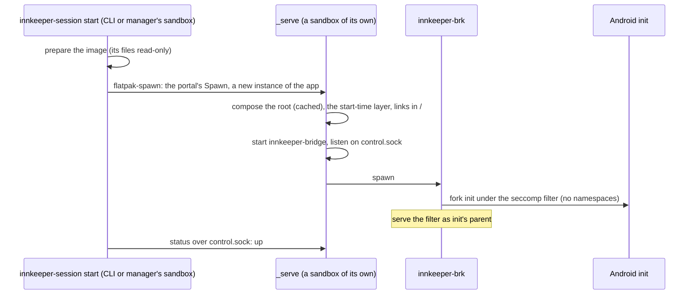
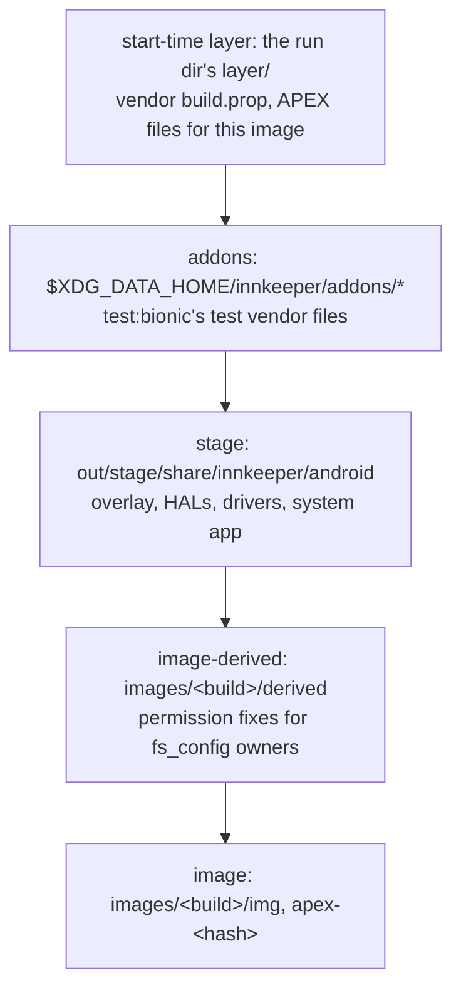
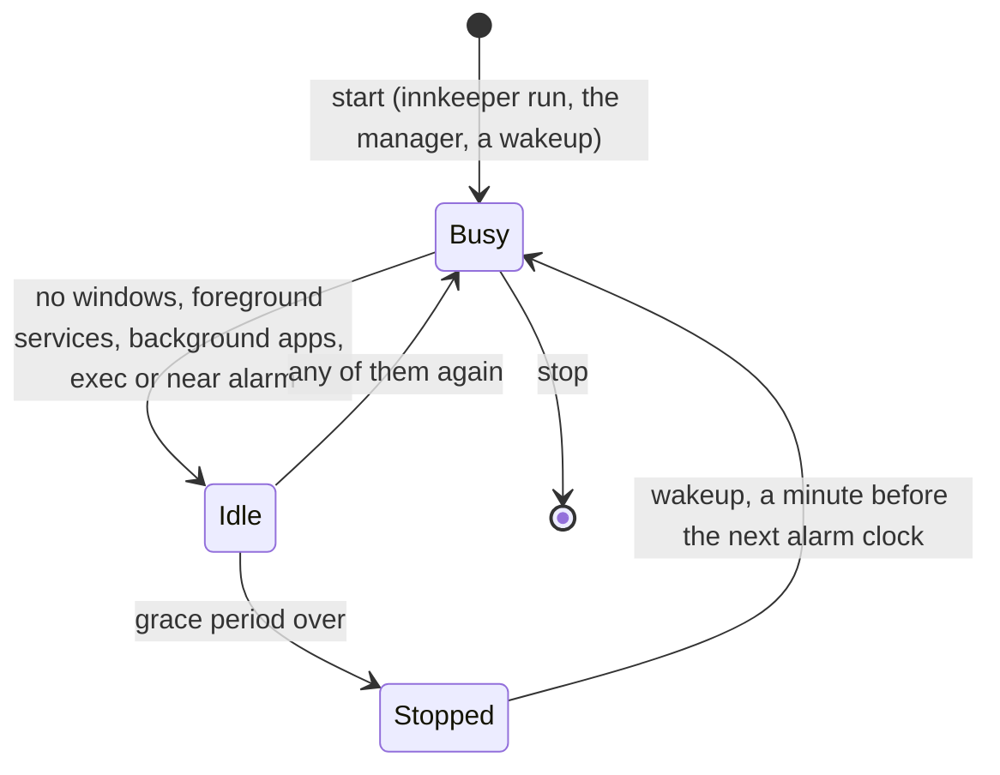

# The session

A session is one rootless Android userspace inside Innkeeper's Flatpak sandbox,
with the bridge and Android's real `init`. `innkeeper-session`
([host/launcher](../host/launcher/README.md)) starts it on demand; it stops
itself when nothing needs it ([Lifecycle](#lifecycle)). `start` prepares the
pinned image and writes `session.conf` with the paths, image and bridge setup.
The launcher supplies second-stage init's root, flattened APEXes and bootconfig;
the supervisor emulates binder, eBPF and credentials.

The session runs in the app's own sandbox, which allows no mounts, no
namespaces, no capabilities and no systemd units (its seccomp filter fails them
with `EPERM` before ours sees them). The sandbox's `/`, `/dev` and `/sys` are
writable tmpfs dirs of its own, so Android's root is built from symlinks.
[packaging/flatpak](../packaging/flatpak/README.md) builds the Flatpak.



The session lives as long as the process that started it, which owns its
sandbox: `_serve`, or `start -f` in the sandbox of whatever ran it. Other
instances of the app (the CLI, the manager) have their own pid namespace and
`/`, so `status`, `exec` and `stop` go through `control.sock` in the app's
runtime dir, which every instance shares. When the session ends (`stop`, a
signal, init's exit) the launcher stops and then kills everything it started,
and, as the sandbox's main process, everything else in it: Android processes
orphaned by a dying init would otherwise keep the sandbox alive.

The launcher composes `$XDG_DATA_HOME/innkeeper/root-<profile>` from hardlinks
to the read-only image cache (reflink copies across filesystems) and copies of
the layers, all read-only. `.compose-key` invalidates it when the image, stage
or addons change. At each start the start-time layer is copied over it. Symlinks
in `/` expose `/system`, `/apex` and `/data`; `/etc` keeps the sandbox's files
and gains Android's others.

The broker injects memfds for `/innkeeper/proc/<path>` on `openat`, rewrites
`readlink` and `getcwd` to Android paths, and shows the user's files as root's.
The shim treats refused mounts and namespace calls as done. Capabilities are
virtual; `/sys/fs/cgroup` is a plain directory, so there is no cgroup freezer.
`/data/user/0` links to `/data/data`, and `/storage/emulated` to `/data/media`:
without FUSE, MediaStore does not index shared storage.

Android uses the host's network (`--share=network`). The system app offers it as
Android's default network, follows the sandbox's `/etc/resolv.conf`, and applies
host metering. Netd's routes, firewall rules and socket marks are accepted and
ignored. lmkd's PSI windows are widened to the unprivileged 2 s; `start` warns
below Linux 6.5 (the supervisor requires 5.14).

The broker shows init as pid 1 to `SO_PEERCRED`.

**No memory cap.** Flatpak puts each instance in a scope of its own, and a
sandbox can create no units or cgroups, so the session can't cap itself. Android
reacts to memory pressure through lmkd (PSI), and beyond that the host's OOM
handling applies, as for any Flatpak app. Talking to systemd to get a cap would
let the app start any unit, which is a sandbox escape.

Development and test sessions get the usual 6/8 GiB cap from outside: the dev
driver sets it on their Flatpak scope from the host
([packaging/flatpak](../packaging/flatpak/README.md#development)).

## Overlay stack

The composed root combines these layers; nothing in the image cache is modified.



The topmost layer wins. `/apex` combines the start-time layer, the derived
layer's `apex/` and the flattened APEX tree. The extracted image lost its
`fs_config` owners: the derived layer adds read and exec bits to partition
files, and records the owners Android verifies (clatd) in the
`user.innkeeper.owner` xattr.

Every Android process runs as the host user. The supervisor supplies virtual
Android credentials ([supervisor](../supervisor/README.md)); apps are not
isolated from each other ([security.md](security.md#app-isolation)).

## Lifecycle

A session stops itself once nothing needs it, as a desktop app quits with its
last window, and comes back for the next alarm.



- **Activity.** The system app sends the bridge's system service a `LIFECYCLE`
  report whenever a part changes: its windows, user apps' running foreground
  services, the next alarm clock and the background-allowed apps
  (`integration/lifecycle/`). The bridge writes it to `<run>/lifecycle`, and the
  launcher checks it every 5 s. No report yet (booting, the system app
  restarting) counts as busy, and so do a running `exec` (it holds `exec.lock`
  shared) and an alarm less than 3 minutes away or ago.
- **Idle timeout.** The profile's Idle timeout preference (default 2 minutes;
  Keep Running: never) before the launcher stops the session as `stop` does; a
  change applies to a running session. Headless sessions (tests) never stop by
  themselves. Apps not allowed in the background stop with it, as if
  force-stopped: their jobs and syncs wait for the next start.
- **Foreground services** keep it up. A media app keeps playing after its window
  closes; its session stays an MPRIS player, and its notification shows on the
  desktop, resident, only while it has no window. Clicking that notification or
  MPRIS `Raise` opens the window again.
- **Background apps.** `innkeeper app set PKG --background on` lets an app run
  with no window open (off by default; the setting lives in the system app).
  While one is installed the session doesn't stop, and the desktop shows a
  resident "Running in the background" notification naming them.
- **Wakeups.** Android forgets alarms when it stops, and apps set them again
  from `BOOT_COMPLETED`, so the launcher starts the session a minute before the
  next alarm clock (`AlarmManager.getNextAlarmClock`, which clock apps use).
  Other exact alarms aren't visible through any API and don't wake a stopped
  session. `start` and `stop` cancel a pending wakeup. A sandbox can't make
  timers, and the Background portal has none, so the session's process stays in
  its sandbox as a waiter: it serves `status` (`stopped`, `wakeup=<ms>`) and
  `stop` on `control.sock`, and at that time runs `start`, which starts the
  session in a new sandbox (this one's `/` holds the last boot's runtime files).
  With no window open (a waiter, a foreground service, a background app) it asks
  the Background portal to keep running.

## Where things live

| Dir                                                  | Contents                                                                                                                                                                                 |
| ---------------------------------------------------- | ---------------------------------------------------------------------------------------------------------------------------------------------------------------------------------------- |
| `$XDG_DATA_HOME/innkeeper/`                          | `images/<build>/{img,apex-<hash>,derived}` (shared by every profile), `data-<profile>/` (Android's `/data` and the profile's settings), `root-<profile>/` (the composed root), `addons/` |
| `$XDG_STATE_HOME/innkeeper-<profile>/`               | `session.log`, `kmsg.log`, `bridge.log`, `documents.grants`                                                                                                                              |
| `$XDG_STATE_HOME/innkeeper/`                         | `profile`, the one in use (shared by every profile)                                                                                                                                      |
| `$XDG_RUNTIME_DIR/app/<app id>/innkeeper-<profile>/` | `session.conf`, `control.sock`, the kmsg FIFO, `bridge/bridge.sock`, `layer/`, `lifecycle`, `exec.lock`; every instance of the app shares it                                             |

`INNKEEPER_PROFILE` names the profile; its suffix goes on every per-profile
path.

## Profiles

A profile is a separate Android setup with its own apps, data and settings; a
session is a running profile, and profiles run side by side. Profiles are listed
from their `data-<name>` directories, and created, used, renamed, deleted,
started and stopped with `innkeeper profile` or the manager's Profiles page
(`host/core/src/profiles.rs`). None is special. A command names its profile
(`--profile`, `INNKEEPER_PROFILE`, an app entry's `Exec`), or uses the one last
chosen (`profile use`, the manager's Show Apps), else the first by name.
Installing or opening something with no profile at all creates `default`, an
ordinary profile. Tests use named profiles with fresh data dirs.

A profile's settings are `.innkeeper-profile.toml` in its data dir, beside the
data version record, so they move and back up with its data
(`host/launcher/src/profile.rs`). The file carries a format `version`; a newer
one is refused rather than rewritten. A missing file or setting means its
default. Deleting a profile removes its data, settings, composed root, logs,
runtime files, desktop preferences and app-menu entries; renaming moves them,
and the composed root is recomposed. Either needs the profile stopped.

## Image upgrades and data recovery

`prepare` only prepares the read-only image cache. On `start`, the launcher
checks `/data/.innkeeper-data-version` before changing anything in `/data`. The
record identifies frameworks by Android SDK level, then numeric AOSP CI build
ID, read from the system image's `build.prop`; renaming a pin does not change
its version. Equal versions and upgrades reuse the existing data. Non-numeric
framework versions are unsupported and fail before data is opened.

The launcher durably records `started` before Android can open the data. Init
records `booted` only after `sys.boot_completed=1`, retaining the previous
successful version through an interrupted first boot. Start the same image or a
newer one to retry; Android performs its usual startup recovery. Because even a
failed boot may have migrated data, a framework older than either recorded
version is refused. The error names the data directory, both versions and
recovery choices. Data with no record is adopted on its next start; back it up
first if its history is uncertain.

An image rollback does **not** roll back `/data`. Before upgrading, stop the
profile and back up its **entire** data directory, including the hidden version
record, app databases, package-manager state, keys and shared storage. Keep the
backup outside the image cache, whose old images may be pruned. For a normal
Flatpak installation, from a host terminal:

```sh
flatpak run --env=INNKEEPER_PROFILE=default --command=/app/libexec/innkeeper/innkeeper-session dev.sargunv.Innkeeper stop
# The default Flatpak XDG_DATA_HOME and the first profile; adjust for another.
data_dir="$HOME/.var/app/dev.sargunv.Innkeeper/data/innkeeper/data-default"
backup_dir="$HOME/innkeeper-data-backup-$(date +%Y%m%d-%H%M%S)"
cp -a --reflink=auto "$data_dir" "$backup_dir"
```

Keep the matching older Innkeeper/image version available if you need to
restore. To recover, stop the profile, move its current data directory aside,
and copy the complete pre-upgrade backup back to the original path with
`cp -a --reflink=auto`. Then start the matching framework. Alternatively, use
the recorded framework or a newer one with the current data. Moving the data
directory aside without restoring a backup starts fresh, without the old apps or
files. Do not delete or edit just the version record to bypass a refusal: it
cannot undo Android's migrations.

Supply the profile's name in `INNKEEPER_PROFILE` on stop/start and use
`data-<profile>`; `INNKEEPER_DATA` overrides that location. Development sessions
use `out/dev/flatpak/<profile>/android-data` by default. Never copy or restore
data while that profile is running.

## Host safety

The Flatpak sandbox is the boundary. `selftest` verifies its filesystem and
device grants, no host home or block devices, no access to the host Flatpak
service, unmapped supplementary groups, unwritable sysfs, no visible FUSE
connections, refused mounts and sysrq, no capabilities, no new privileges, and
both seccomp filters. `mise run test:e2e -- boot` runs it against a fresh named
session. See [security.md](security.md).
