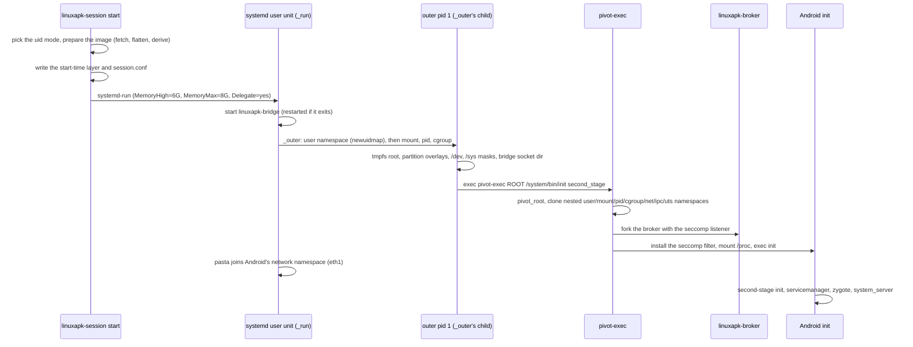
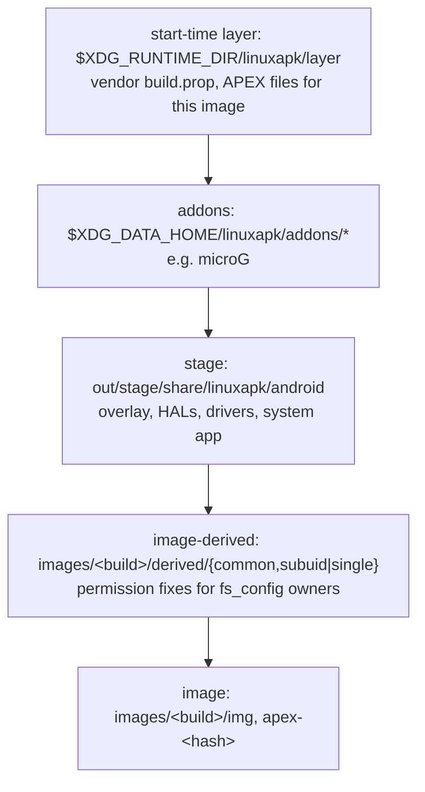
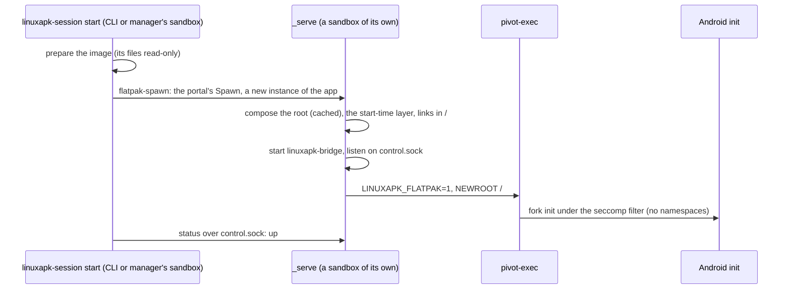

# The session

A session is one rootless Android instance: a transient systemd user unit that
holds the bridge, pasta and two levels of namespaces with Android's real `init`
inside. `linuxapk-session` ([host/launcher](../host/launcher/README.md)) starts
it; `linuxapk run` and the manager start it on demand.

## Boot

- **One config.** `start` decides everything once (paths, uid mode and id
  ranges, image, bridge arguments) and writes it as `session.conf` in the
  runtime dir, which the unit's processes and `selftest` read back.
- **Second-stage init directly.** The launcher does first stage's job: it mounts
  `/dev`, `/proc` and `/sys`, and passes `androidboot.*` values through a fake
  `/proc/bootconfig` (`androidboot.hardware=linuxapk`, plus the vendor APEX
  selection in [image/bootconfig](../image/bootconfig)).
- **Nested, locked namespaces.** The outer user namespace maps root to the host
  user (plus Android's uid ranges in subuid mode). pivot-exec clones init into
  nested namespaces with an identity map, so every inherited mount is
  `MNT_LOCKED` (the bubblewrap technique) and Android's root can't unmount the
  masks over host sysfs.
- **SELinux hidden.** `/sys/fs/selinux` is an empty tmpfs, so libselinux reports
  SELinux disabled. The LD_PRELOAD shim turns the call sites that still assume a
  policy into no-ops ([supervisor/shim](../supervisor/README.md)); init unsets
  `LD_PRELOAD` for its children, so the rc files of services that need it set it
  again.
- **APEXes pre-flattened.** apexd can't mount APEXes without loop or dm devices.
  The launcher binds a flattened tree over `/apex`, and the `linuxapk-apexd`
  wrapper shows apexd matching `/proc/mounts` entries so it reports every APEX
  active.
- **eBPF emulated.** netd, netbpfload and system_server's JNI code use `bpf()`,
  which an unprivileged namespace can't. The seccomp supervisor emulates maps
  and pins; program loads and attaches succeed and do nothing, so per-app
  traffic accounting and the per-uid firewall are no-ops.
- **iptables on nf_tables.** The image's legacy iptables needs kernel modules;
  ours uses nf_tables in the session's own network namespace, and its wrapper
  drops `-m bpf` and netd's `quota2` rules
  ([android/system](../android/system/README.md)).
- **Networking through pasta.** pasta's tap is `eth1`, which EthernetService
  brings up as the default network (DHCP from pasta). DNS goes to `169.254.1.1`,
  which pasta forwards to the host's first IPv4 resolver. There is no inbound
  forwarding, and `--no-map-gw` keeps host loopback services unreachable.

## Overlay stack

Every partition is a read-only overlayfs; nothing in the image cache is ever
modified.

The topmost layer wins. `/apex` stacks the start-time layer, the uid mode's
derived layer and the flattened APEX tree. The derived layers exist because the
extracted image lost its `fs_config` owners: `common` adds read and exec bits,
`subuid` chowns files whose owner code verifies, and `single` records those
owners in the `user.linuxapk.owner` xattr instead.

## Uid modes

The mode is automatic and fixed per `/data`:

- **subuid:** when `/etc/subuid` and `/etc/subgid` give the user at least 49999
  ids each and `newuidmap` is installed. Android's uids are real host
  subordinate uids, so the kernel isolates apps from each other.
- **single:** otherwise (always inside Flatpak). Only root is mapped, and every
  Android process is the host user; the supervisor gives each process virtual
  credentials ([supervisor/README.md](../supervisor/README.md)). Apps are
  **not** isolated from each other in this mode
  ([security.md](security.md#single-uid-mode)); the CLI and manager say so once.

An existing `/data` keeps the mode it was made in: the launcher reads it from
the owner of `/data/system`.

## Flatpak mode

Inside a Flatpak (`/.flatpak-info` exists) the launcher runs the session in the
app's own sandbox, which allows no mounts, no namespaces, no capabilities and no
systemd units (its seccomp filter fails them with `EPERM` before ours sees
them). The sandbox's `/`, `/dev` and `/sys` are writable tmpfs dirs of its own,
so the layout above is rebuilt from symlinks.
[packaging/flatpak](../packaging/flatpak/README.md) builds the Flatpak (issue
#25).

The session lives as long as the process that started it, which owns its
sandbox: `_serve`, or `start -f` in the sandbox of whatever ran it. Other
instances of the app (the CLI, the manager) have their own pid namespace and
`/`, so `status`, `exec` and `stop` go through `control.sock` in the app's
runtime dir, which every instance shares. When the session ends (`stop`, a
signal, init's exit) the launcher stops and then kills everything it started,
and, as the sandbox's main process, everything else in it: Android processes
orphaned by a dying init would otherwise keep the sandbox alive.

| Host mode                                     | Flatpak mode                                                                                                                                                                                                       |
| --------------------------------------------- | ------------------------------------------------------------------------------------------------------------------------------------------------------------------------------------------------------------------ |
| systemd unit, `start` returns                 | `start` spawns a sandbox for the session and returns; no memory cap of our own                                                                                                                                     |
| `exec` joins init's namespaces                | `exec` asks the session's launcher, which starts the static exec relay with the caller's stdio (its child is under init's filter, so the linker sees Android paths)                                                |
| user, mount, pid, net... namespaces           | the sandbox's; init is a child of pivot-exec, its subreaper; uid mode is single                                                                                                                                    |
| overlayfs per partition                       | `$XDG_DATA_HOME/linuxapk/root[-<instance>]`: hardlinks to the read-only image cache plus copies of the layers, files read-only; composed again only when the image, the stage or an addon changes (`.compose-key`) |
| the start-time layer, top of each overlay     | copied over the composed root at each start                                                                                                                                                                        |
| the root, binds of `/data` and `/apex`        | symlinks in `/` (`/system`, `/apex`, `/data`...); `/etc` keeps the sandbox's files and gains `/system/etc`'s others                                                                                                |
| `/proc` binds (bootconfig, sysctls)           | the broker injects memfds of `/linuxapk/proc/<path>` on `openat`, and apexd's `/proc/mounts`                                                                                                                       |
| canonical paths are Android's                 | the broker rewrites `readlink` of `/proc/*/fd,exe,cwd` and `getcwd`, so the linker sees `/system/...`                                                                                                              |
| root owns everything (user namespace)         | the broker shows the user's files as root's (`fstat`, emulated `lstat`); `mkdir`/`chmod` keep a directory's owner `rwx`                                                                                            |
| capabilities                                  | `capset` and the capability `prctl`s are accepted, `capget` reports all; set\*id privilege is virtual root's                                                                                                       |
| `mount`, `unshare`, `setns`, namespaced clone | the shim (in init, zygote, vold, netd...) treats a refused call as done                                                                                                                                            |
| cgroup v2, delegated                          | a plain `/sys/fs/cgroup` dir: kills fall back to process groups, no freezer                                                                                                                                        |
| own netns, pasta, EthernetService on `eth1`   | the host's network (`--share=network`); the system app offers it as Android's default network, with the host's resolvers                                                                                           |
| netd's routes, rules, iptables, marks         | accepted and ignored: rtnetlink `EPERM` acks read as success (shim), no-op iptables, `SO_MARK` (bpfemu)                                                                                                            |
| `/data/user/0` bind of `/data/data`           | a symlink, which the broker's `lstat` shows as the directory                                                                                                                                                       |
| lmkd's 1 s PSI windows                        | widened to 2 s, the most an unprivileged process gets (shim); this needs Linux 6.5, and `start` warns on older kernels (both modes need 5.14)                                                                      |

Init still believes it is pid 1 where it matters: the broker shows it as pid 1
to `SO_PEERCRED`.

## Where things live

| Dir                                      | Contents                                                                                                                                                                           |
| ---------------------------------------- | ---------------------------------------------------------------------------------------------------------------------------------------------------------------------------------- |
| `$XDG_DATA_HOME/linuxapk/`               | `images/<build>/{img,apex-<hash>,derived}` (shared by every instance), `data[-<instance>]/` (Android's `/data`), `addons/`, `test-bin/` (dev), `root[-<instance>]/` (Flatpak mode) |
| `$XDG_STATE_HOME/linuxapk[-<instance>]`  | `session.log`, `kmsg.log`, `bridge.log`, `documents.grants`                                                                                                                        |
| `$XDG_STATE_HOME/linuxapk/notices/`      | one-time notices already shown (shared by every instance)                                                                                                                          |
| `$XDG_RUNTIME_DIR/linuxapk[-<instance>]` | `session.conf`, pid files, the kmsg FIFO, `bridge/bridge.sock`, `layer/`, `root/`; in Flatpak mode under `app/<app id>/`, with `control.sock`                                      |

`LINUXAPK_INSTANCE` names an independent session for tests; its suffix goes on
every per-instance path and the unit name.

## Host safety

Inside the user namespace Android's root is the host user, so it can touch
anything the user owns (an early vold shutdown aborted every host FUSE mount).
The session therefore:

- masks and locks host sysfs submounts, keeps `/sys` read-only and shows no FUSE
  connections;
- has its own network (pasta), IPC and UTS namespaces;
- runs in its own delegated cgroup with a memory cap;
- binds only `/data`, the kmsg FIFO, the bridge directory and the device nodes
  null, zero, full, random, urandom, fuse, udmabuf and `/dev/dri`, never
  `/run/user`, `$HOME` or `/dev` wholesale;
- drops host supplementary groups (subuid mode), or proves them unusable inside
  (single mode).

In Flatpak mode the sandbox is the boundary instead, as for any Flatpak app: no
host `/sys` beyond its read-only device dirs, no FUSE, a read-only `/proc/sys`,
no host `$HOME` beyond the app's own dir, and the host's network. `selftest`
checks the sandbox's grants (no `--device=all`, no host filesystem or home, no
`org.freedesktop.Flatpak`), what it shows (only the app's dir in `$HOME`, no
host block or input devices, no host group mapped), and, from an Android shell,
that `/sys` is read-only, no FUSE connection or sysrq is reachable, a sysfs
mount fails, and the process has no capabilities, `NoNewPrivs` and both seccomp
filters.

`linuxapk-session selftest` probes all of this against a live session, and
`mise run test:boot` runs it in both uid modes. Every change that touches the
session must keep it passing.

## Numbers

Measured on the dev host (Strix Halo, RADV), headless, CI image 16644040:

- Boot to `sys.boot_completed`: about 4.5 to 5 s on a fresh `/data`; 2.1 s warm
  in subuid mode, 2.6 s in single-uid mode.
- Idle session, 90 s after a warm boot: 84 processes, 750 to 900 MiB total PSS,
  and 550 to 575 MiB of cgroup memory without page cache (400 MiB anonymous, 105
  MiB kernel, mostly page tables). Page cache is charged to whichever session
  read the image first, so `memory.current` varies more. The binder freezer
  freezes the 8 cached processes but frees nothing: without swap their pages
  stay resident. `tools/dev/footprint.sh` lists it per process; the compat run
  budgets the start time and idle memory
  ([compatibility.md](compatibility.md#budgets)).
- Flatpak mode (same host, kernel 7.1.9, Flatpak 1.18.4, runtime
  org.freedesktop.Platform 26.08), from `linuxapk-session start` in another
  instance of the app to `sys.boot_completed`: about 5.5 s on a fresh `/data`
  and root (composing it included), 2.5 s warm; `start` returns after 0.3 s;
  0.84 GB idle in the prototype.
- Binder through the broker: 15 µs per round trip against 3.8 µs for kernel
  binder; the difference doesn't show in boot time or the compat corpus.
