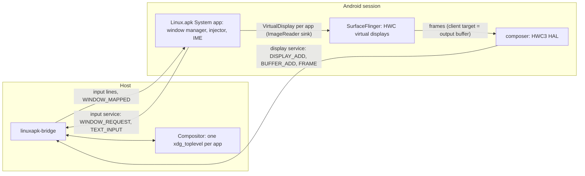

# Windowing: one Wayland window per app (M2)

Each Android app task gets its own window on the host desktop:

- Its title is the app's label.
- Its `app_id` is `dev.linuxapk.<package>`, which the `.desktop` files that
  `linuxapk install` writes use as their `StartupWMClass`.
- Resizing the window resizes the app.
- Closing the window ends the app's task.

Display 0 (Android's default display) no longer has a window. The old
single-window mode is still there:
`session/linuxapk-session start --single-window`.

## How it works



1. **The window manager** is the persistent Linux.apk System app
   (`android/app/.../wm/WindowManagerFeature.kt`). To open an app it creates a
   trusted virtual display with these flags:
   - `TRUSTED`, `OWN_DISPLAY_GROUP` and `ALWAYS_UNLOCKED` (no keyguard; needs
     its own group);
   - `OWN_FOCUS` (each window keeps its own focused app);
   - `OWN_CONTENT_ONLY` (no mirroring of display 0);
   - `SUPPORTS_TOUCH`;
   - `DESTROY_CONTENT_ON_REMOVAL` (closing a display ends its tasks; it never
     dumps them onto display 0);
   - `SECURE` (`FLAG_SECURE` windows show instead of turning black).

   The display has no system decorations, so SystemUI draws no status bar or
   navigation bar in it. Apps see zero status-bar and navigation-bar insets
   (checked with the window probe below).

   The app is then started with `ActivityOptions.setLaunchDisplayId`. The system
   app holds the permissions this needs, all granted by the platform key:
   - `ADD_TRUSTED_DISPLAY`, `ADD_ALWAYS_UNLOCKED_DISPLAY` and
     `CAPTURE_SECURE_VIDEO_OUTPUT`;
   - `INTERNAL_SYSTEM_WINDOW` (launch onto any display, move tasks, IME policy);
   - `MANAGE_ACTIVITY_TASKS`, `REMOVE_TASKS`, `REORDER_TASKS` and
     `REAL_GET_TASKS`;
   - `START_ACTIVITIES_FROM_BACKGROUND` and `QUERY_ALL_PACKAGES`.

   Hidden framework APIs (`TaskStackListener`, `IActivityTaskManager`,
   `IWindowManager`) are compiled against stubs in `android/hidden/`, which are
   compile-only, and are resolved against the real framework at runtime.

2. **Frames: HWC-backed virtual displays.** The composer's `.rc` sets
   `debug.sf.enable_hwc_vds=1`, and the composer reports 32 virtual displays.
   SurfaceFlinger then asks the composer to create every virtual display
   (`createVirtualDisplay`) and hands it each frame's output buffer
   (`setOutputBuffer`). The composer keeps every layer CLIENT, so
   SurfaceFlinger's RenderEngine renders straight into the sink's buffer
   (GPU-only mode of SurfaceFlinger's `VirtualDisplaySurface`). That buffer is
   both the client target and the output buffer. The composer copies it into the
   window's linux-dmabuf (or wl_shm) pool, the same path as display 0 in M1.

   The sink is an `ImageReader` (`PRIVATE` format) in the system app that drops
   each frame. It exists because a virtual display needs a consumer. Because the
   format is `PRIVATE`, the reader accepts frames of any size after a resize.

   Why not zero-copy: the sink buffer goes back to SurfaceFlinger as soon as the
   ImageReader drops it, so attaching it to the window directly would tear.
   Holding images until `wl_buffer.release` is a later optimisation. Copying a
   2176x1360 frame costs about 1 to 2 ms.

3. **Matching a display to its window.** HWC3's `createVirtualDisplay` carries
   only a size and a format, so nobody can tell whose display it is. The window
   manager therefore orders things:
   1. It creates the virtual display without a surface. SurfaceFlinger keeps
      such displays dormant, with no HWC display.
   2. It asks the bridge's input service for a window (`WINDOW_REQUEST`: its
      display id, size, density, app id and title) and waits for the reply.
   3. Only then does it attach the surface.

   SurfaceFlinger's next commit creates the HWC display; the composer adds it to
   the bridge's display service (`DISPLAY_ADD`), and the bridge gives it the
   oldest request of that size (requests expire after 10 s). Virtual displays
   nobody asked for, such as `screenrecord` and MediaProjection, stay headless.
   If the window disappears while the display lives (`WINDOW_UNMAPPED`), the
   window manager requests it again and re-attaches the surface, which makes
   SurfaceFlinger create a fresh HWC display.

4. **Window semantics**:
   - **Resize and scale:** the window's `configure` and `wp_fractional_scale_v1`
     preferred scale (or the integer buffer scale where the compositor has no
     fractional scale) come back as `window <w> <h> <scale> <display>`. After a
     120 ms debounce the window manager calls
     `VirtualDisplay.resize(w×scale, h×scale, 160×scale)`. The app gets a normal
     configuration change and renders at the window's physical pixel size, so
     text stays sharp at fractional scales. Until the first frame at the new
     size arrives, `wp_viewporter` stretches the old one. Each window follows
     its own scale (a window moved to another monitor gets that monitor's), and
     the last scale seen is kept in the window manager's preferences, so after a
     restart new windows open at it. Proof (nested KWin, 2026-10-27): changing
     the output scale live with `kscreen-doctor` from 1.7 to 1.25 resized
     F-Droid's display from 2176x1360 @ 272 dpi to 1600x1000 @ 200 dpi, and the
     activity was relaunched with `sw800dp w1280dp h800dp 200dpi` (the same
     1280x800 dp: the window's logical size didn't change); back to 1.7 restored
     2176x1360 @ 272.
   - **Close:** `xdg_toplevel.close` arrives as `close <display>`. The window
     manager calls `removeTask` on every task on the display, sends
     `window_destroy`, and releases the display.
   - **The app finishes** (for example Back on its root activity, which an app
     launched by a non-home caller finishes rather than moves to the back): a
     `TaskStackListener` sees the display's last task go and closes the window.
     A window whose app never starts a task closes after 20 s.
   - **Focus:** `keyboard_enter <display>` makes the window manager call
     `focusTopTask(display)`, so the window with the host keyboard focus is
     Android's top focused display. Keys are injected with that display id in
     any case (`OWN_FOCUS`). Launching an app that already has a window sends
     `window_activate`, which uses `xdg_activation_v1`. Compositors may refuse
     an activation without a recent input serial, and KWin then flags the window
     instead of raising it.
   - **Input:** v2 enter lines carry the display id (see
     [hal-display.md](hal-display.md)). The translator sends pointer, key and
     touch events to that display (`InputEvent.setDisplayId`). It ends the hover
     or drag on the old window before the pointer starts on a new one, and it
     keeps a touch sequence on one window.
   - **IME:** the display IME policy is `LOCAL`. The default input method, the
     Linux.apk Keyboard ([input.md](input.md#text-input)), draws nothing, so no
     soft keyboard covers the window; an Android IME the user picks shows inside
     the window. `HIDE` would keep every IME from binding, so text input through
     the host's input methods would stop working.
5. **Display 0 in per-app mode** keeps running, headless:
   - Launcher3 is its home activity.
   - Any ordinary app task that appears there is moved into a window of its own
     (`moveRootTaskToDisplay`). That covers `am start` without a display,
     notification taps and other `PendingIntent`s, which resolve to display 0.
   - Home, recents, dream and assistant tasks stay.

### System dialogs

| Dialog                                                      | Where it shows                                                                                                                                                                                                                                                                                                                                                        |
| ----------------------------------------------------------- | --------------------------------------------------------------------------------------------------------------------------------------------------------------------------------------------------------------------------------------------------------------------------------------------------------------------------------------------------------------------- |
| Runtime permission prompt (`GrantPermissionsActivity`)      | Inside the app's window: it starts in the app's task. Proven with Tomato's notification prompt.                                                                                                                                                                                                                                                                       |
| Share sheet (chooser), package installer (`InstallStart`)   | The app's window: started from the app's activity, so they go into its task or onto its display (`LaunchParamsUtil` prefers the source display). PackageInstaller's "Install this app?" from F-Droid showed inside F-Droid's window (2026-10-27).                                                                                                                     |
| Crash and ANR dialogs                                       | The app's window (`ErrorDialogController` uses the displays where the app has visible windows).                                                                                                                                                                                                                                                                       |
| "Built for an older version of Android" (`AppWarnings`)     | Android always shows it on the default display, which has no window. The window manager turns it off (`debug.wm.disable_deprecated_target_sdk_dialog=true`) and shows the same text in the app's window (`AppWarningActivity`) the first time the app runs. OK hides it for good, as the original does. Proven with Simple Solitaire Collection (target SDK 25 < 28). |
| Other `AppWarnings` (unsupported display size, compile SDK) | Still on display 0 (rare). Open issue.                                                                                                                                                                                                                                                                                                                                |
| SystemUI dialogs not tied to an activity (USB, volume, …)   | Display 0, unseen. Open issue.                                                                                                                                                                                                                                                                                                                                        |

### Window size

A new window's size comes from the launch activity's metadata
(`WindowSizing.kt`). Sizes are in dp, and the window manager multiplies them by
the window's scale.

1. `<layout android:defaultWidth/defaultHeight>`, Android's own freeform sizing
   hints;
2. else `android:screenOrientation`: portrait-only activities (`portrait`,
   `sensorPortrait`, `userPortrait`, `reversePortrait`) get a phone-sized
   412x915 window, and landscape-only ones get 1280x720;
3. else 1280x800.

`<layout android:minWidth/minHeight>` become the toplevel's minimum size
(`window_min_size`). Activities with `resizeableActivity=false` get no special
case: Android's size compatibility mode letterboxes them inside the window when
its shape doesn't fit.

The first window after boot is created at scale 1. Once the window reports its
real scale it is resized, and later windows start at the last scale seen.

## Control interface

The host side (the `linuxapk` CLI's `android::launch`) drives the window manager
with a broadcast that runs inside the session as root. The receiver requires a
signature permission, which root passes and other apps don't hold.

```sh
C="-n dev.linuxapk.system/.wm.ControlReceiver"
am broadcast $C -a dev.linuxapk.LAUNCH --es package org.wikipedia \
  [--es component org.wikipedia/.main.MainActivity] [--es uri https://...] \
  [--ei width DP --ei height DP]
am broadcast $C -a dev.linuxapk.LIST
am broadcast $C -a dev.linuxapk.CLOSE (--ei display 3 | --es package org.wikipedia)
```

`am` prints `Broadcast completed: result=-1, data="..."`. `-1` means success and
`0` means error, with `data` starting with `error:`. The replies are:

- **LAUNCH:** `launched display=N package=P size=WxH dpi=D`, or
  `focused display=N` if the app already has a window. That window comes to the
  front, and a `uri` or `component` opens in it.
- **LIST:** one line per window:
  `display=N package=P size=WxH dpi=D tasks=… window=yes|no label=…`.
- **CLOSE:** `closed display=N package=P`.

In single-window mode, LAUNCH starts the app on display 0.

## Window types (decisions; the protocol leaves room for each)

- **Multiple tasks per app** (`FLAG_ACTIVITY_MULTIPLE_TASK`,
  `documentLaunchMode`, a browser's "new window"): the goal is one window per
  task, every window sharing the `app_id`. Today a package has one window, and a
  second task of the same app lands in it. That comes from the source-display
  rule, or from adoption from display 0. Next step: key windows by task, not
  package, and open a display per new task in `onTaskCreated`.
- **Picture-in-picture:** a small toplevel of its own per PiP task (a virtual
  display sized to the PiP aspect ratio). Wayland has no portable "keep above".
  KWin can do it through a window rule or a KWin script (`keepAbove`), which the
  bridge can set when it runs on KWin; elsewhere the window is an ordinary
  toplevel. Closing that window dismisses PiP (`removeTask`). Not implemented.
- **Translucent and dialog-themed activities:** frames go through as XBGR today
  (alpha dropped). Next step: ARGB8888 buffers when the activity is translucent,
  plus a content-sized window for dialog-only apps (the display sized to the
  dialog). Not implemented.
- **Overlays** (`TYPE_APPLICATION_OVERLAY`, chat heads): they render inside the
  display of the app that owns them, which is acceptable for now. A separate
  always-on-top surface is a later feature.
- **Fullscreen and immersive:** F11 toggles `xdg_toplevel.set_fullscreen` in the
  bridge (the key never reaches Android), and the display follows the new size
  like any resize. Mapping an app's own immersive or fullscreen request (system
  bars hidden) to fullscreen, and a window-menu entry, are next.

## Windows through the host bridge (default)

The composer is a Bionic process, so it can't use libdecor, GTK or host fonts,
and compositors without xdg-decoration (GNOME) would show its windows without a
title bar. So the Wayland client lives in the Rust host bridge
(`linuxapk-bridge`, its `display` service; protocol in
[bridge.md](bridge.md#display-service-id-2)), and the composer talks to the
bridge instead of the compositor (`vendor.linuxapk.hwc.backend=bridge`, the
session default; `composer/BridgePresenter.cpp`):

- **Composer:** a pure HWC. It adds each virtual display to the bridge
  (`DISPLAY_ADD`); once the bridge says the display shows in a window, each
  frame is copied into one of three udmabufs per display, added once
  (`BUFFER_ADD` with the dma-buf fd), and shown with `FRAME`; `RELEASE` hands
  the buffer back, the way `wl_buffer.release` does. RGBA frames go as XBGR8888
  and BGRA as XRGB8888, so the copy is a plain `memcpy`. If the bridge restarts,
  the composer reconnects and adds its displays again.
- **Bridge:** one host Wayland connection per composer connection; one
  `xdg_toplevel` per window with linux-dmabuf buffers, `wp_viewporter`,
  fractional scale and xdg-activation. Decorations are server-side where
  xdg-decoration is offered (KDE) and otherwise an Adwaita-style client-side
  frame (`sctk-adwaita`: title, minimize, maximize, close, move, resize, window
  menu). The seat becomes protocol v2 lines.
- **Input path:** the system app holds the bridge's input service, which only
  its uid may open: it gets the seat's lines, the window events and the host
  input methods' results there, and sends its window requests and IME state.
  Which window shows which HWC display is the bridge's business; the composer
  never sees input.

## Testing

- `android/e2e/e2e.sh` (in a booted session) checks the following:
  - the window manager's permissions;
  - that the input probe opens in a window of its own through `LAUNCH` and is
    listed;
  - that the probe stream, rewritten to v2 with the probe's display id, arrives
    there with `displayId=N` and never on another display;
  - that `CLOSE` removes the window.
- `compat/run.sh` in per-app mode does the following:
  - launches every app through `LAUNCH` at 1280x800 dp and takes its first frame
    from the `"Displayed"` log line;
  - captures screenshots with `screencap -d <SurfaceFlinger id>` (from
    `dumpsys SurfaceFlinger --display-id`);
  - sends input with `input -d <display>`, scaling coordinates to the window's
    pixels (re-read from `LIST` once the window has its real scale);
  - finds script nodes with `uiautomator dump --windows`, in the window's
    `<display>` section. The plain dump clips every node to display 0's size, so
    on a window larger than 1280x800 (any scale above 1) buttons near the bottom
    disappear; that was the `--window` 13/16 (OpenCalc's "15", and Wikipedia's
    "Skip").
  - reads focus from the window's display.
- The window probe
  (`LAUNCH --es package dev.linuxapk.system --es component dev.linuxapk.system/.wm.WindowProbeActivity`)
  shows and logs the window's insets over a card with 24 dp elevation.
- Without a desktop to spare (or with the user's screen locked), run a nested
  compositor and point the session at it (`WAYLAND_DISPLAY`, a name or an
  absolute socket path, when starting the session). A locked host session
  swallows input and discards frames.
  ```sh
  systemd-run --user -p MemoryMax=2G -- dbus-run-session -- kwin_wayland \
    --virtual --no-lockscreen --socket lapk-win --width 2560 --height 1440 \
    --exit-with-session <script that saves $DBUS_SESSION_BUS_ADDRESS and sleeps>
  WAYLAND_DISPLAY=lapk-win session/linuxapk-session start
  ```
  Use spectacle and KWin scripts with that `DBUS_SESSION_BUS_ADDRESS`.
  `org_kde_kwin_fake_input` gives real seat input: the client needs a `.desktop`
  file with `X-KDE-Wayland-Interfaces=org_kde_kwin_fake_input`.

### Proof (2026-10-27, nested KWin 6.7 and weston 15 on this machine)

Through the bridge (the default since the bridge move):

- On the AOSP CI image (ci-16644040), in nested KWin at scale 1.7 (the user's
  desktop scale): `compat/run.sh` with windows gave 15/16 (only arm64-only Open
  Sudoku fails, as headless), and `android/e2e/e2e.sh` passed 27/27.

- The same two-window input test in nested KWin gave the same results (9 in
  Calculator, Wikipedia advanced), with server-side decorations.
- Under weston (headless, in podman; weston has no xdg-decoration, like GNOME)
  Calculator and Wikipedia got Adwaita-style client-side title bars. With the
  client-side frame forced in nested KWin (a test switch since removed), a
  fake-input click on the frame's close button sent `CLOSE`.
- weston in podman needs `--security-opt label=disable`: with SELinux labels,
  `container_t` may not write the host's memfds, and weston fails the
  decorations' `wl_shm_pool.resize` (`failed mremap`).

Direct composer Wayland client (before the bridge move):

- **Two windows at once:** OpenCalc and Wikipedia, each a KDE window with
  server-side decorations, title "Calculator" / "Wikipedia" and `app_id`
  `dev.linuxapk.com.darkempire78.opencalculator` / `dev.linuxapk.org.wikipedia`.
- **Input to the right window:** fake-input clicks on 7, +, 2 and = in the
  Calculator window showed 9. A click on Wikipedia's arrow then advanced its
  onboarding. The stream showed `pointer_enter … 2`, `keyboard_enter 2`, then
  `pointer_enter … 3`, `keyboard_enter 3`.
- **Resize:** dragging Wikipedia from 800x560 to 460x872 resized display 3
  (`800x560@160 -> 460x872@160`), and the onboarding page re-flowed to portrait.
  On the host KWin at scale 1.7, a 1000x672 window became a 1700x1142 @ 272 dpi
  display, and OpenCalc switched to its scientific layout.
- **Close:**
  - Closing the Calculator window (`closeWindow()`) removed task 11.
    `am stack list` no longer shows it, and the composer logged
    `virtual display 100 destroyed`.
  - Back on Calculator's root closed its window (`finishTasks=false`), and the
    same happened for Wikipedia.
- **Permission dialog:** Tomato's "Allow Tomato to send you notifications?"
  showed inside the Tomato window. Display 5's `mCurrentFocus` was
  `GrantPermissionsActivity`.
- **Insets and shadows:**
  - The window probe reported zero status-bar, navigation-bar and IME insets.
  - Its 24 dp card cast a visible ambient and spot shadow. HWUI shadows work
    through ANGLE on RADV in virtual displays.
  - Apps that look flat use Material 3 tonal elevation (surface tint) rather
    than shadows.

### Images

Windowing works the same on the AOSP CI (cuttlefish) image and the SDK emulator
image. Nothing depends on `config_isDesktopModeSupported` (true on the emulator,
false on cuttlefish): the virtual displays are fullscreen-windowed either way,
and the window manager uses no desktop-mode API. Switching an instance between
images needs a fresh `/data` (`LINUXAPK_DATA`); the emulator's `/data` makes the
CI image's system_server crash-loop in `SyntheticPasswordCrypto.decryptBlob`.

## Open issues

- Zero-copy frames (hold the sink image until `wl_buffer.release`); ARGB for
  translucent windows.
- One window per task (multiple tasks per app), PiP, fullscreen requests,
  content-sized dialog windows (see above).
- `AppWarnings` dialogs other than the target-SDK one, and SystemUI dialogs,
  still go to display 0.
- The first window on a fresh `/data` opens at scale 1 and is resized once the
  compositor reports the real scale (later boots start at the last scale).
- Activation without a fresh input serial may only flag the window in KWin.
- An app that asks for portrait on a landscape window is letterboxed. The window
  doesn't reshape itself yet (`onActivityRequestedOrientationChanged`).
- Matching relies on ordering plus size. A foreign virtual display of exactly
  the same size, created within the same commit as ours, could take our window.
  That's unlikely, but possible.
