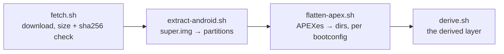

# image

Fetching every guest's image, and preparing Android's. An Android profile boots
an unmodified AOSP build from Android's public CI
([android/pin.toml](../android/pin.toml): `aosp_cf_x86_64_only_phone-userdebug`,
Android 17, test-keys), downloaded from Google on the user's machine and never
redistributed or committed; an OpenHarmony profile boots
[ohos/pin.toml](../ohos/pin.toml)'s ([ohos](../ohos/README.md#image)).
`mise run build:data` stages the config to `share/innkeeper/image/` and the
scripts to `libexec/innkeeper/image/`; `mise run build:image-tools` builds the
static `simg2img`, `lpunpack`, `fsck.erofs` and `debugfs` (`tools/build.sh`, in
the build container), so setup needs neither podman nor distro packages.
`innkeeper-session prepare` (or the first `start`) runs the pipeline.

Each guest's pin has one schema: `name` (its directory in the cache), `version`
(for reference: Android's `ro.build.fingerprint`, OpenHarmony's software
version), and the zip's `url`, `size` and `sha256`. The build stages it as
`share/innkeeper/<system>/pin.toml`. `fetch.sh <system> <pin> <images>`
downloads the zip (resumable, size and SHA-256 checked), then hands it to the
guest's hook, `extract-<system>.sh <zip> <dir>`, which writes the partitions:
Android's unpacks `super.img`, OpenHarmony's `system.img` and `vendor.img`.

Cache, shared by every profile and guest, in
`$XDG_DATA_HOME/innkeeper/images/<name>/`: `dl/` (resumable downloads; the zip
goes once extracted), `img/` (the partitions), and for Android `apex-<hash>/`
(one flattened tree per vendor APEX selection, never rewritten under a running
session) and `derived/` (the layer
[docs/session.md](../docs/session.md#overlay-stack) stacks above the image).

A successful `prepare`, of either guest, prunes stale builds (with their derived
layer) and unselected `apex-<hash>` trees, logging what it frees; every guest's
pinned build stays. The current pin and every running session hold leases on
their build and, for Android, its APEX tree, and a cache-wide lock in
`images/.locks/` serializes preparation and pruning across profiles. Pruning
skips symlinks, unknown directories and incomplete APEX extractions. A changed
derived layer can't be regenerated while another session uses that build; stop
it first.

- **apexd and flatten-apex.sh must agree.** [bootconfig](bootconfig) selects
  multi-install vendor APEXes the way cuttlefish's launcher does
  (`androidboot.vendor.apex.<name>=<file>|none`); the session passes the same
  values to init. A mismatch aborts apexd in `getActivePackages`.
- [vendor.prop](vendor.prop) overrides image properties; every line says why.

## Bumping the pin

1. Pick a build on ci.android.com (branch `aosp-android-latest-release`, the
   target above) and record the img zip's `url`, `size` and `sha256` in
   [android/pin.toml](../android/pin.toml) with the new `name` and `version`
   (the fingerprint).
2. `mise run session -- prepare`, then list `img/vendor/apex` and add a
   selection to `bootconfig` for every new multi-install or VM-only APEX.
3. `prepare` checks the upstream SHA-256 bases in
   [fork-bases.sha256](fork-bases.sha256) for the overlay's forks and overridden
   services, and fails with each changed path and an image-to-overlay diff or
   the file holding its override stanzas. Port upstream changes into the files
   listed in [android/overlay/README.md](../android/overlay/README.md), then
   update the hashes from the **image copies**, never the edited overlays.
   System paths resolve under `img/system/system/`; APEX paths under the
   selected `apex-<hash>/`. Stage the updated hashes with `mise run build`, then
   rerun `prepare`. Rename the blanked APEX APKs to the new build id.
4. Prove it: `mise run test:e2e` passes, and a few corpus apps still work
   (`mise run test:compat -- --only <package>,...`).

Tests: launcher unit tests cover pin selection and pruning.
`tests/fork-drift.sh` (in `mise run test`) checks the fork-base check against a
fixture; `prepare` checks the real bases against the pinned image.
