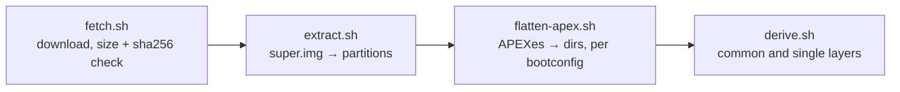

# image

The one Android image Innkeeper boots: an unmodified AOSP build from Android's
public CI ([pin.toml](pin.toml): `aosp_cf_x86_64_only_phone-userdebug`, Android
17, test-keys), downloaded from Google on the user's machine and never
redistributed or committed. `mise run build:data` stages the config to
`share/innkeeper/image/` and the scripts to `libexec/innkeeper/image/`;
`mise run build:image-tools` builds the static `simg2img`, `lpunpack`,
`fsck.erofs` and `debugfs` (`tools/build.sh`, in the build container), so setup
needs neither podman nor distro packages. `innkeeper-session prepare` (or the
first `start`) runs the pipeline.

Cache, shared by every profile, in `$XDG_DATA_HOME/innkeeper/images/<name>/`:
`dl/` (resumable downloads; the zip goes once extracted), `img/` (the
partitions), `apex-<hash>/` (one flattened tree per vendor APEX selection, never
rewritten under a running session), `derived/` (the layers
[docs/session.md](../docs/session.md#overlay-stack) stacks above the image).
About 1.2 GB downloaded, 2.4 GB extracted, 0.75 GB per APEX tree.

After successful preparation, stale build directories (including their derived
layers) and unselected `apex-<hash>` trees are pruned, with paths and allocated
bytes released logged to stderr. The current pin and running sessions keep
leases on their build and APEX tree; a cache-wide prepare lock serializes
preparation and collection across profiles, even with private runtime dirs. Lock
files under `images/.locks/` stay in place. Symlinks, unknown directories and
incomplete APEX extractions are left alone. Changed derived layers cannot be
regenerated while another session uses that build; stop those sessions first.

- **apexd and flatten-apex.sh must agree.** [bootconfig](bootconfig) selects
  multi-install vendor APEXes the way cuttlefish's launcher does
  (`androidboot.vendor.apex.<name>=<file>|none`); the session passes the same
  values to init. A mismatch aborts apexd in `getActivePackages`.
- [vendor.prop](vendor.prop) overrides image properties; every line says why.

## Bumping the pin

1. Pick a build on ci.android.com (branch `aosp-android-latest-release`, the
   target above) and record the zip's and `sbom/sbom.spdx.json`'s size and
   sha256 in `pin.toml` with the new `name`, `build_id` and `fingerprint`.
2. `mise run session -- prepare`, then list `img/vendor/apex` and add a
   selection to `bootconfig` for every new multi-install or VM-only APEX.
3. `prepare` checks the upstream SHA-256 bases in
   [fork-bases.sha256](fork-bases.sha256) for all nine overlay forks and fails
   with each changed path and an image-to-overlay diff. Port upstream changes
   into the forks listed in
   [android/overlay/README.md](../android/overlay/README.md), then update the
   hashes from the **image copies**, never the edited overlays. System paths
   resolve under `img/system/system/`; APEX paths under the selected
   `apex-<hash>/`. Stage the updated hashes with `mise run build:data` and
   `mise run stage`, then rerun `prepare`. Rename the blanked APEX APKs to the
   new build id.
4. Prove it: `mise run test:e2e -- boot`, `mise run test:e2e` and
   `mise run test:compat` with no regressions, then regenerate the
   [Compatibility wiki](https://github.com/sargunv/innkeeper/wiki/Compatibility).

## Licensing

The SBOM (SPDX 2.3) for build 16644040 lists Apache-2.0 for most installed
files, then MIT/ISC, SIL OFL fonts, BSD, LGPL-2.1 and a few GPL-2.0 tools. Flags
for packaging:

- `libdng_sdk.so` is under Adobe's DNG SDK license (permissive, not OSI), and
  `libultrahdr` and the JPEG codecs carry an Adobe gain-map notice; both ship in
  every AOSP build.
- The Android SDK license appears only on build-time inputs (AndroidX jars
  compiled into Launcher3 and SystemUI), not on any installed file.
- The kernel and dtb (GPL-2.0) are in `boot.img`, which we never extract.

Tests: launcher units cover pin selection and pruning, including active leases,
read-only trees and symlinks. `tests/fork-drift.sh` (in `mise run test`) checks
unchanged, changed and missing overlay bases with a self-contained fixture.
Image preparation checks all nine real upstream bases against the pinned image.
