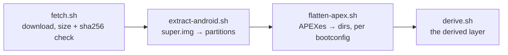

# image

This directory fetches every guest's image and prepares Android's. An Android
profile boots an unmodified AOSP build from Android's public CI
([android/pin.toml](../android/pin.toml): `aosp_cf_x86_64_only_phone-userdebug`,
Android 17, test-keys). The user's machine downloads it from Google, and it is
not redistributed or committed. An OpenHarmony profile boots the image in
[ohos/pin.toml](../ohos/pin.toml) ([ohos](../ohos/README.md#image)).

`mise run build:data` stages the config to `share/innkeeper/image/` and the
scripts to `libexec/innkeeper/image/`. `mise run build:image-tools` builds
static `simg2img`, `lpunpack`, `fsck.erofs` and `debugfs` in the build container
(`tools/build.sh`), so setup needs neither podman nor distro packages.
`innkeeper-session prepare`, or the first `start`, runs the pipeline.

Every guest's pin has the same schema:

- `name` is the image's directory in the cache.
- `version` is for reference. For Android it is `ro.build.fingerprint`, and for
  OpenHarmony it is the software version.
- `url`, `size` and `sha256` describe the zip.

The build stages the pin as `share/innkeeper/<system>/pin.toml`.
`fetch.sh <system> <pin> <images>` downloads the zip, resumably, and checks its
size and SHA-256. It then hands the zip to the guest's hook,
`extract-<system>.sh <zip> <dir>`, which writes the partitions. Android's hook
unpacks `super.img`, and OpenHarmony's extracts `system.img` and `vendor.img`.

Every profile and guest shares one cache in
`$XDG_DATA_HOME/innkeeper/images/<name>/`:

- `dl/` holds resumable downloads. The zip is deleted once extracted.
- `img/` holds the partitions.
- `apex-<hash>/` (Android) holds one flattened tree per vendor APEX selection. A
  tree is not rewritten while a session uses it.
- `derived/` (Android) holds the layer that
  [docs/session.md](../docs/session.md#overlay-stack) stacks above the image.

A successful `prepare` of either guest prunes stale builds with their derived
layers, and unselected `apex-<hash>` trees. It logs what it frees. Every guest's
pinned build stays. The current pin and every running session hold leases on
their build and, for Android, on its APEX tree. A cache-wide lock in
`images/.locks/` serializes preparation and pruning across profiles. Pruning
skips symlinks, unknown directories and incomplete APEX extractions. If the
derived layer changes while another session uses that build, it can't be
regenerated until that session stops.

- **apexd and flatten-apex.sh must agree.** [bootconfig](bootconfig) selects
  multi-install vendor APEXes in the same way as cuttlefish's launcher
  (`androidboot.vendor.apex.<name>=<file>|none`). The session passes the same
  values to init. A mismatch aborts apexd in `getActivePackages`.
- [vendor.prop](vendor.prop) overrides image properties. Each line gives its
  reason.

## Bumping the pin

1. Pick a build on ci.android.com, on the branch `aosp-android-latest-release`
   and the target above. Record the img zip's `url`, `size` and `sha256` in
   [android/pin.toml](../android/pin.toml), with the new `name` and the
   fingerprint as `version`.
2. Run `mise run session -- prepare`. List `img/vendor/apex`, and add a
   selection to `bootconfig` for every new multi-install or VM-only APEX.
3. `prepare` checks the upstream SHA-256 bases in
   [fork-bases.sha256](fork-bases.sha256) for the overlay's forks and overridden
   services. On a mismatch it fails and lists each changed path with an
   image-to-overlay diff, or with the file that holds its override stanzas. Port
   the upstream changes into the files listed in
   [android/overlay/README.md](../android/overlay/README.md). Then update the
   hashes from the **image copies**, not from the edited overlays. System paths
   resolve under `img/system/system/`, and APEX paths under the selected
   `apex-<hash>/`. Stage the updated hashes with `mise run build`, and rerun
   `prepare`. Rename the blanked APEX APKs to the new build id.
4. Check that `mise run test:e2e` passes and that a few corpus apps still work
   (`mise run test:compat -- --only <package>,...`).

Launcher unit tests cover pin selection and pruning. `tests/fork-drift.sh`, part
of `mise run test`, tests the fork-base check against a fixture. `prepare`
checks the real bases against the pinned image.
